# Android 手機、平板安裝與使用指南

琦琦輸入法適用於 **Android 8 以上**的手機和平板，本指南對應 **1.5.2**，可下載版本以 Google Play 商店頁面為準。安裝後，從 App 首頁依序啟用、選用鍵盤，就能在其他 App 輸入中文。**打字功能免費，未付費支持也能完整使用。**

以下帶你完成第一次輸入，再試好打注音的句中選字與倉頡提前選字。文中的系統畫面使用 Android 17 英文介面，不同品牌的名稱和位置可能略有不同。

## 1.5.1 的新功能

1.5.1 可拖曳鍵盤上下緣調整高度，分別保存直式及橫式。好打注音和傳統注音可選漢語拼音，觸控好打注音也支援省略聲調。需要輸出簡體字時，可開啟「繁體中文轉簡體」。四種輸入法都使用 Guanyinma（觀音嬤）核心。從舊版升級前可先匯出自訂詞，新版將學習與自訂詞儲存在獨立的資料庫。

## 1. 從 Google Play 安裝

在 Android 裝置上[開啟琦琦輸入法的 Google Play 商店頁面](https://play.google.com/store/apps/details?id=tw.chichi77.keykey.android)，確認名稱為 **琦琦輸入法**，點 **安裝**，完成後點 **開啟**。

打開 App 後，先看首頁的三個按鈕：**1. 啟用輸入法 → 2. 選擇琦琦輸入法 → 3. 調整設定**。前兩步完成後即可開始打字，設定可以稍後再調整。

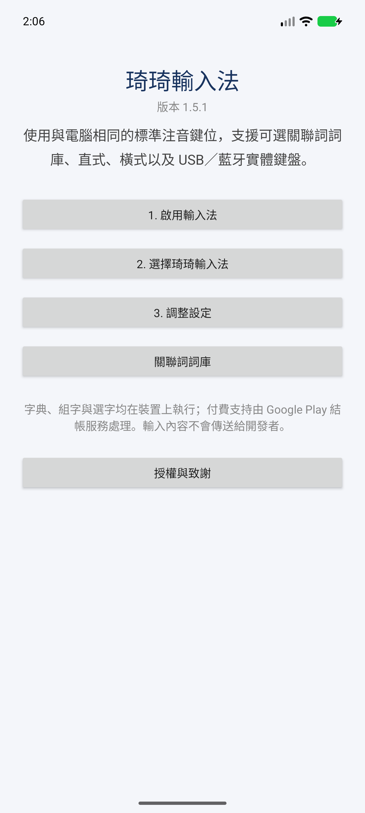

*從 1.5.1 首頁點「1. 啟用輸入法」，進入系統鍵盤管理。*

## 2. 啟用並選用鍵盤

點首頁的 **1. 啟用輸入法**，在系統的螢幕鍵盤管理頁找到 **琦琦輸入法**，打開它的開關。Android 若顯示第三方輸入法的安全提示，請確認名稱後再決定是否啟用。琦琦的字典、組字與選字都在裝置上執行。付費支持由 Google Play 結帳服務處理。

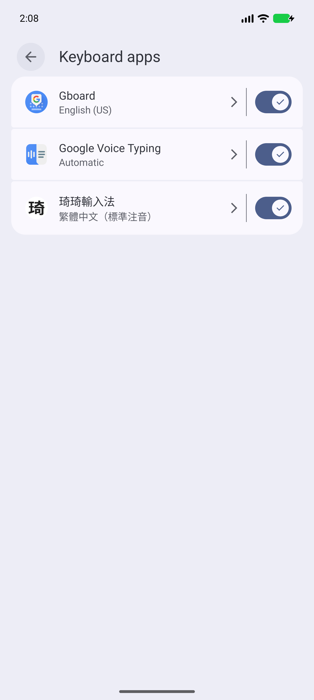

*圖中的「Keyboard apps」是螢幕鍵盤管理。琦琦右側開關開啟後，返回 App。*

接著點 **2. 選擇琦琦輸入法**，在清單選 **繁體中文（標準注音）／琦琦輸入法**。啟用開關只讓鍵盤可用，這一步才會將它選為目前鍵盤。

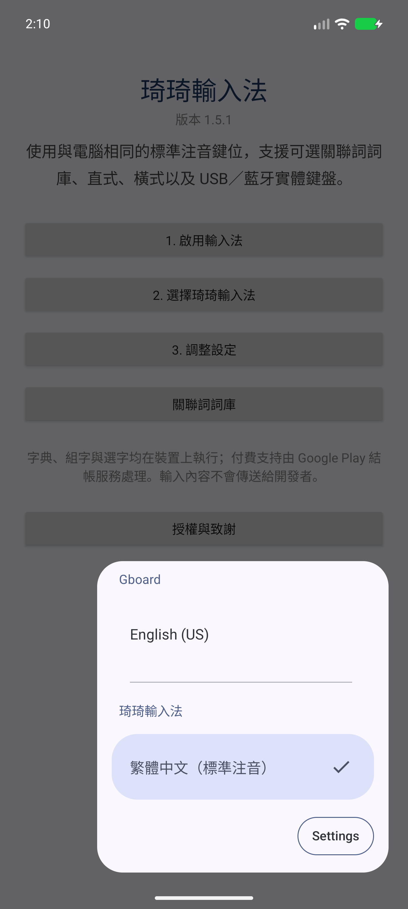

*琦琦輸入法下方的「繁體中文（標準注音）」旁有勾號。接著到文字 App 點入一般文字欄位即可打字。*

## 3. 第一次用好打注音組句

在支援多行輸入的記事本或文字 App 開始練習。預設的 **好打注音**可連續輸入每個字的注音與聲調，由前後文組句；一聲字以 **空白**結束音節。若想省略聲調，可到「設 → 注音與選字」開啟 **好打注音省略聲調**。標準、許氏與漢語拼音的觸控鍵盤都可連打讀音。例如標準注音可連打「ㄋㄧㄏㄠ」，許氏可連打 `nehw`，漢語拼音可連打 `nihao`。組出的「你好」會出現在鍵盤的 11 格組字區，讀音留在 App 輸入框。點任一字可單獨換字。切換三種配置時會保留此設定。

先輸入「**你好**」，按 **↵** 確認並換行。第二行輸入「**明天要去哪裡玩呢去海邊**」的讀音。圖中「玩」的位置先組成了「完」，點鍵盤上方的 **完** 可開啟候選，再選 **玩**。

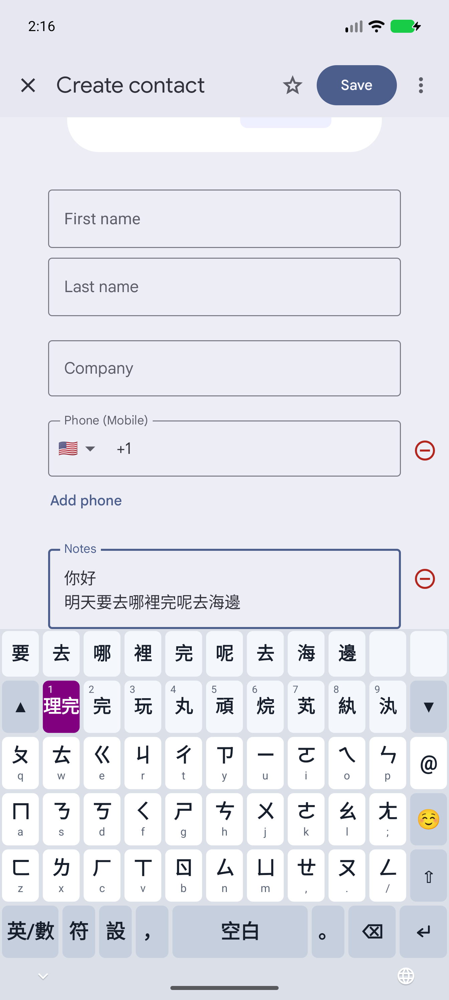

*第一行已確認，第二行仍可選字。圖中「玩」是第 3 項，順位可能因選字紀錄而不同。*

圖中借用 Android「聯絡人」的多行 Notes（備註）欄示範，內容只用於輸入練習。使用聲調輸入時，組字列保留最近 **9 個**已完成音節。輸入到「海邊」時，開頭的「明天」已送出，後面的 9 個字仍可在鍵盤上換字。備註欄保留整句。

### 選字後，繼續在句尾輸入

點候選 **玩**，接著輸入「**散步**」。即使剛才修改的是句中用字，後續文字仍會接在句尾。

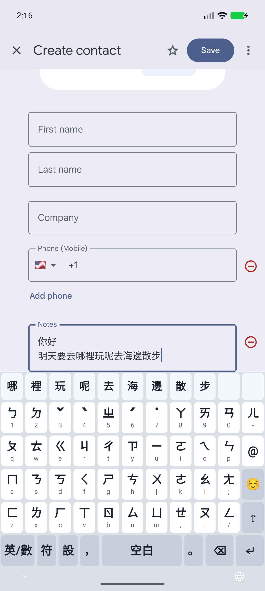

*選字後續打「散步」，新增文字接在「海邊」之後。*

完成後按一次 **↵** 即可確認並換行，組字列會清空。

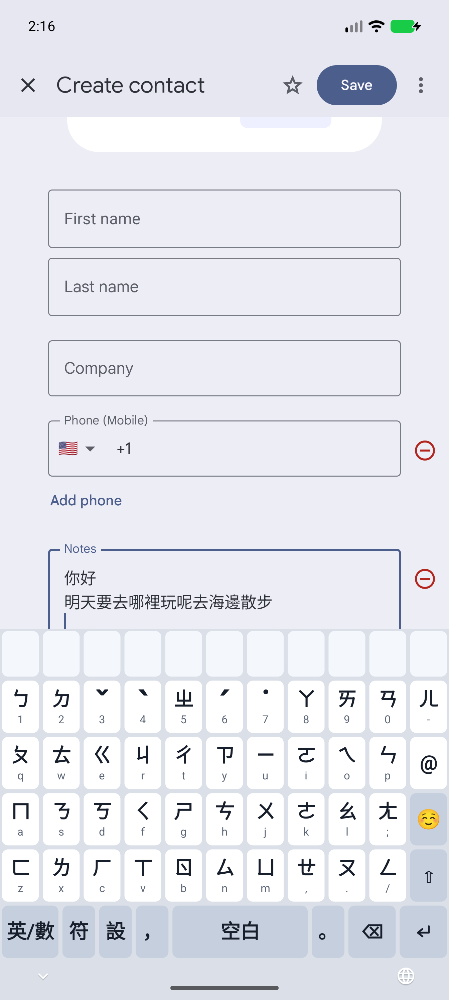

*按一次換行完成確認，游標位於下一行，組字列已清空。*

在搜尋或訊息等欄位，右下角可能顯示 **搜尋／前往／傳送**；按一次就會執行該欄位的動作。練習換行時，請選可輸入多行的文字欄位。

### 常用按鍵

| 按鍵 | 用途 |
| --- | --- |
| **英／數**、**數／ㄅ**、**ㄅ／英** | 左下角模式鍵依序切換注音、英文、數字符號，提示隨模式改變。 |
| **符**、**☺** | 開啟符號或表情符號，點選項目即可輸入。 |
| **@** | 第二排末端的 @ 鍵。 |
| **設** | 開啟琦琦設定，可切換好打注音、傳統注音、倉頡或簡易。 |
| **空白** | 未完成讀音時結束一聲；好打注音預設在讀音完成後插入組字中的空白。開啟「好打注音使用空白鍵選字」後，改為開候選及翻頁。 |
| **⌫** | 刪除；讀音未完成時先逐步刪除注音或聲調。 |
| **↵／搜尋／前往／傳送** | 依欄位確認換行或執行對應動作。 |

「設 → 注音與選字」的 **好打注音使用空白鍵選字**預設關閉，虛擬與實體鍵盤共用。關閉時仍可點組字格或按實體鍵盤 **↓** 開候選。候選列兩端的 **▲／▼**及左右滑動可換頁。

電子郵件、網址或密碼欄位通常先顯示英文；電話與數字欄位通常先顯示數字。想確認注音功能時，先點一般文字欄位。

## 4. 切換輸入法，試試倉頡提前選字

點鍵盤上的 **設**，或回 App 首頁點 **3. 調整設定**。最上方的 **輸入法**選單可選好打注音、傳統注音、倉頡及簡易；偏好逐字選字時可選 **傳統注音**。

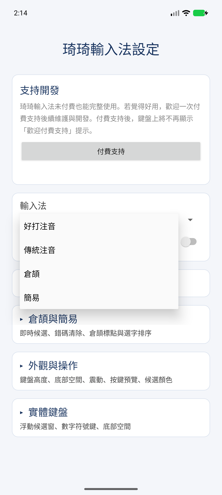

*四種輸入法從同一個選單切換；接 USB／藍牙實體鍵盤時也沿用所選模式。*

選 **倉頡**後，展開 **倉頡與簡易**，找到 **倉頡設定（虛擬鍵盤）**。確認 **即時候選**及 **未打完也能選字**都已勾選，就能在字碼尚未打完時查看候選。

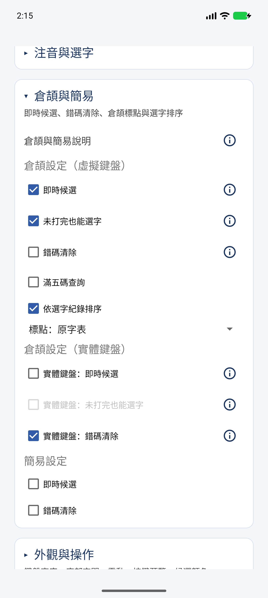

*螢幕鍵盤與實體鍵盤各有自己的倉頡設定。*

回到文字欄位，只點 **竹、大**兩個字根，就能看到 **喬**。此時不必先完成「竹大口月口」；想輸入「喬」時，直接點它的候選。

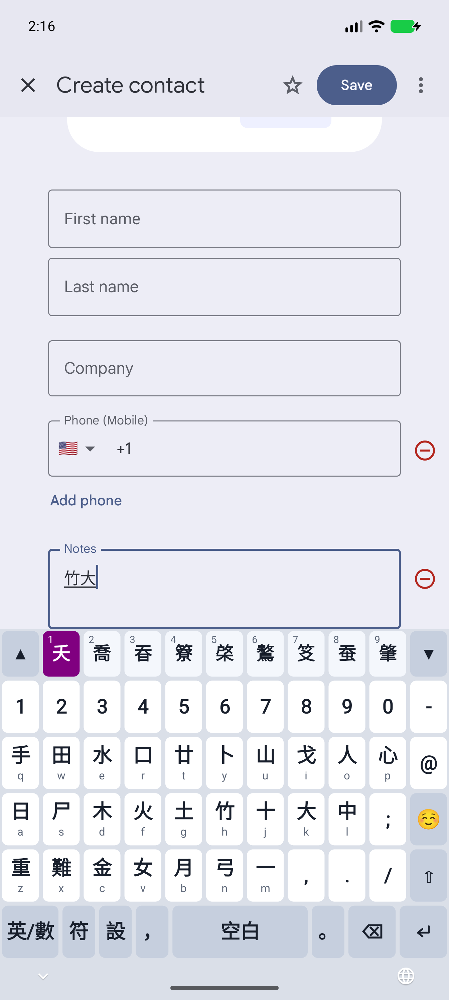

*「竹大」的底線表示尚未選字。圖中「喬」是第 2 項。*

倉頡最多五碼，也可按空白查詢；簡易輸入兩碼就會開候選。點候選或用實體 **1–9／Enter** 選字；倉頡只有一頁候選時，空白確認首選，多頁則翻頁，並支援 `?`／`*` 萬用字元。**未打完也能選字**依賴 **即時候選**，即時候選與錯碼清除互斥。

## 5. 依習慣調整設定

設定頁分成 **注音與選字、倉頡與簡易、外觀與操作、實體鍵盤**四個區塊。點區塊名稱即可展開。關聯詞詞庫從 App 首頁開啟。

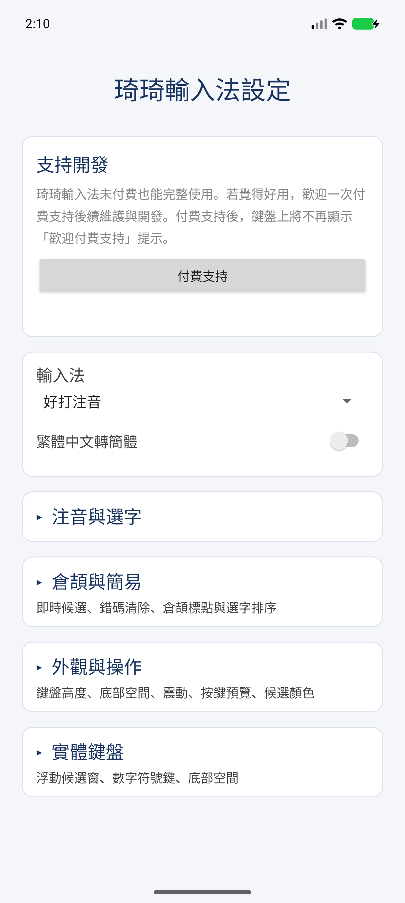

*輸入法選單下方的「繁體中文轉簡體」預設關閉。開啟後，候選與組字仍顯示繁體，送到 App 的文字會轉成簡體，例如「臺灣」輸出為「台湾」。*

| 想調整的功能 | 設定位置 |
| --- | --- |
| 注音鍵盤配置、省略聲調、空白選字、上下文選字、自訂詞與學習紀錄 | **注音與選字** |
| 倉頡／簡易的即時候選、提前選字、錯碼清除、標點及排序 | **倉頡與簡易** |
| 鍵盤版面、鍵帽間隔、字體、刪除鍵位置、震動、按鍵預覽、候選字底色 | **外觀與操作** |
| 直式及橫式鍵盤高度 | **外觀與操作 → 調整鍵盤高度** |
| 浮動候選窗、實體鍵盤雙排選字及數字符號列 | **實體鍵盤** |
| 選好字後的接續詞建議分類 | **App 首頁 → 關聯詞詞庫** |

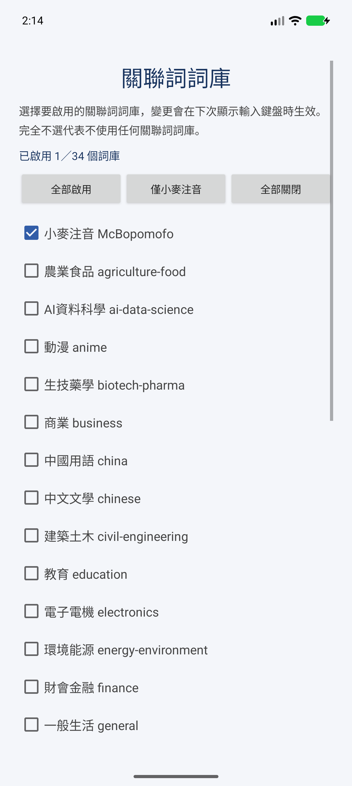

關聯詞在**選好一個字後**提供接續詞建議。初次安裝預設只開啟「小麥注音」詞庫；可勾選其他分類，或選 **僅小麥注音／全部關閉**。變更後，離開文字欄位再點入，讓鍵盤重新顯示即可套用。分類詞庫可能有錯字或不合適的詞，輸入重要內容時請自行確認。

付費支持與鍵盤上的提示

打字功能免費。未付費時，「支持開發」區塊在設定頁最上方；購買或恢復購買成功後移至最後並顯示感謝文字，付款由 Google Play 處理。

安裝滿 30 天且尚未付費支持時，沒有組字、未完成讀音、候選或關聯詞的空閒狀態，會顯示「歡迎／付費／支持」提示；實體鍵盤底部列或浮動窗也有對應提示。開始組字或出現候選時隱藏，付費或恢復購買成功後也會隱藏。

## 6. 使用 USB／藍牙實體鍵盤

先依 Android 裝置的方式連接實體鍵盤，並確認目前輸入法仍是琦琦。**Android 版可在其他 App 的文字欄位使用實體鍵盤。**

| 實體鍵盤按鍵 | 用途 |
| --- | --- |
| **1–9** | 選取對應號碼的候選字。 |
| **Page Up／Page Down** | 翻候選字頁。 |
| **Shift + 1–9** | 選取關聯詞候選。 |
| **Ctrl + Space** | 切換注音／英文。 |
| **Shift + Space** | 切換半形／全形。 |
| **Ctrl + 0** 或 **Ctrl + 1** | 開啟符號候選。 |

預設在螢幕底部顯示候選列，也能直接點選。若想讓候選靠近游標，到 **3. 調整設定 → 實體鍵盤 → 使用浮動候選字窗**，選垂直或水平排列；目標 App 不支援浮動窗時會改用底部列。

**啟用好打注音雙排選字**預設關閉，且只在未使用浮動窗時生效。啟用後，上排顯示組字與功能鍵，下排在原本數字列的位置顯示候選；數字符號鍵列選項控制是否另保留符號列。

底部單排與好打注音雙排都可點候選區的語言鍵（例如 **ㄅ** 或 **英**）開啟快速設定。前三個按鈕分別切換繁簡輸出、選擇輸入法或英文、切換半形／全形，操作時游標留在原本的文字欄位。點右側的 **設定** 可開啟琦琦輸入法設定頁。

非浮動實體鍵盤面板不需要時，可按 **▼** 收合；再次點文字欄位可恢復。

## 7. 手機橫向與平板

手機轉成橫向，或在 Android 平板開啟一般文字欄位，都可依前面的好打注音與倉頡步驟練習。鍵盤寬度與高度依裝置及方向不同。到 **外觀與操作 → 調整鍵盤高度**，將裝置轉到要調整的方向，拖曳預覽的上緣或下緣後按 **完成**。直式和橫式各自保存。

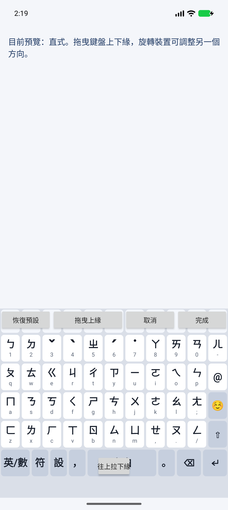

## 遇到問題時

| 情況 | 先檢查 |
| --- | --- |
| Google Play 找不到 App 或無法安裝 | 開啟上方商店連結，確認 Android 8 以上，並檢查商店帳號地區及裝置相容性。 |
| 安裝後找不到鍵盤 | 依序完成首頁的「1. 啟用輸入法」及「2. 選擇琦琦輸入法」。 |
| 打字仍出現原本的鍵盤 | 回 App 點「2. 選擇琦琦輸入法」，選琦琦後再點文字欄位。 |
| 看不到注音鍵 | 在一般文字欄位測試；密碼、網址、電話等欄位可能顯示其他版面。接了實體鍵盤時也可能只顯示候選面板。 |
| 只打「竹大」看不到「喬」 | 確認為倉頡，並檢查對應鍵盤的「即時候選」與「未打完也能選字」；虛擬與實體設定分開。 |
| 詞庫勾選後沒有變化 | 離開文字欄位再點入；關聯詞在選好字後才出現。 |
| 實體鍵盤沒有浮動窗 | 確認已選琦琦，先試預設底部候選列；浮動窗無法顯示時會退回底部列。 |

仍無法使用時，請記下 Android 版本、裝置型號、文字 App、使用螢幕或實體鍵盤，以及卡住的步驟。程式架構、建置與進階快捷鍵見 [Android IME 技術文件](Source/Loaders/Android-IME/README.md)。

曾加入 Google Play 測試的帳號

若商店仍顯示測試人員或內部 Beta 提示，可在[測試加入頁面](https://play.google.com/apps/testing/tw.chichi77.keykey.android)退出，依 [Google 的退出測試說明](https://support.google.com/googleplay/answer/15654751?hl=zh-Hant)切回正式版。需要解除安裝前，先備份自訂詞與設定。

圖片來源

畫面使用琦琦輸入法 1.5.1，在 Pixel 9 Pro XL 裝置設定的 Android 17（API 37）模擬器擷取。注音組句、選字、續打及倉頡候選以觸控鍵盤在聯絡人的未儲存 Notes（備註）欄操作。

