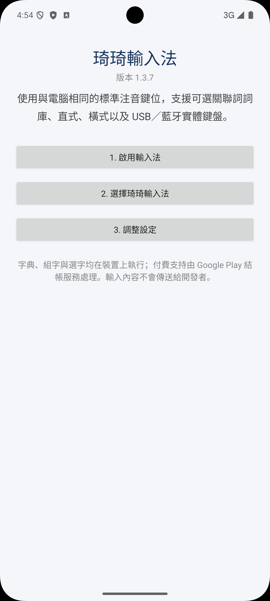
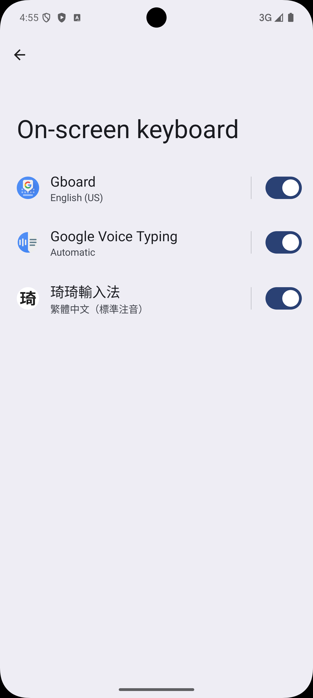
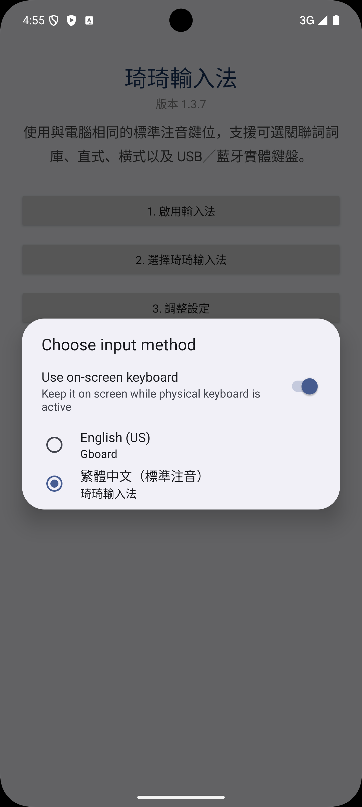
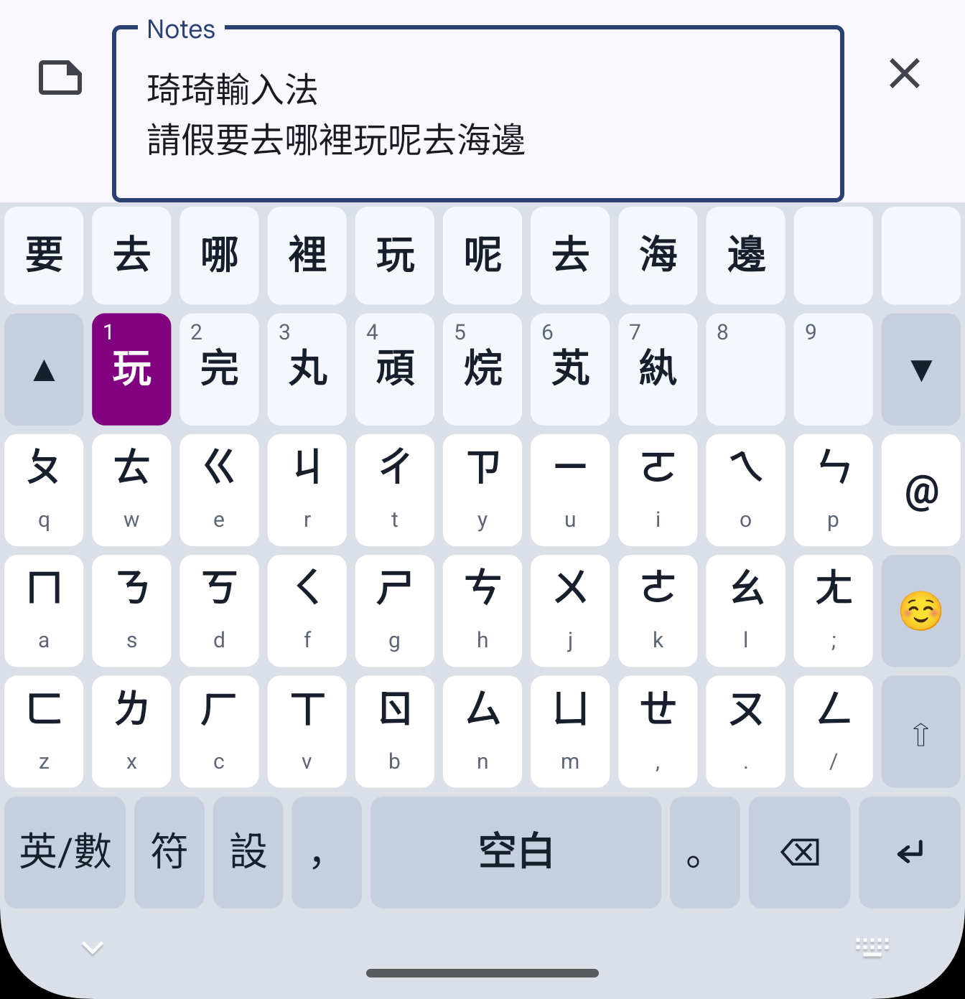
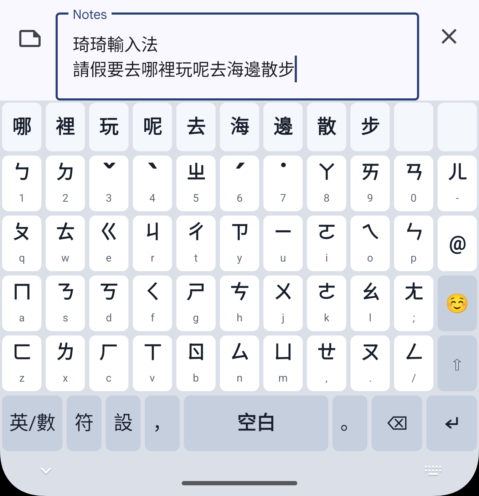
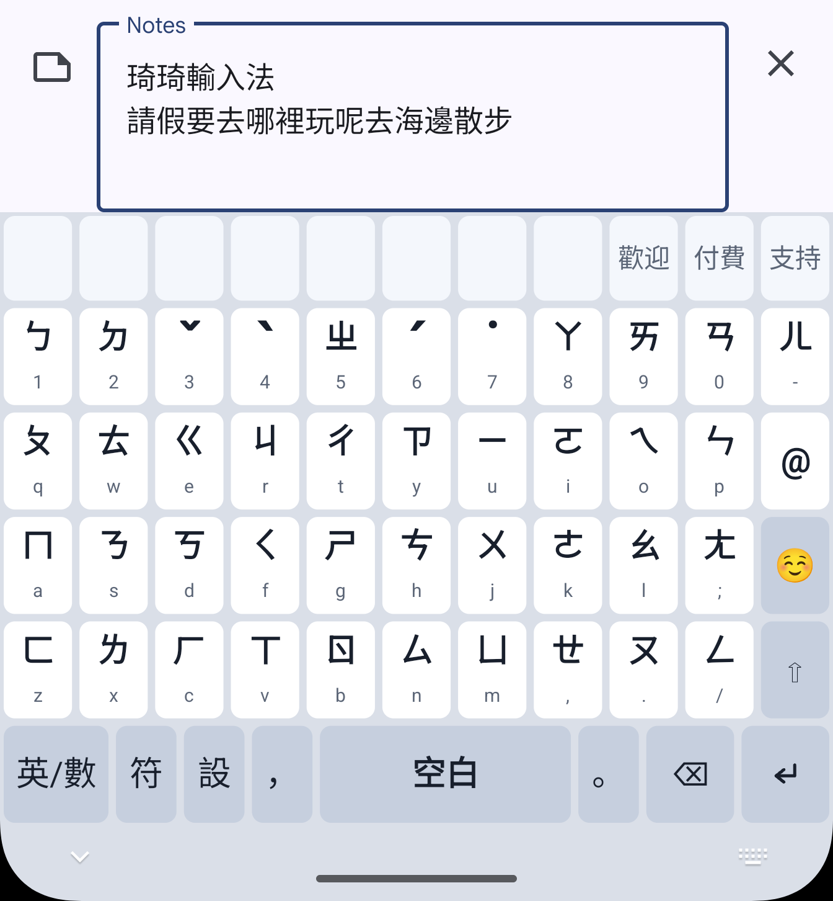
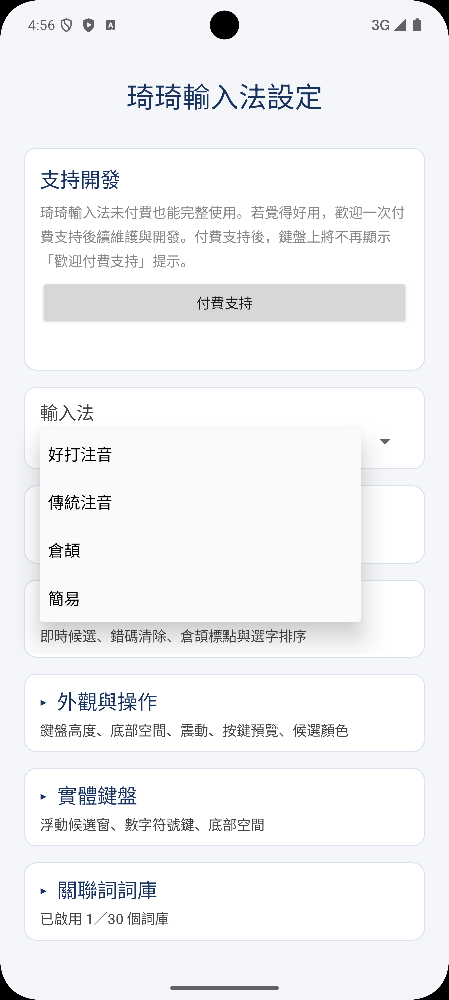
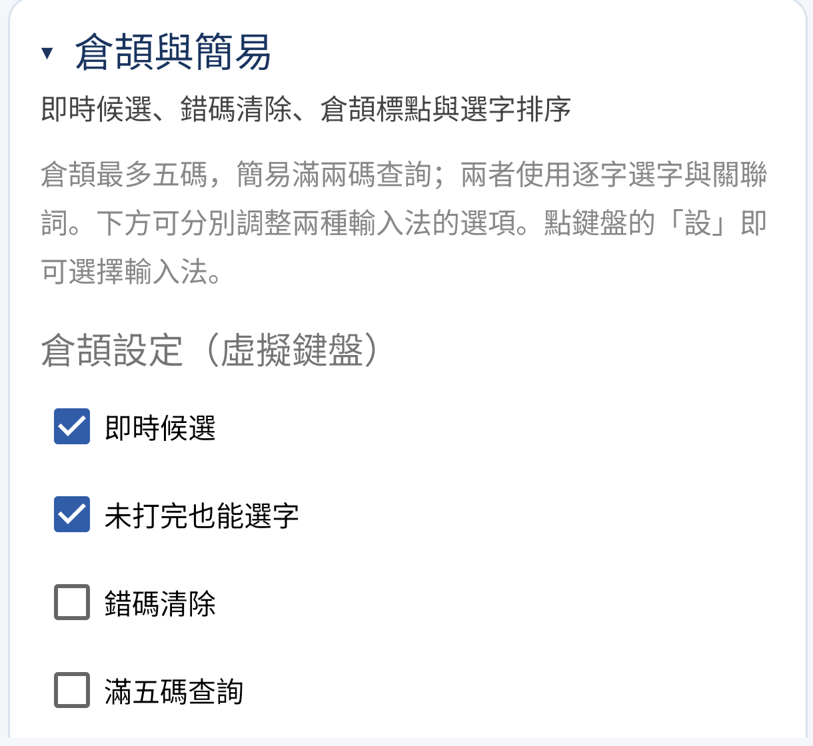
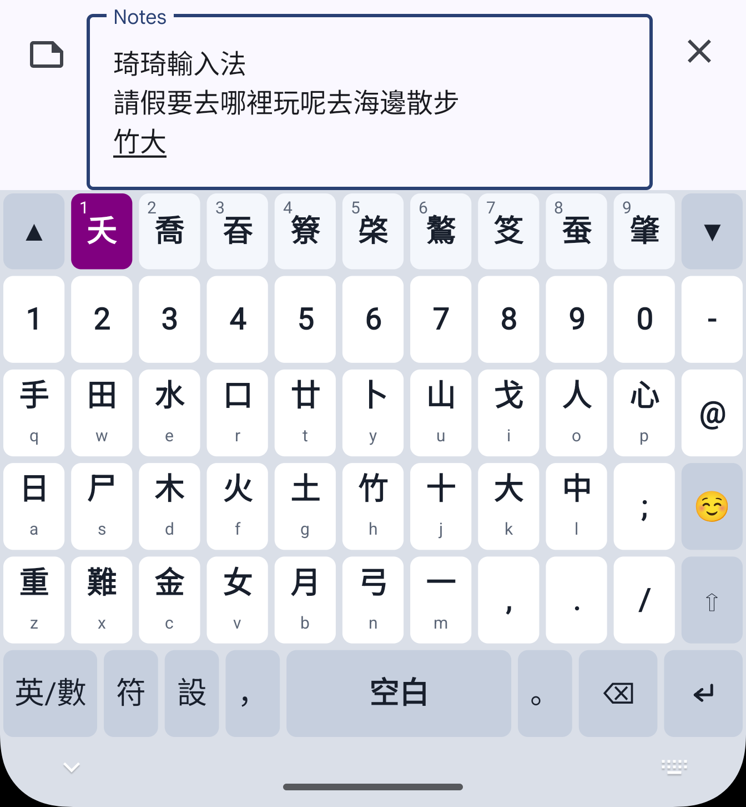
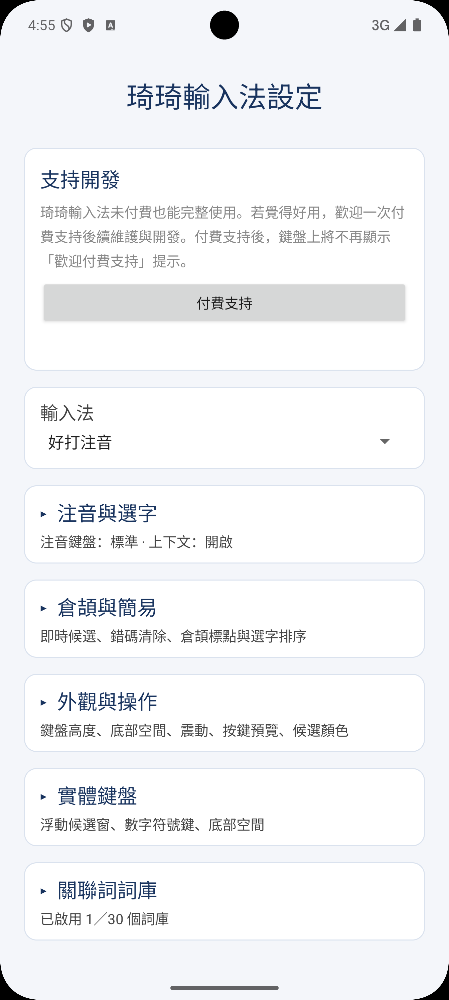

# Android 手機、平板安裝與使用指南

琦琦輸入法適用於 **Android 8 以上**的手機和平板，Google Play 最新正式版為 **1.3.7**。安裝後，從 App 首頁依序啟用、選用鍵盤，就能在其他 App 輸入中文。**打字功能免費，未付費支持也能完整使用。**

以下帶你完成第一次輸入，再試好打注音的句中選字與倉頡提前選字。系統設定圖使用 Android 15 英文介面；不同品牌的名稱和位置可能略有不同。圖片來源與驗證範圍列於頁末。

## 1. 從 Google Play 安裝

在 Android 裝置上[開啟琦琦輸入法的 Google Play 商店頁面](https://play.google.com/store/apps/details?id=tw.chichi77.keykey.android)，確認名稱為 **琦琦輸入法**，點 **安裝**，完成後點 **開啟**。

> **待補圖｜AND-01**
>
> Google Play 正式商品頁及安裝／開啟入口，避開帳號與個人推薦內容。

打開 App 後，先看首頁的三個按鈕：**1. 啟用輸入法 → 2. 選擇琦琦輸入法 → 3. 調整設定**。前兩步完成後即可開始打字，設定可以稍後再調整。

*首頁顯示版本 1.3.7；先點「1. 啟用輸入法」進入系統鍵盤管理。*

一般使用者請從 Google Play 取得正式版；GitHub Actions 的 debug APK 為開發驗證產物。

## 2. 啟用並選用鍵盤

點首頁的 **1. 啟用輸入法**，在系統的螢幕鍵盤管理頁找到 **琦琦輸入法**，打開它的開關。Android 若顯示第三方輸入法的安全提示，請確認名稱後再決定是否啟用。琦琦的字典、組字與選字在裝置上執行，App 未宣告網路權限。

*圖中「On-screen keyboard」即螢幕鍵盤管理；琦琦右側開關開啟後，返回 App。*

接著點 **2. 選擇琦琦輸入法**，在清單選 **繁體中文（標準注音）／琦琦輸入法**。啟用開關只讓鍵盤可用，這一步才會將它選為目前鍵盤。

*「Choose input method」清單中，琦琦旁的圓點已選中。回到文字 App，點一般文字欄位即可叫出鍵盤。*

## 3. 第一次用好打注音組句

在支援多行輸入的記事本或文字 App 開始練習。預設的 **好打注音**可連續輸入每個字的注音與聲調，由前後文組句；一聲字以 **空白**結束音節。

先輸入「**琦琦輸入法**」，需要時從同音候選選「琦」，再按 **↵** 確認並換行。第二行輸入「**請假要去哪裡玩呢去海邊**」，暫時保留組字，點鍵盤上方組字列的 **玩**，就能展開同音候選。

*第一行已確認，第二行仍可選字；「玩」候選在本次畫面為第 1 項。此為文字欄位與完整鍵盤的局部圖，[查看完整裝置原圖](docs/images/keykey-android-v137-and06a-middle-candidate-pixel8pro-simulator.png)。*

圖中借用 Android「聯絡人」的多行 Notes（備註）欄示範，內容只用於輸入練習。鍵盤最上方的組字列保留最近 **9 個**已完成音節：輸入到「海邊」時，「請假」已移出可修改範圍，上方保留「要去哪裡玩呢去海邊」。文字欄位仍保留整句。

### 選字後，繼續在句尾輸入

點候選 **玩**，接著輸入「**散步**」。即使剛才修改的是句中用字，後續文字仍會接在句尾。

*選字後續打「散步」，前面的兩行保留，新增文字接在「海邊」之後。[完整原圖](docs/images/keykey-android-v137-and06b-continue-at-end-pixel8pro-simulator.png)。*

完成後按一次 **↵** 即可確認並換行，組字列會清空。

*一次換行完成確認，游標位於下一行；文字沒有重複輸入。[完整原圖](docs/images/keykey-android-v137-and05-confirmed-pixel8pro-simulator.png)。*

在搜尋或訊息等欄位，右下角可能顯示 **搜尋／前往／傳送**；按一次就會執行該欄位的動作。練習換行時，請選可輸入多行的文字欄位。

### 常用按鍵

| 按鍵 | 用途 |
| --- | --- |
| **英／數**、**數／ㄅ**、**ㄅ／英** | 左下角模式鍵依序切換注音、英文、數字符號，提示隨模式改變。 |
| **符**、**☺** | 開啟符號或表情符號，點選項目即可輸入。 |
| **@** | 第二排末端的 @ 鍵。 |
| **設** | 開啟琦琦設定，可切換好打注音、傳統注音、倉頡或簡易。 |
| **空白** | 未完成讀音時結束一聲；好打注音預設在讀音完成後插入組字中的空白。開啟「使用空白鍵選字」後，改為開候選及翻頁。 |
| **⌫** | 刪除；讀音未完成時先逐步刪除注音或聲調。 |
| **↵／搜尋／前往／傳送** | 依欄位確認換行或執行對應動作。 |

「設 → 注音與選字」的 **使用空白鍵選字**預設關閉，虛擬與實體鍵盤共用。關閉時仍可點組字格或按實體鍵盤 **↓** 開候選。候選列兩端的 **▲／▼**及左右滑動可換頁。

電子郵件、網址或密碼欄位通常先顯示英文；電話與數字欄位通常先顯示數字。想確認注音功能時，先點一般文字欄位。

## 4. 切換輸入法，試試倉頡提前選字

點鍵盤上的 **設**，或回 App 首頁點 **3. 調整設定**。最上方的 **輸入法**選單可選好打注音、傳統注音、倉頡及簡易；偏好逐字選字時可選 **傳統注音**。

*四種輸入法從同一個選單切換；接 USB／藍牙實體鍵盤時也沿用所選模式。*

選 **倉頡**後，展開 **倉頡與簡易**，找到 **倉頡設定（虛擬鍵盤）**。確認 **即時候選**及 **未打完也能選字**都已勾選，就能在字碼尚未打完時查看候選。

*這兩個選項屬於螢幕鍵盤；實體鍵盤另有自己的設定。局部圖保留實際勾選狀態，[查看完整設定原圖](docs/images/keykey-android-v137-and08a-cangjie-settings-pixel8pro-simulator.png)。*

回到文字欄位，只點 **竹、大**兩個字根，就能看到 **喬**。此時不必先完成「竹大口月口」；想輸入「喬」時，直接點它的候選。

*「竹大」仍在組字，尚未選字確認；本次「喬」位於第 2 項。[完整裝置原圖](docs/images/keykey-android-v137-and08b-cangjie-candidates-pixel8pro-simulator.png)。候選順位以你的實際畫面為準。*

倉頡最多五碼，也可按空白查詢；簡易輸入兩碼就會開候選。點候選或用實體 **1–9／Enter** 選字；倉頡只有一頁候選時，空白確認首選，多頁則翻頁，並支援 `?`／`*` 萬用字元。**未打完也能選字**依賴 **即時候選**，即時候選與錯碼清除互斥。

## 5. 依習慣調整設定

設定頁分成 **注音與選字、倉頡與簡易、外觀與操作、實體鍵盤、關聯詞詞庫**五個區塊。點區塊名稱即可展開；先保留預設值也能正常打字。

*從要調整的功能展開對應區塊，例如到「外觀與操作」調整鍵盤高度、候選字顏色與按鍵回饋。*

| 想調整的功能 | 設定位置 |
| --- | --- |
| 注音鍵盤配置、空白選字、上下文選字、自訂詞與學習紀錄 | **注音與選字** |
| 倉頡／簡易的即時候選、提前選字、錯碼清除、標點及排序 | **倉頡與簡易** |
| 震動、按鍵預覽、候選字底色、直式及橫式鍵盤高度 | **外觀與操作** |
| 浮動候選窗、實體鍵盤雙排選字及數字符號列 | **實體鍵盤** |
| 選好字後的接續詞建議分類 | **關聯詞詞庫** |

> **待補圖｜AND-13**
>
> 展開關聯詞詞庫，預設小麥注音與其他分類的勾選位置可辨認。

關聯詞在**選好一個字後**提供接續詞建議。初次安裝預設只開啟「小麥注音」詞庫；可勾選其他分類，或選 **僅小麥注音／全部關閉**。變更後，離開文字欄位再點入，讓鍵盤重新顯示即可套用。分類詞庫可能有錯字或不合適的詞，輸入重要內容時請自行確認。

付費支持與鍵盤上的提示

打字功能免費。未付費時，「支持開發」區塊在設定頁最上方；購買或恢復購買成功後移至最後並顯示感謝文字，付款由 Google Play 處理。

安裝滿 30 天且尚未付費支持時，沒有組字、未完成讀音、候選或關聯詞的空閒狀態，會顯示「歡迎／付費／支持」提示；實體鍵盤底部列或浮動窗也有對應提示。開始組字或出現候選時隱藏，付費或恢復購買成功後也會隱藏。

## 6. 使用 USB／藍牙實體鍵盤

先依 Android 裝置的方式連接實體鍵盤，並確認目前輸入法仍是琦琦。**Android 版可在其他 App 的文字欄位使用實體鍵盤。**

| 實體鍵盤按鍵 | 用途 |
| --- | --- |
| **1–9** | 選取對應號碼的候選字。 |
| **Page Up／Page Down** | 翻候選字頁。 |
| **Shift + 1–9** | 選取關聯詞候選。 |
| **Ctrl + Space** | 切換注音／英文。 |
| **Shift + Space** | 切換半形／全形。 |
| **Ctrl + 0** 或 **Ctrl + 1** | 開啟符號候選。 |

預設在螢幕底部顯示候選列，也能直接點選。若想讓候選靠近游標，到 **3. 調整設定 → 實體鍵盤 → 使用浮動候選字窗**，選垂直或水平排列；目標 App 不支援浮動窗時會改用底部列。

> **待補圖｜AND-10**
>
> 實體鍵盤浮動候選窗與宿主游標同時可見；標註真實鍵盤或模擬器。

**啟用好打注音雙排選字**預設關閉，且只在未使用浮動窗時生效。啟用後，上排顯示組字與功能鍵，下排在原本數字列的位置顯示候選；數字符號鍵列選項控制是否另保留符號列。

> **待補圖｜AND-09**
>
> 實體鍵盤雙排設定、組字、候選及恢復數字列，分圖呈現；關閉浮動窗。

非浮動實體鍵盤面板不需要時，可按 **▼** 收合；再次點文字欄位可恢復。

> **待補圖｜AND-11**
>
> 面板收合前、按 ▼ 後與再次顯示的三種狀態。

本輪補拍以觸控為主；實體鍵盤雙排、浮動窗、面板收合與實際 USB／藍牙連線仍待補拍驗證。

## 7. 手機橫向與平板

手機轉成橫向，或在 Android 平板開啟一般文字欄位，都可依前面的好打注音與倉頡步驟練習。鍵盤寬度與高度依裝置及方向不同；可到 **外觀與操作**調整直式、橫式鍵盤高度。

> **待補圖｜AND-12a**
>
> 手機橫向的完整觸控鍵盤與玩候選，保留文字宿主。

> **待補圖｜AND-12b**
>
> Android 平板自己的版面與候選；不得拉寬手機截圖代替。

## 遇到問題時

| 情況 | 先檢查 |
| --- | --- |
| Google Play 找不到 App 或無法安裝 | 開啟上方商店連結，確認 Android 8 以上，並檢查商店帳號地區及裝置相容性。 |
| 安裝後找不到鍵盤 | 依序完成首頁的「1. 啟用輸入法」及「2. 選擇琦琦輸入法」。 |
| 打字仍出現原本的鍵盤 | 回 App 點「2. 選擇琦琦輸入法」，選琦琦後再點文字欄位。 |
| 看不到注音鍵 | 在一般文字欄位測試；密碼、網址、電話等欄位可能顯示其他版面。接了實體鍵盤時也可能只顯示候選面板。 |
| 只打「竹大」看不到「喬」 | 確認為倉頡，並檢查對應鍵盤的「即時候選」與「未打完也能選字」；虛擬與實體設定分開。 |
| 詞庫勾選後沒有變化 | 離開文字欄位再點入；關聯詞在選好字後才出現。 |
| 實體鍵盤沒有浮動窗 | 確認已選琦琦，先試預設底部候選列；浮動窗無法顯示時會退回底部列。 |

仍無法使用時，請記下 Android 版本、裝置型號、文字 App、使用螢幕或實體鍵盤，以及卡住的步驟。程式架構、建置與進階快捷鍵見 [Android IME 技術文件](Source/Loaders/Android-IME/README.md)。

曾加入 Google Play 測試的帳號

若商店仍顯示測試人員或內部 Beta 提示，可在[測試加入頁面](https://play.google.com/apps/testing/tw.chichi77.keykey.android)退出，依 [Google 的退出測試說明](https://support.google.com/googleplay/answer/15654751?hl=zh-Hant)切回正式版。需要解除安裝前，先備份自訂詞與設定。

圖片來源與本輪驗證範圍

2026-10-24 於 Pixel 8 Pro arm64 模擬器、Android 15（API 35）補拍 10 張 1344 × 2992 裝置原圖，另提供 5 張局部裁切圖。局部圖只裁切範圍，未更改產品內容；完整原圖均保留連結。系統啟用與選用畫面為英文介面，琦琦介面為繁體中文。

App 由正式 `v1.3.7` tag（`a11f1eab381dda3b29d59f0ec8c201599fdadeaf`）獨立來源副本，透過 Android Studio 既有 Debug 組態建置安裝；已核對畫面及 APK 為 1.3.7、versionCode 1003007，APK 內共用 `KeyKey.db` SHA-256 為 `8fc3aead36cefd16a77c0a0d4319f7a305fb712b752db09396c8ac2bd4ebbfdb`。這批是正式 tag 自建模擬器操作圖，Google Play 商品頁及商店安裝仍待另行補拍。

輸入宿主為系統聯絡人的未儲存備註欄。兩行指定文字、句中玩候選、選字後續打散步、一次換行，以及倉頡只輸入竹大均透過螢幕按鍵實際操作，沒有貼上中文字模擬組字。倉頡兩個虛擬鍵盤選項原已勾選。完成後已恢復好打注音、捨棄本次測試草稿；暫時關閉的 AVD 硬體鍵盤設定也已恢復，未更動 Xcode 設定或產品原始碼。

實機觸控、Google Play 安裝、USB／藍牙實體鍵盤及平板／橫向版面不以本輪手機模擬器畫面代替。

> **待補圖｜AND-06c**
>
> Android 手機實機的指定兩行玩候選與倉頡竹大／喬，分圖；記錄裝置、OS 與安裝來源。

