# FreeBSD 琦琦輸入法安裝與使用指南

琦琦輸入法已正式支援 FreeBSD，這份指南以 **1.3.7**帶你完成 **安裝套件 → 設定桌面環境 → 加入 Fcitx → 在 Mousepad 試打**。軟體透過 FreeBSD 官方 ports／pkg 安裝及更新。

先查套件庫提供的版本；若已符合需求，直接用 pkg 安裝。套件可能較晚上架，需要 1.3.7 時可改走 ports 編譯，完成後仍由 pkg 管理。

套件資訊可先看 [FreshPorts：chinese/fcitx5-keykey](https://www.freshports.org/chinese/fcitx5-keykey/)，查看 port 版本、相依套件及更新紀錄；本機已安裝版本要以 `pkg info` 核對。

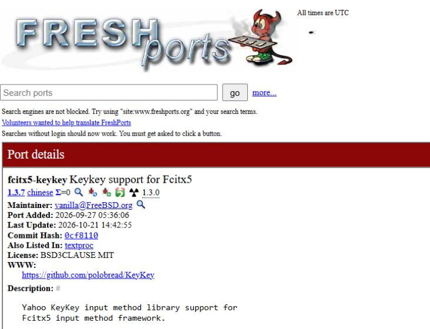

2026-10-24 擷取的 FreshPorts 頁面，port 版本為 1.3.7；這是來源資訊，本機版號仍須用 `pkg info` 確認。


本指南的桌面步驟已在 **FreeBSD 15.1-RELEASE-p3 amd64、Xfce／X11、LightDM、Fcitx 5 與 Mousepad／GTK 3** 驗證。需先有可登入的圖形桌面、網路及管理員權限；安裝後使用一般帳號設定與輸入中文。

## 1. 從套件庫直接安裝

開啟桌面終端機，切換 root 後先更新目錄並查詢：

```sh
su -
pkg update
pkg search -x '^zh-fcitx5-keykey'
```

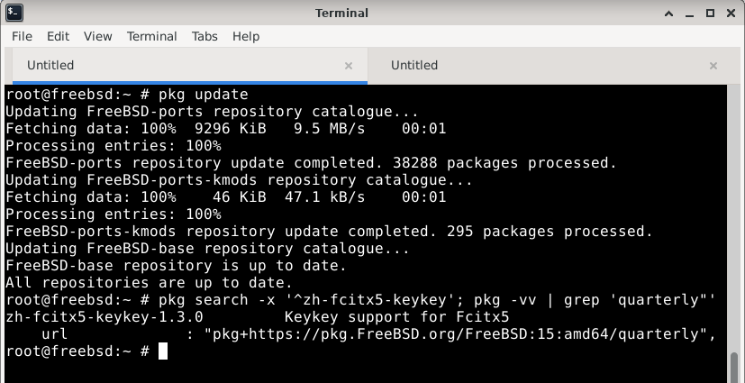

2026-10-24 已刷新全部套件庫目錄；這台機器的 FreeBSD 15／amd64 **quarterly** 套件庫提供 `zh-fcitx5-keykey-1.3.0`。需要 1.3.7 時可走下一節 ports 流程；其他套件庫分支或架構以各自查詢為準。

若清單已提供你要的版本，繼續安裝，完成後查看本機版本：

```sh
pkg install zh-fcitx5-keykey
pkg info -x keykey
```

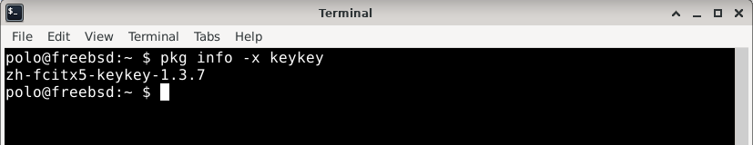

本次補拍時已安裝 1.3.7，來源為先前的 ports 建置；上圖是重新查詢本機狀態，並非本次執行 `pkg install` 的結果。

**確認版本符合需求後，可直接前往第 3 節設定桌面。** 若套件庫仍較舊，而你需要 1.3.7，略過舊版安裝，改走下一節 ports 流程。套件庫版本依 FreeBSD 版本、架構與分支不同，以當次結果為準。

安裝寫入 `/usr/local` 與系統套件資料庫，需要 root；字型、個人設定與打字則用一般帳號。`pkg install` 依套件名稱安裝；`pkg add` 用於本機 `.pkg` 或完整 URL，範例見下一節。

## 2. 加入 ports，從原始碼安裝 1.3.7

ports tree 是 FreeBSD 軟體的建置配方集合。`chinese/fcitx5-keykey` 會下載對應版本的琦琦原始碼、校驗、編譯並產生可由 pkg 管理的套件。

已從套件庫安裝所需版本的人可跳過本節。需要編譯時，依下方步驟先確認 port 版號，再建置與安裝。

### 2.1 用 net/gitup 取得或更新 /usr/ports

以 root 安裝輕量的 [net/gitup](https://github.com/johnmehr/gitup)：

```sh
pkg install net/gitup
```

首次使用前，確認 `/usr/local/etc/gitup.conf` 的 `ports` 區段指向官方 `git.freebsd.org` 的 `/ports.git`、`main` 分支及本機 `/usr/ports`；這是[上游預設設定](https://github.com/johnmehr/gitup/blob/main/gitup.conf)。若設定檔不存在，可從同目錄的 `gitup.conf.sample` 複製建立。

**`/usr/ports` 不存在、為空目錄，或已由 net/gitup 管理時**，執行：

```sh
gitup ports
```

這個指令會依設定取得或更新 ports tree，日後更新也使用同一指令。更新後仍須依下方步驟確認 port 版號、編譯並安裝，才會更新琦琦。

若 `/usr/ports` 已有 `.git`，請沿用原本的 Git 更新方式；net/gitup 不會接管 Git checkout。其他已有內容的目錄也先保留，可將 `ports` 的 `target_directory` 改成尚未使用的目錄（例如 `/usr/ports-keykey`），並將後續路徑一併改成該目錄。若選用 quarterly 分支，port 可能仍是舊版，更新後仍須確認版號。

### 2.2 確認 port 版號與來源

```sh
cd /usr/ports/chinese/fcitx5-keykey
make -V DISTVERSION
make -V PKGNAME
```

安裝本指南版本時，兩個版本查詢應顯示：

```text
1.3.7
zh-fcitx5-keykey-1.3.7
```

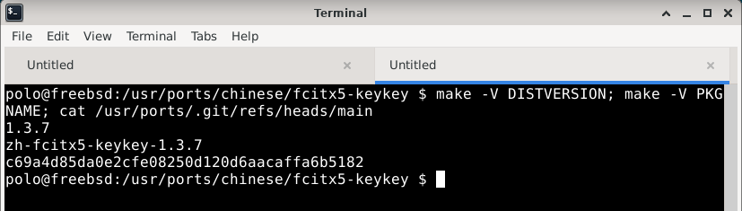

圖中為既有 Git checkout 的版本與修訂驗證紀錄；net/gitup 不建立 `.git`，使用上述 `make` 指令確認 port 版號即可。

`PORTREVISION` 若有套件修訂，套件名稱可能另有 `_1` 等尾碼。本次通過安裝及桌面試打的官方 ports 修訂是 `c69a4d85da0e2cfe08250d120d6aacaffac6b5182`。

#### 進階：用 Git 重現當次驗證的 1.3.7 ports 修訂

若日後預設分支已改版，而仍需重現 1.3.7，可另外取得當次修訂。以 root 安裝 Git，並在尚不存在的 `/usr/ports-keykey-137` 建立獨立 checkout：

```sh
pkg install git-lite
git clone --depth 1 https://git.FreeBSD.org/ports.git /usr/ports-keykey-137
git -C /usr/ports-keykey-137 fetch --depth 1 origin c69a4d85da0e2cfe08250d120d6aacaffac6b5182
git -C /usr/ports-keykey-137 switch --detach FETCH_HEAD
cd /usr/ports-keykey-137/chinese/fcitx5-keykey
make -V DISTVERSION
make -V PKGNAME
```

歷史修訂用於重現既有版本；相依套件仍須與目前系統相容。

接續命令都在所選 ports tree 的 `chinese/fcitx5-keykey` 目錄執行。

### 2.3 設定編譯選項與相依套件

查看目前選項；需要調整時開啟設定：

```sh
make showconfig
make config
```

若顯示沒有可設定選項，正常繼續。若希望先設定所有相依 port，可執行 `make config-recursive`，依畫面選項設定後再編譯。

本指南使用 `BATCH=yes`，採用已儲存的選項，尚未設定者使用預設值，避免編譯途中反覆出現選項視窗；`MAKE_JOBS_NUMBER=4` 限制單一 port 的平行編譯工作數，可依可用記憶體調低。這些值直接寫在命令中即可，不必改全域 `/etc/make.conf`。

ports 會處理缺少的建置與執行相依套件；缺少的相依 port 也可能需要編譯。既有套件應與所選 ports tree 相容，若遇到函式庫版本錯誤，先處理失敗原因再安裝。

### 2.4 編譯並產生套件

```sh
make BATCH=yes MAKE_JOBS_NUMBER=4 package
make BATCH=yes check-plist
ls -l work/pkg/
```

第一行會下載原始碼並校驗、安裝缺少的相依套件、編譯及封裝。等候完成，確認兩個 `make` 均無錯誤，並在 `work/pkg/` 看到 `zh-fcitx5-keykey-1.3.7.pkg` 後再安裝。`check-plist` 檢查安裝檔案與 port 清單是否一致。

### 2.5 用 pkg add 安裝編好的 1.3.7

先儲存正在編輯的文件並關閉琦琦設定視窗，再執行：

```sh
pkg add -f ./work/pkg/zh-fcitx5-keykey-1.3.7.pkg
pkg info -x keykey
```

`-f` 用於替換已安裝的舊套件；確認結果是 `zh-fcitx5-keykey-1.3.7`。若有套件修訂尾碼，請使用 `ls` 顯示的實際檔名。安裝後由 pkg 記錄與管理，不需要手動複製程式至 `/usr/local`。

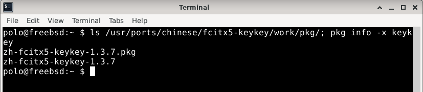

這次補拍重新核對既有 `.pkg` 與安裝版號，沒有重新建置或安裝；來源版號見上一張圖。

這是既有 1.3.7 驗證採用的流程：**從 ports 編譯原始碼，再用 `pkg add` 安裝本機產物**。若是尚未安裝琦琦的系統，也可在同一個 port 目錄使用 `make BATCH=yes MAKE_JOBS_NUMBER=4 install clean` 直接編譯安裝；前面已完成 `pkg add` 時不需重做。

若要保留套件供重裝，先將 `.pkg` 複製到其他目錄；不需保留工作目錄時再執行 `make clean`。下一步補齊桌面整合後，登出並重新登入，以載入新版輸入法。

## 3. 補上 GTK 3 輸入橋接

Mousepad 使用 GTK 3，需要對應的 Fcitx 模組；只裝 GTK 4 bridge 仍不足。在 root shell 執行：

```sh
pkg install -y fcitx5 fcitx5-configtool fcitx5-gtk3
pkg info -x fcitx5-gtk
```

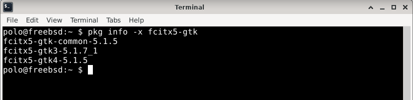

既有驗證使用 `fcitx5-gtk3-5.1.7_1`；你的套件修訂可能不同。若安裝出現 `GLib version too old (micro mismatch)`，先看文末的 GLib 排除方式，完成後再重新開啟 App。

安裝結束：

```sh
exit
```

## 4. 確認中文字型

若中文或注音顯示為缺字方框，先檢查：

```sh
fc-list :lang=zh family
```

可在一般使用者的字型目錄安裝 [Noto 官方繁體中文字型](https://github.com/notofonts/noto-cjk/blob/main/Sans/OTF/TraditionalChinese/NotoSansCJKtc-Regular.otf)：

```sh
mkdir -p ~/.local/share/fonts
fetch -o ~/.local/share/fonts/NotoSansCJKtc-Regular.otf \
  https://raw.githubusercontent.com/notofonts/noto-cjk/main/Sans/OTF/TraditionalChinese/NotoSansCJKtc-Regular.otf
fc-cache -f ~/.local/share/fonts
```

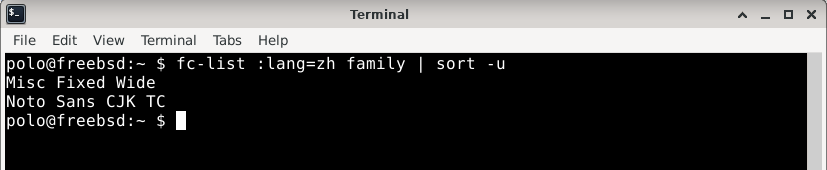

本機已有 Noto Sans CJK TC，不需重複下載；下方 Mousepad 圖可見指定中文正常顯示。倉頡清單的少數罕字仍缺字，見第 8 節。

完成字型與下一步環境設定後，儲存文件並登出／登入，使 Fcitx、設定視窗與編輯器都載入新字型。

## 5. 設定環境變數，重新登入

使用 LightDM 登入 Xfce 時，可檢查登入腳本是否載入 `~/.xprofile`，再用一般帳號開啟該檔案：

```sh
grep -n xprofile /usr/local/etc/lightdm/Xsession
ee ~/.xprofile
```

檔案不存在時可建立。在檔案加入以下三行，保留其他既有設定，儲存後離開編輯器：

```sh
export GTK_IM_MODULE=fcitx
export QT_IM_MODULE=fcitx
export XMODIFIERS=@im=fcitx
```

確認 `/usr/local/etc/xdg/autostart/org.fcitx.Fcitx5.desktop` 存在；Xfce 的「設定 → 工作階段與啟動 → 應用程式自動啟動」中也應啟用 Fcitx 5。若沒有自動啟動項目，可在該介面新增，名稱填 `Fcitx 5`、命令填 `/usr/local/bin/fcitx5 -d`，已有項目時不必重複新增。

接著**儲存文件、登出 Xfce，再重新登入**。其他登入管理器應先確認其環境設定入口；`~/.xprofile` 只有被登入流程讀取才會生效。

重新登入後開啟終端機：

```sh
env | grep -E '^(GTK_IM_MODULE|QT_IM_MODULE|XMODIFIERS)='
pgrep -laf fcitx5
```

三個值應分別為 `fcitx`、`fcitx`、`@im=fcitx`，並能看到 Fcitx 行程。

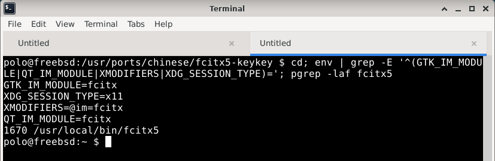

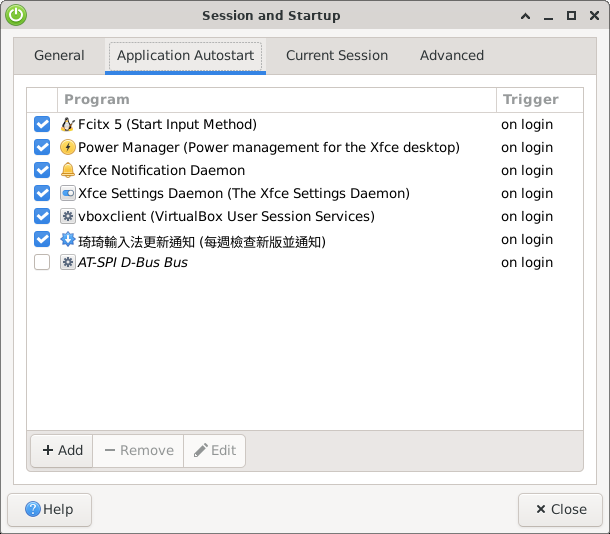

之後直接從桌面開啟 App 試打；只用單次環境變數啟動 App，不能代替登入環境驗證。

## 6. 加入琦琦輸入法

從 Applications → Settings → Fcitx 5 Configuration 開啟設定，或在一般使用者的終端機執行：

```sh
fcitx5-config-qt
```

取消右下方 **Only Show Current Language**，在搜尋欄輸入 `keykey`，將需要的輸入法加入左側清單並按 **Apply**：

| 清單名稱 | 用途 |
|---|---|
| chichi77 KeyKey Bopomofo | 注音，包含好打注音與傳統注音 |
| chichi77 KeyKey Cangjie | 倉頡 |
| chichi77 KeyKey Simplex | 簡易 |

保留 Keyboard – English (US) 作為英文鍵盤。

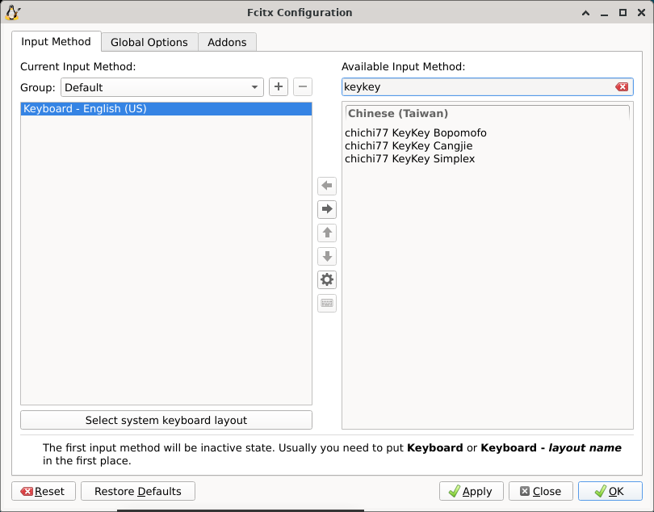

先取消語言篩選，再搜尋；搜尋時介面會收起語言篩選列。這張圖呈現加入前的清單。


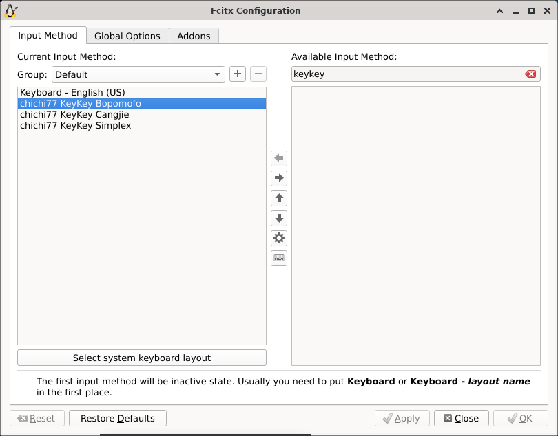

*左側是目前可切換的輸入法；本次重新登入後三個琦琦項目仍保留。*

單擊左側 **Bopomofo**，再按齒輪開啟設定。先保留「標準」注音鍵盤配置與「好打注音」模式；需要逐字選字時，再改成傳統注音。

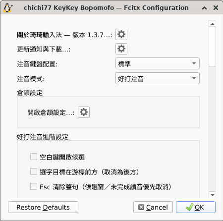

*注音模式為好打注音；下方提供空白開候選、選字目標與 Esc 清除整句等選項。*

## 7. 在 Mousepad 試打與選字

直接從桌面開啟 Mousepad，新增空白文件並點選文字區。按 **Ctrl+Space** 切到琦琦注音；新文件若仍輸出英文鍵碼，先確認該文件的輸入法啟用狀態。

在 Xfce 上方面板的 Fcitx 圖示按右鍵，可看到目前輸入法；圓點應在 **chichi77 KeyKey Bopomofo**。

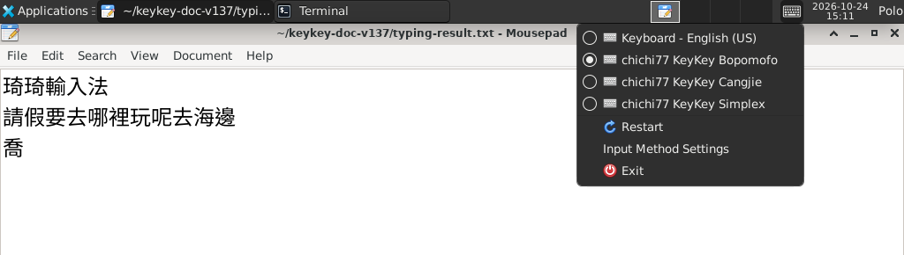

### 用兩行文字練習句中選字

先輸入「**琦琦輸入法**」，按 Enter 確認，再按 Enter 換行；第二行輸入「**請假要去哪裡玩呢去海邊**」，先不要確認。用方向鍵移動組字游標，按 **↓** 開候選，依反白目標確認正在修改「玩」。

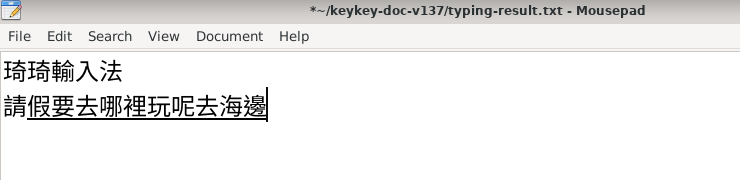

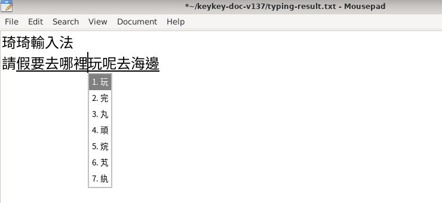

選 **玩**後，組字游標會停在「玩」後方，第二行仍有底線。按 **End** 回到句尾，再按 **Enter** 確認，保留原句。候選開著時 Enter 是選字，關閉後才確認整段。

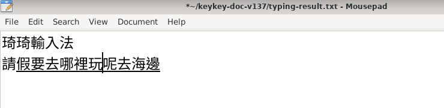

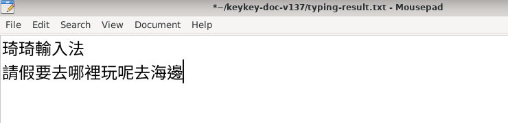

### 常用操作與既有長句示範

常用操作：

| 按鍵 | 本次核對的行為 |
|---|---|
| Ctrl+Space | 切換琦琦與英文鍵盤 |
| ↓ | 在好打注音組字中開候選 |
| Page Down／Page Up | 候選翻頁與返回 |
| 數字鍵 | 選取該頁候選，修改組字內容 |
| Enter | 候選關閉時提交組字 |
| Backspace | 刪除未完成讀音的末碼 |
| Esc | 取消未完成讀音 |

既有 1.3.7 實拍另逐鍵輸入 19 音節句「請假要去哪裡玩呢去海邊因為那裡有比基尼」，檢查第 10、11、19 音節與全文；另選出「鐘」，再切回英文輸入 `abc 123`。

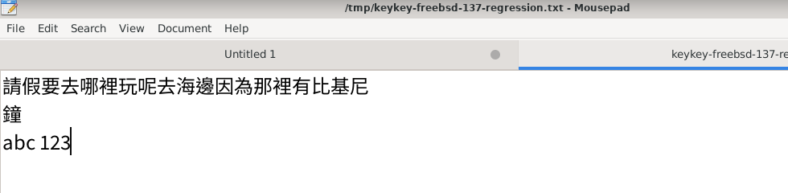

*實際儲存檔的三行文字與預期完全一致，第一行為完整 19 字，沒有漏字或重複字。*

## 8. 確認關於與設定工具

從琦琦設定的「關於琦琦輸入法」開啟關於視窗，也可執行：

```sh
keykey-about
```

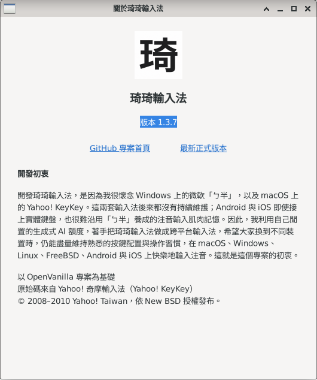

*版本為 1.3.7，圖示、中文開發初衷與專案連結均可見。*

### 倉頡：只輸入「竹大」，提前選「喬」

從注音設定內點 **開啟倉頡設定…**，開啟 **即時候選**與 **未打完也能選字**。桌面版預設關閉，即時候選與錯碼清除互斥；改好依提示儲存。

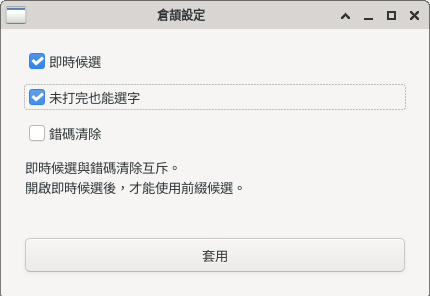

回 Mousepad，從 Fcitx 選 **Cangjie**，只輸入 H、K，也就是 **竹、大**，查看包含 **喬**的候選。想選喬時按實際編號或點選，不必先打完「竹大口月口」。

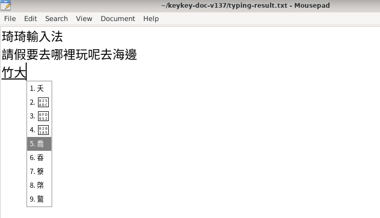

本次第 5 項是「喬」，第 2～4 項的罕字顯示缺字框，截圖保留真實狀態。選取喬後已確認並儲存；實際檔案的兩行注音示範與第三行「喬」均核對一致。拍攝後已還原原有倉頡設定。

更新通知只提醒有新版，FreeBSD 仍透過 ports／pkg 更新，套件可能較晚上架。

## 常見環境問題

### GTK 3 bridge 回報 GLib 太舊

若安裝 GTK 3 bridge 時回報 `GLib version too old (micro mismatch)`，使用 root 先預覽更新範圍，確認適合後才執行：

```sh
pkg install -n glib
pkg install -y glib
pkg install -y -f fcitx5-gtk3
```

更新完成後重新安裝 bridge，確認 GTK 模組註冊成功，再登出並登入。此步驟用於處理特定相依版本不相容。

### 一般帳號不能使用 su

由管理者登入 root 後，將要授權的帳號加入 wheel，保留既有成員：

```sh
pw groupmod wheel -m YOUR_USER
id YOUR_USER
```

將 `YOUR_USER` 替換成要授權的帳號；確認群組包含 `0(wheel)`，再重新登入該帳號。密碼由帳號持有人自行輸入。


### 移除或更新輸入法

移除系統套件時執行：

```sh
su -
pkg delete zh-fcitx5-keykey
exit
```

一般帳號的設定與學習資料仍會保留。日後更新可重新走 ports 流程，或在套件庫提供需要的版本後透過 pkg 更新；先查看安裝計畫，確認版號。

## 圖片來源與驗證範圍

2026-10-24 新增 20 張實拍，環境為 FreeBSD 15.1-RELEASE-p3 amd64、Xfce／X11（xfce4-session 4.20.4）、LightDM、Fcitx 5 與 Mousepad 0.7.0／GTK 3，已安裝琦琦 1.3.7。涵蓋套件庫刷新與查詢、ports 來源、既有安裝版號、橋接、字型、重新登入、自動啟動、Fcitx 清單、設定、面板選用、指定兩行與玩候選、倉頡竹大／喬及關於視窗。只裁切真實畫面，未修改產品畫面內容。

19 字長句結果圖保留先前的 1.3.7 驗證；本輪未重跑該長句、ports 建置或套件安裝。套件庫刷新及版本查詢由管理員手動驗證後執行，完成便退出 root；本輪沒有變更套件庫分支、升級或降級套件。

## 參考

- [FreshPorts：chinese/fcitx5-keykey](https://www.freshports.org/chinese/fcitx5-keykey/)
- [FreeBSD Handbook：Packages and Ports](https://docs.freebsd.org/en/books/handbook/ports/)
- [官方 ports 原始碼](https://cgit.freebsd.org/ports/tree/chinese/fcitx5-keykey)
- [Linux／FreeBSD frontend](Source/Loaders/Linux-IME/README.md)
- [更新通知與 ports 整合](Source/Loaders/Linux-IME/docs/update-notifications.md)
- [實體鍵盤固定回歸句](docs/SMART_MANDARIN_PHYSICAL_KEYBOARD_HANDOFF.md)
- 圖文編排參考：[琦琦注音介紹與使用教學](https://free.com.tw/chichi-keykey/)；本頁步驟與圖片皆依 FreeBSD 實際操作製作。
