# Linux／Ubuntu 安裝與使用指南

想在 Ubuntu 輸入中文，可以安裝琦琦輸入法 **1.3.7**，透過 Fcitx 5 使用好打注音、傳統注音、倉頡與簡易。完成套件安裝後，還要啟用 Fcitx、加入琦琦，再回文字 App 試打。

本頁帶你依序完成 **下載五檔 → 校驗安裝 → 啟用並重啟 → 加入琦琦 → 第一次選字**。自行編譯另見 [Linux `./configure` 編譯安裝指南](LINUX_CONFIGURE_INSTALL.md)。

## 安裝前確認

本版的 Linux 安裝步驟適用於 **Ubuntu Desktop 24.04 LTS、GNOME Shell 46、Fcitx 5、amd64**。在「設定 → 關於」確認 Ubuntu 版本，並執行 `dpkg --print-architecture`，結果應為 `amd64`。安裝需要管理員密碼，設定完成後需要重新啟動 Ubuntu。其他 Ubuntu 版本、ARM64、IBus 與其他桌面環境尚未列入這份指南的驗證範圍。

## 1. 下載最新正式版套件

開啟 [琦琦輸入法最新正式版下載頁](https://github.com/polobread/KeyKey/releases/latest)，展開 **Assets**，將下列五個檔案下載到同一個資料夾，例如 `~/Downloads/keykey-v1.3.7`。下方檔名、CDN 連結及安裝指令以 **1.3.7** 示範；下載其他正式版本時，請以頁面當次檔名為準，並調整指令中的目錄與檔名。五檔必須來自同一發布版本，才能一起校驗。

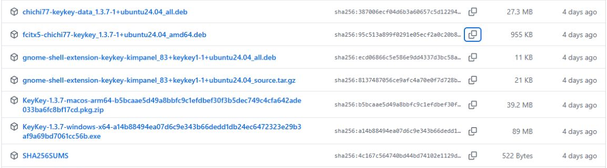

上圖是未登入 GitHub 的正式版 Assets 局部；下載三個 `.deb`、面板 `source.tar.gz` 與 `SHA256SUMS`，略過其他平台的檔案。


| 檔案（台灣 AWS CDN 下載） | 用途 |
| --- | --- |
| [chichi77-keykey-data_1.3.7-1+ubuntu24.04_all.deb](https://download.aws.polobread.com/keykey/releases/download/v1.3.7/chichi77-keykey-data_1.3.7-1%2Bubuntu24.04_all.deb) | 注音、詞庫與語言模型資料 |
| [fcitx5-chichi77-keykey_1.3.7-1+ubuntu24.04_amd64.deb](https://download.aws.polobread.com/keykey/releases/download/v1.3.7/fcitx5-chichi77-keykey_1.3.7-1%2Bubuntu24.04_amd64.deb) | Fcitx 5 輸入法與好打注音 |
| [gnome-shell-extension-keykey-kimpanel_83+keykey1-1+ubuntu24.04_all.deb](https://download.aws.polobread.com/keykey/releases/download/v1.3.7/gnome-shell-extension-keykey-kimpanel_83%2Bkeykey1-1%2Bubuntu24.04_all.deb) | GNOME 候選字面板 |
| [gnome-shell-extension-keykey-kimpanel_83+keykey1-1+ubuntu24.04_source.tar.gz](https://download.aws.polobread.com/keykey/releases/download/v1.3.7/gnome-shell-extension-keykey-kimpanel_83%2Bkeykey1-1%2Bubuntu24.04_source.tar.gz) | 面板對應原始碼；只需校驗，不須安裝 |
| [SHA256SUMS](https://download.aws.polobread.com/keykey/releases/download/v1.3.7/SHA256SUMS) | 上述四個檔案的校驗值 |

也可從發布頁的 **台灣 AWS 下載點**或上表連結下載，不需要登入 GitHub。AWS CDN 與 GitHub Assets 的同名檔案內容相同，任選一個來源下載完整五檔；接著仍須依下一節核對 `SHA256SUMS`。

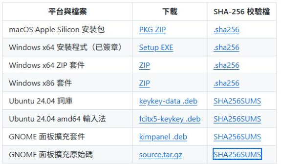

Ubuntu 的四個下載項目共用同一份 `SHA256SUMS`，合計仍是五個檔案。

面板套件沿用獨立的 `83+keykey1` 版號。請下載此頁的 Linux Assets；GitHub 自動產生的 **Source code** 壓縮檔不是 `.deb` 安裝包。

## 2. 校驗並安裝

在下載資料夾開啟終端機。若使用上面的範例路徑，執行：

```sh
cd ~/Downloads/keykey-v1.3.7
sha256sum -c SHA256SUMS
```

四個檔案都顯示 `OK` 後再安裝。若資料夾不同，將 `cd` 改成實際路徑；若顯示 `FAILED`，重新下載對應檔案。

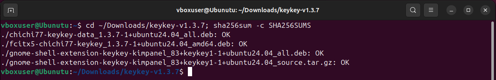

四個檔名後方都顯示 `OK`，再接續安裝。

接著安裝三個 .deb 與需要的輸入橋接套件：

```sh
sudo apt install \
  ./chichi77-keykey-data_1.3.7-1+ubuntu24.04_all.deb \
  ./fcitx5-chichi77-keykey_1.3.7-1+ubuntu24.04_amd64.deb \
  ./gnome-shell-extension-keykey-kimpanel_83+keykey1-1+ubuntu24.04_all.deb \
  fcitx5-frontend-gtk3 fcitx5-frontend-gtk4 fcitx5-frontend-qt6 \
  fcitx5-config-qt im-config
```

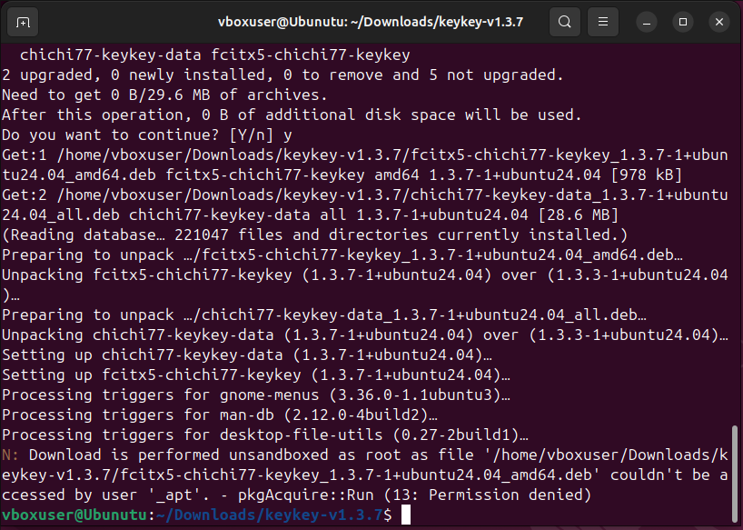

本機是從 1.3.3 升級至 1.3.7，GNOME 面板套件原先已安裝；新安裝仍使用上方三個 `.deb` 的完整指令。畫面末尾的 `N:` 是讀取使用者目錄內本機套件時的 `_apt` 提示；兩個套件已完成 `Setting up` 並返回提示符，面板狀態則在下一節確認。

**不必另外安裝 SQLite。** 輸入法套件依賴執行期的 `libsqlite3-0`，上面的 `apt install` 會一併處理。`libsqlite3-dev` 只供[從原始碼編譯](LINUX_CONFIGURE_INSTALL.md)使用；一般安裝 `.deb` 不需要它，也不需要 `sqlite3` 命令列程式。

## 3. 啟用 Fcitx 5 與 GNOME 候選面板

執行 `im-config`，在圖形精靈選 **fcitx5**，依提示儲存。

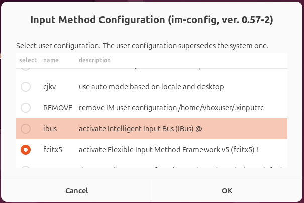

以 **fcitx5 左側的實心圓鈕**判斷選取狀態；上圖已選 fcitx5，橘色列背景不是框架啟用指示。

儲存手邊文件後**重新啟動 Ubuntu**，再登入同一個帳號。重新啟動可讓新開啟的 App 取得 Fcitx 的登入環境；只關閉終端機不會套用設定。Fcitx 的 [Ubuntu 設定說明](https://fcitx-im.org/wiki/Setup_Fcitx_5)也使用 `im-config`。

重新登入後執行：

```sh
keykey-gnome-panel enable
keykey-gnome-panel status
```

`status` 顯示 `State: ACTIVE` 表示面板已啟用。若啟用後仍看不到候選窗，再登出並登入一次。

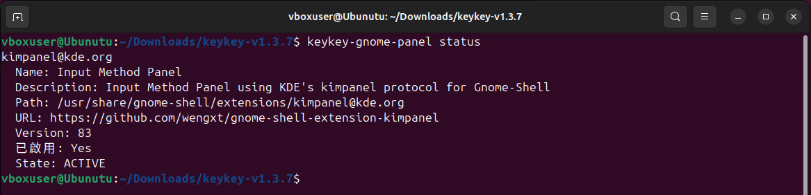

上圖為 Ubuntu 24.04.5／GNOME 46 的 Wayland 工作階段，重啟並登入後面板仍為 `ACTIVE`。


## 4. 加入琦琦注音並設定模式

從「顯示應用程式」開啟 **Fcitx 5 Configuration**，或執行 `fcitx5-config-qt`。在「輸入法」頁取消 **Only Show Current Language／只顯示目前語言**，搜尋 **KeyKey**，將 **chichi77 KeyKey Bopomofo** 加入目前使用清單。

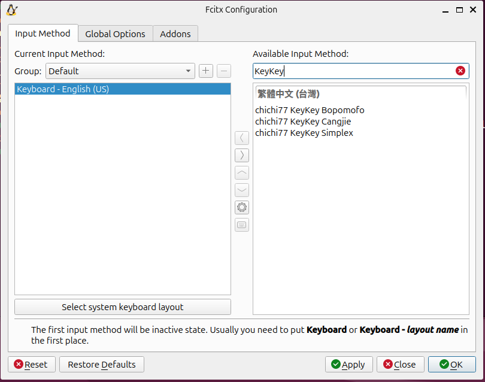

選取右側的 Bopomofo，再按中間的 **←** 加入。搜尋時這版工具會隱藏語言篩選列；先清空搜尋欄即可找到該選項。

加入後，確認左側清單出現 Bopomofo。若也要用倉頡或簡易，再分別加入 **chichi77 KeyKey Cangjie**、**chichi77 KeyKey Simplex**；保留英文鍵盤供切換。

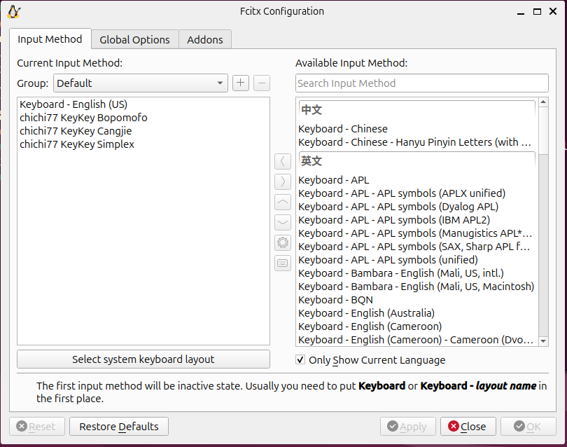

左側出現項目表示已加入；已加入的項目不會重複出現在右側可用清單。完成後按 **Apply／套用**儲存。

選取清單中的 Bopomofo，開啟設定。**「注音模式」預設為「好打注音」**，可在此改成「傳統注音」。第一次使用可先保留 **標準（Standard）** 鍵盤配置和 **直式（Vertical）** 候選；習慣倚天、倚天 26 鍵、許氏或漢語拼音時，再切換鍵盤布局。此頁也可調整繁轉簡、Big-5 範圍外候選、打字錯誤提示音、中英文快捷鍵和關聯詞庫。

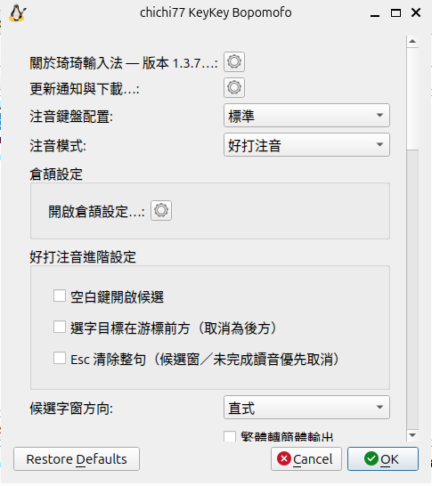

本機使用 **標準、好打注音、直式**；下方另有好打注音進階設定。這是升級後保留的設定畫面。

## 5. 試打與基本操作

開啟 **文字編輯器（琦琦注音）**，新增空白文件並點選文字區。此啟動器讓 GNOME 文字編輯器使用 Fcitx 的輸入路徑；若找不到，先確認已安裝 GNOME 文字編輯器，也可在其他一般文字欄位試打。

從桌面右上角的 Fcitx 選單選 **chichi77 KeyKey Bopomofo**。按 **Ctrl + Space** 可以在 Fcitx 的英文鍵盤和琦琦注音間切換；快捷鍵若已自行更改，以 Fcitx 5 Configuration 的「全域選項」為準。

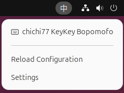

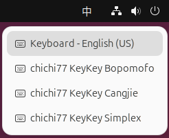

第一張顯示目前使用 Bopomofo；點選名稱可展開第二張的切換清單。第二張的英文列只是滑鼠停留位置。兩張均為 GNOME Wayland 實拍。

### 輸入兩行文字，保留組字

先輸入「**琦琦輸入法**」，按 Enter 確認，再按 Enter 換行。第二行輸入「**請假要去哪裡玩呢去海邊**」，先不按 Enter。一聲讀音以空白完成，其他聲調用聲調鍵；有底線的部分仍可回頭改字。


第一行已確認；第二行的「請假」已先固定，其餘仍有黑色組字底線，尚未確認整句。

### 在「玩」開候選，選字後回句尾

用方向鍵移動組字游標，按 **↓** 開候選，再確認反白目標為「玩」。選字目標預設在游標後方；若已開啟「選字目標在游標前方」，請依實際反白位置操作。支援組字點擊的 App 也可點字開候選。

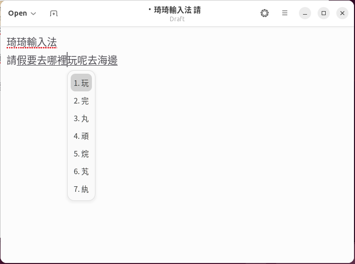

本機的「玩」為第 **1** 項，順位會隨詞庫、上下文與學習紀錄改變。

按候選編號或點選 **玩**，再按 **End** 回到組字末端。本例只保留「請假要去哪裡玩呢去海邊」，不追加文字。候選窗開著時 Enter 是選字；關閉後再按 Enter，才會確認整段。

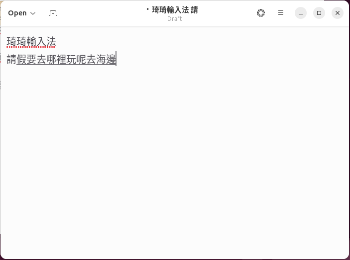

本機選字後游標停在「玩」後方；上圖已按 End 回句尾，尚未送出整段。

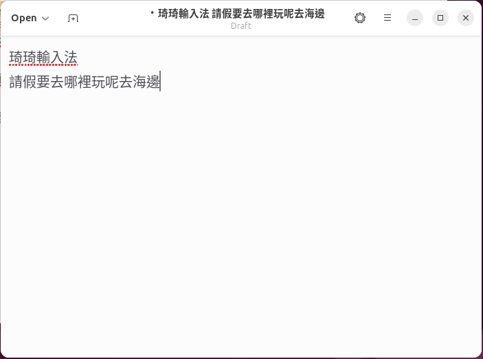

按 Enter 後，兩行文字保留，黑色組字底線消失；紅色虛線是文字編輯器的拼字檢查。

**Backspace／Delete** 可修正目前組字位置的讀音或文字；**Esc** 可先關閉候選或取消未完成讀音。

桌面好打注音保留最多十個已完成音節；第十一個音節完成時，最前方完整詞段會先固定，其餘仍可組字。已固定的前段要用文字 App 自己的編輯功能修改。

### 傳統注音

在 Fcitx 的 Bopomofo 設定頁把「注音模式」改成 **傳統注音**。傳統注音以逐字選字為主：輸入完整讀音和聲調後顯示候選；第一聲讀音可按 **Space** 開啟候選，再按候選編號或用滑鼠選字。選字後若出現關聯詞，可按 **Shift + 1–9** 選取對應詞，也可直接開始輸入下一個字。

### 倉頡打到「竹大」，就能提前選「喬」

從琦琦設定開啟 **倉頡設定…**，勾選 **即時候選**及 **未打完也能選字**，依視窗提示儲存。桌面版這兩項預設關閉，即時候選與錯碼清除互斥。

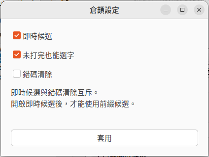

上圖兩項均已開啟，錯碼清除關閉；這是本機原有設定，不代表全新安裝預設值。

回文字編輯器，從 Fcitx 清單選 **Cangjie**，只輸入 H、K，也就是 **竹、大**，從候選找 **喬**。不必先輸入完整「竹大口月口」，按實際候選編號即可選字。

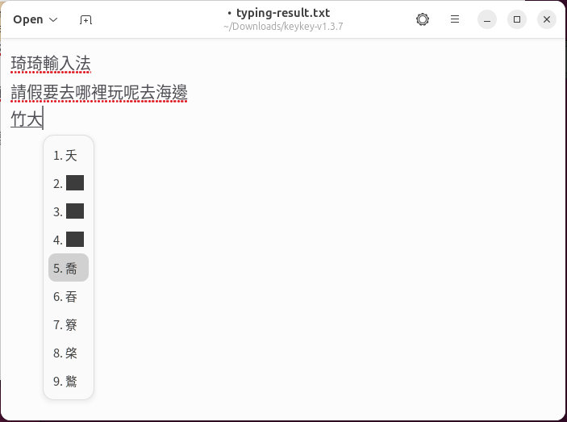

本機只打 H、K，「喬」為第 **5** 項，選取後已核對輸出確為「喬」。第 2～4 項罕字在這台 VM 顯示為方框，圖片保留實際呈現。

### 常用按鍵

| 按鍵 | 用法 |
| --- | --- |
| **Ctrl + Space** | 切換 Fcitx 的英文鍵盤與琦琦注音。 |
| `Ctrl + \` 或短按 **Shift** | 已選琦琦注音時，切換其中文／英文模式；`Ctrl + \` 可在設定中關閉。 |
| **Shift + Space** | 切換半形與全形。 |
| **↓** | 好打注音組字時，開啟目前選字目標的候選。 |
| **1–9**、滑鼠或方向鍵後按 **Enter** | 選取候選字；選字後可繼續組字。 |
| 候選窗中的 **Space／Page Down**、**Page Up** | 候選有多頁時翻頁。 |
| **Enter** | 候選窗開啟時選字；好打注音沒有候選窗時送出整段組字。 |
| **Ctrl + 0** | 開啟符號候選清單。 |

已選琦琦注音卻仍直接輸出英文字母時，按 `Ctrl + \` 或短按 **Shift** 切回中文；這和 **Ctrl + Space** 切換 Fcitx 輸入法是兩種不同操作。

好打注音會在目前 Linux 使用者的資料目錄保存自訂詞和選字學習紀錄。進階使用者可用 `keykey-smart-phrases list` 查看自訂詞，或執行 `man keykey-smart-phrases` 查看新增、移除與重設學習紀錄的指令。

## 日常設定與已知情況

「好打注音進階設定」可調整 **空白鍵開啟候選**、選字目標在游標前／後，以及 **Esc 清除整句**。空白開候選與 Esc 清除整句預設關閉；未啟用空白選字時仍可按 ↓ 開候選。

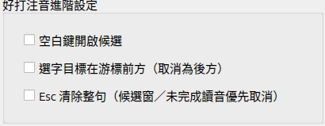

本機三項均未勾選，選字目標為游標後方；此圖為前述注音設定頁的局部。

在不同 App 或桌面 session 的鍵盤操作相同，但輸入橋接與候選窗位置可能不同。請先用上述文字編輯器主線試打，再比較其他 App。

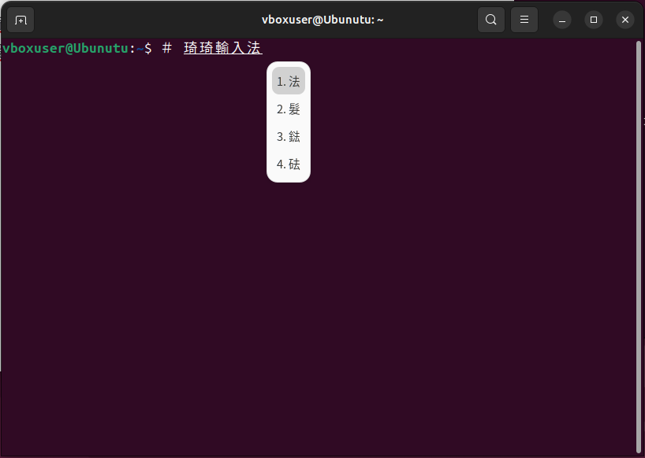

另一宿主為 **GNOME Terminal 3.52.0／GTK 3／Wayland**，使用登入環境的 `GTK_IM_MODULE=fcitx`。圖中「琦琦輸入法」仍在組字，「法」候選第 1 項反白；`#` 是終端機註解前綴。此畫面不代替其他 App 或 X11 的驗證。


- 在 Fcitx 5 Configuration 的 Bopomofo 設定頁可切換好打／傳統注音、五種鍵盤布局、直／橫式候選、繁轉簡與關聯詞庫。候選窗字體和外觀也受 Fcitx／GNOME 主題影響。
- GNOME 文字編輯器 46 的一般啟動方式，在某些 Wayland 輸入路徑可能無法啟用 Fcitx；可改用套件附的 **文字編輯器（琦琦注音）** 啟動器。其他 GTK App 遇到相同情況時，可用 `keykey-fcitx-app 程式名稱` 啟動。
- 切換輸入法或中英文模式時，好打注音會先完成可辨識的讀音並送出目前的組字文字。尚未完成的讀音會以原始按鍵保留。
- 實體雙螢幕、熱插拔、所有 GNOME 主題與所有 App 尚未逐一驗證；若遇到問題，請記下環境與重現步驟。

## 遇到問題時

| 情況 | 先檢查 |
| --- | --- |
| `sha256sum` 顯示 `FAILED` | 停止安裝，確認五個檔案都來自同一版正式發布頁，重新下載失敗的檔案。 |
| Fcitx 清單找不到琦琦注音 | 確認三個 `.deb` 已安裝、取消語言篩選，重新登入後再開設定工具。 |
| 找得到輸入法，但打字只有英文 | 確認選到 Bopomofo，按 `Ctrl + \` 切回中文；第一聲讀音後按 **Space** 完成音節。 |
| 只有「文字編輯器（琦琦注音）」可用，Firefox 或終端機只輸出英文 | 重新啟動 Ubuntu 後再開啟這些 App。執行 `printenv GTK_IM_MODULE QT_IM_MODULE XMODIFIERS`，三行應依序為 `fcitx`、`fcitx`、`@im=fcitx`；若仍是 `ibus`，重新執行 `im-config` 選 **fcitx5** 並重啟。 |
| 候選窗位置或滑鼠操作異常 | 執行 `keykey-gnome-panel status`，確認 `State: ACTIVE`；若曾自行安裝同名 GNOME 擴充，檢查是否存在重複版本。 |
| 只有 GNOME 文字編輯器無法輸入 | 用 **文字編輯器（琦琦注音）** 啟動器重試，並到其他文字欄位比較。 |

仍無法使用時，請記下 Ubuntu 版本、`dpkg --print-architecture` 的輸出、安裝檔名、`keykey-gnome-panel status` 的結果，以及無法輸入的 App 和文字欄位。

## 移除

先在 Fcitx 5 Configuration 的目前使用清單移除琦琦注音，再執行：

```sh
keykey-gnome-panel disable
sudo apt remove fcitx5-chichi77-keykey chichi77-keykey-data \
  gnome-shell-extension-keykey-kimpanel
```

登出並重新登入後，GNOME 會重新載入擴充狀態。這不會刪除其他 Fcitx 輸入法或 Fcitx 個人設定。

## 圖片與適用範圍

本輪於 **2026-10-24** 在 VirtualBox 的 **Ubuntu 24.04.5 LTS／GNOME Shell 46.0／Wayland／amd64** 實拍，使用 AWS CDN 的正式 1.3.7 套件；四個檔案均通過 `SHA256SUMS`。既有 1.3.3 已升級至 1.3.7，重新啟動並登入後核對套件版號、關於頁及 GNOME 面板 `ACTIVE`。

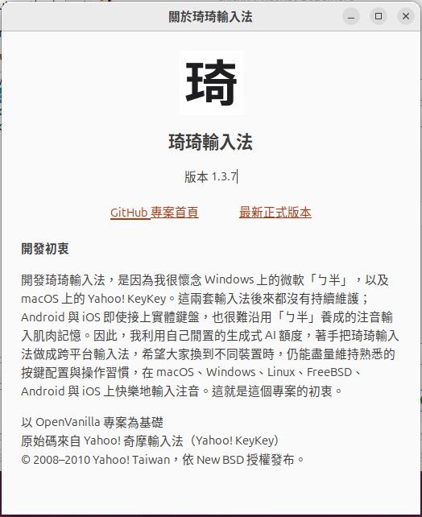

主線宿主為 **GNOME Text Editor 46.3／GTK 4.14.5**，經 `keykey-fcitx-app` 使用直接 Fcitx 輸入路徑；另拍 GNOME Terminal 的 GTK 3 路徑。兩行文字與倉頡「喬」均以實際按鍵輸入，並從儲存檔核對內容，沒有貼上文字模擬組字。18 個補圖位置已補齊，共引用 20 張圖片，含設定局部與版本核對圖。

本輪沒有拍攝全新安裝或 X11，也沒有重跑完整發布矩陣；圖片只記錄上述 VM 與宿主的操作。原本 1.3.0 圖片未作為新版證據，完整來源見[跨平台截圖計畫](docs/CROSS_PLATFORM_SCREENSHOT_PLAN.md)。
