# Linux／Ubuntu 安裝與使用指南

琦琦輸入法 **1.5.1** 在 Ubuntu 透過 Fcitx 5 提供好打注音、傳統注音、倉頡與簡易。完成套件安裝後，啟用 Fcitx、加入琦琦，再開啟文字 App 試打。

本頁帶你依序完成 **下載五檔 → 校驗安裝 → 啟用並重啟 → 加入琦琦 → 第一次選字**。下載與安裝以 1.5.1 套件為例；另附 [1.5.2 設定導覽](#新版原始碼設定導覽152)，說明新版 Guanyinma（Rust）核心的設定與「省略聲調」。自行編譯另見 [Linux `./configure` 編譯安裝指南](LINUX_CONFIGURE_INSTALL.md)。

## 新核心升級準備

自 1.5.0 起使用 Guanyinma（觀音嬤）共用核心，補齊桌面偏好及圖形自訂詞／學習管理，提供完整 Guanyinma JSON 備份與匯入。使用者資料改用 `guanyinma-user.db`。舊 C++ 詞庫保留原檔，升級前請先備份。各平台驗收進度另見 [1.5.1 發布準備](docs/CROSS_PLATFORM_V1_5_1_RELEASE.md)。

## 安裝前確認

本版的 Linux 安裝步驟適用於 **Ubuntu Desktop 24.04 LTS、GNOME Shell 46、Fcitx 5、amd64**。在「設定 → 關於」確認 Ubuntu 版本，並執行 `dpkg --print-architecture`，結果應為 `amd64`。安裝需要管理員密碼，設定完成後需要重新啟動 Ubuntu。其他 Ubuntu 版本、ARM64、IBus 與其他桌面環境尚未列入這份指南的驗證範圍。

## 1. 取得 1.5.1 套件

手上已有本機建置的 1.5.1 安裝包時，將三個 `.deb`、面板原始碼壓縮檔及對應的 `SHA256SUMS` 放在同一資料夾，再進行下一節的校驗。正式資產上傳後，可從 [1.5.1 發布頁](https://github.com/polobread/KeyKey/releases/tag/v1.5.1) 的 **Assets** 或下表的台灣 AWS 下載點取得同一組檔案。等待 1.5.1 上線期間，正式版可從 [1.5.0 發布頁](https://github.com/polobread/KeyKey/releases/tag/v1.5.0) 取得。


| 檔案（台灣 AWS CDN 下載） | 用途 |
| --- | --- |
| [chichi77-keykey-data_1.5.1-1+ubuntu24.04_all.deb](https://download.aws.polobread.com/keykey/releases/download/v1.5.1/chichi77-keykey-data_1.5.1-1%2Bubuntu24.04_all.deb) | 注音、詞庫與語言模型資料 |
| [fcitx5-chichi77-keykey_1.5.1-1+ubuntu24.04_amd64.deb](https://download.aws.polobread.com/keykey/releases/download/v1.5.1/fcitx5-chichi77-keykey_1.5.1-1%2Bubuntu24.04_amd64.deb) | Fcitx 5 輸入法與好打注音 |
| [gnome-shell-extension-keykey-kimpanel_83+keykey1-1+ubuntu24.04_all.deb](https://download.aws.polobread.com/keykey/releases/download/v1.5.1/gnome-shell-extension-keykey-kimpanel_83%2Bkeykey1-1%2Bubuntu24.04_all.deb) | GNOME 候選字面板 |
| [gnome-shell-extension-keykey-kimpanel_83+keykey1-1+ubuntu24.04_source.tar.gz](https://download.aws.polobread.com/keykey/releases/download/v1.5.1/gnome-shell-extension-keykey-kimpanel_83%2Bkeykey1-1%2Bubuntu24.04_source.tar.gz) | 面板對應原始碼；只需校驗，不須安裝 |
| [SHA256SUMS](https://download.aws.polobread.com/keykey/releases/download/v1.5.1/SHA256SUMS) | 上述四個檔案的校驗值 |

同一組套件共用一份 `SHA256SUMS`。面板沿用獨立版號 `83+keykey1`。請選用 Linux 專用 Assets 內的三個 `.deb`。

## 2. 校驗並安裝

在下載資料夾開啟終端機。若使用上面的範例路徑，執行：

```sh
cd ~/Downloads/keykey-v1.5.1
sha256sum -c SHA256SUMS
```

四個檔案都顯示 `OK` 後再安裝。若資料夾不同，將 `cd` 改成實際路徑；若顯示 `FAILED`，重新下載對應檔案。

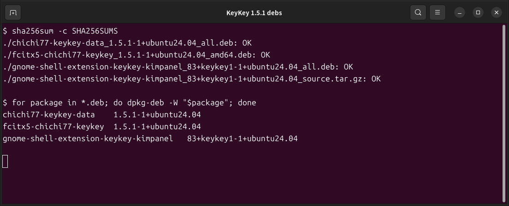

接著安裝三個 .deb 與需要的輸入橋接套件：

```sh
sudo apt install \
  ./chichi77-keykey-data_1.5.1-1+ubuntu24.04_all.deb \
  ./fcitx5-chichi77-keykey_1.5.1-1+ubuntu24.04_amd64.deb \
  ./gnome-shell-extension-keykey-kimpanel_83+keykey1-1+ubuntu24.04_all.deb \
  fcitx5-frontend-gtk3 fcitx5-frontend-gtk4 fcitx5-frontend-qt6 \
  fcitx5-config-qt im-config
```

安裝後執行 `dpkg-query -W chichi77-keykey-data fcitx5-chichi77-keykey gnome-shell-extension-keykey-kimpanel`。前兩個套件應顯示 `1.5.1-1+ubuntu24.04`，面板應顯示 `83+keykey1-1+ubuntu24.04`。也可從應用程式選單開啟琦琦輸入法的關於頁，確認顯示 **1.5.1**。

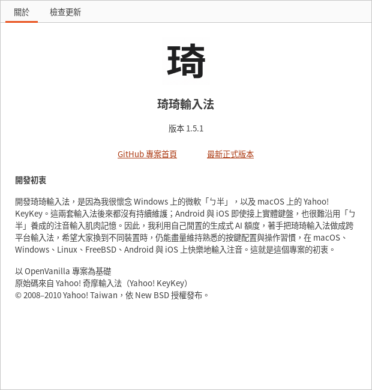

**不必另外安裝 SQLite。** 輸入法套件依賴執行期的 `libsqlite3-0`，上面的 `apt install` 會一併處理。`libsqlite3-dev` 只供[從原始碼編譯](LINUX_CONFIGURE_INSTALL.md)使用；一般安裝 `.deb` 不需要它，也不需要 `sqlite3` 命令列程式。

## 3. 啟用 Fcitx 5 與 GNOME 候選面板

執行 `im-config`，在圖形精靈選 **fcitx5**，依提示儲存。

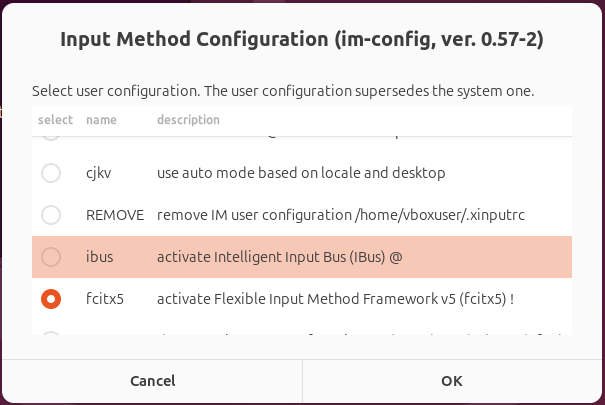

以 **fcitx5 左側的實心圓鈕**判斷選取狀態；上圖已選 fcitx5，橘色列背景不是框架啟用指示。

儲存手邊文件後**重新啟動 Ubuntu**，再登入同一個帳號。重新啟動可讓新開啟的 App 取得 Fcitx 的登入環境；只關閉終端機不會套用設定。Fcitx 的 [Ubuntu 設定說明](https://fcitx-im.org/wiki/Setup_Fcitx_5)也使用 `im-config`。

重新登入後執行：

```sh
keykey-gnome-panel enable
keykey-gnome-panel status
```

`status` 顯示 `State: ACTIVE` 表示面板已啟用。若啟用後仍看不到候選窗，再登出並登入一次。

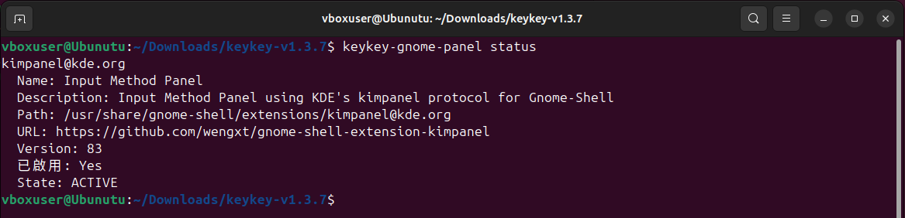

上圖為 Ubuntu 24.04.5／GNOME 46 的 Wayland 工作階段，重啟並登入後面板仍為 `ACTIVE`。


## 4. 加入琦琦注音並設定模式

從「顯示應用程式」開啟 **Fcitx 5 Configuration**，或執行 `fcitx5-config-qt`。在「輸入法」頁取消 **Only Show Current Language／只顯示目前語言**。繁體中文介面搜尋 **琦琦**，英文介面搜尋 **KeyKey**，將 **琦琦注音（chichi77 KeyKey Bopomofo）** 加入目前使用清單。

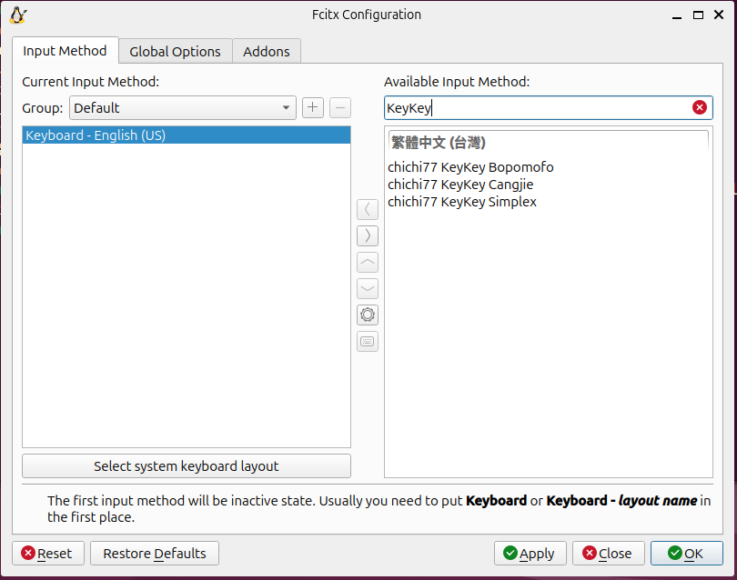

選取右側的 Bopomofo，再按中間的 **←** 加入。搜尋時這版工具會隱藏語言篩選列；先清空搜尋欄即可找到該選項。

加入後，確認左側清單出現 **琦琦注音**。若也要用倉頡或簡易，再分別加入 **琦琦倉頡**、**琦琦簡易**，並保留英文鍵盤供切換。

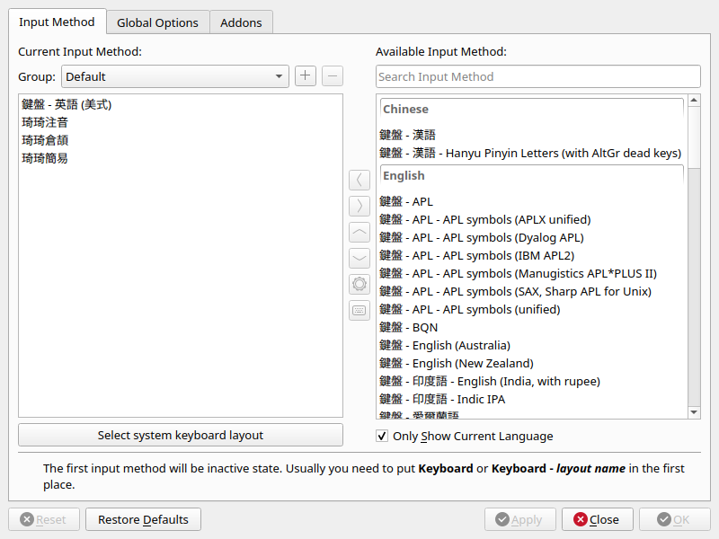

左側出現項目表示已加入；已加入的項目不會重複出現在右側可用清單。完成後按 **Apply／套用**儲存。

選取清單中的 Bopomofo，開啟設定。**「注音模式」預設為「好打注音」**，可在此改成「傳統注音」。第一次使用可先保留 **標準（Standard）** 鍵盤配置和 **直式（Vertical）** 候選；習慣倚天、倚天 26 鍵、許氏或漢語拼音時，再切換鍵盤布局。此頁也可調整繁轉簡、Big-5 範圍外候選、打字錯誤提示音、中英文快捷鍵和關聯詞庫。

新版 **1.5.2** 的設定依「一般、注音、倉頡、簡易、自訂詞、詞庫」分組，可向下捲動；視窗最上方可查看版本與檢查更新。

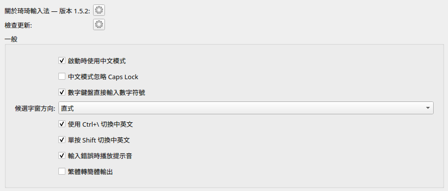

「中文模式忽略 Caps Lock」預設關閉；英文模式保留大小寫功能。候選字窗方向在此設定，字型與外觀由 Fcitx／GNOME 主題調整。

## 5. 試打與基本操作

開啟 **文字編輯器（琦琦注音）**，新增空白文件並點選文字區。此啟動器讓 GNOME 文字編輯器使用 Fcitx 的輸入路徑；若找不到，先確認已安裝 GNOME 文字編輯器，也可在其他一般文字欄位試打。

從桌面右上角的 Fcitx 選單選 **琦琦注音（chichi77 KeyKey Bopomofo）**。按 **Ctrl + Space** 可以在 Fcitx 的英文鍵盤和琦琦注音間切換。快捷鍵若已自行更改，以 Fcitx 5 Configuration 的「全域選項」為準。

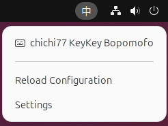

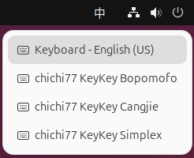

兩張切換圖取自 1.3.7 的 GNOME Wayland 工作階段。第一張顯示目前使用 Bopomofo，點選名稱可展開第二張的切換清單。

### 先試打「請假」

使用好打注音的標準鍵盤，依序按 `F U / 3 R U 8 4` 輸入「ㄑㄧㄥˇ ㄐㄧㄚˋ」。按 **↓** 可查看候選，再選「請假」並按 **Enter** 確認。


### 輸入兩行文字，保留組字

先輸入「**琦琦輸入法**」，按 Enter 確認，再按 Enter 換行。第二行輸入「**請假要去哪裡玩呢去海邊**」，先保留組字。一聲讀音以空白完成，其他聲調用聲調鍵。有底線的部分仍可回頭改字。以下長句流程圖取自 1.3.7 的 GNOME Wayland 工作階段。


第一行已確認；第二行的「請假」已先固定，其餘仍有黑色組字底線，尚未確認整句。

### 在「玩」開候選，選字後回句尾

用方向鍵移動組字游標，按 **↓** 開候選，再確認反白目標為「玩」。選字目標預設在游標後方；若已開啟「選字目標在游標前方」，請依實際反白位置操作。支援組字點擊的 App 也可點字開候選。

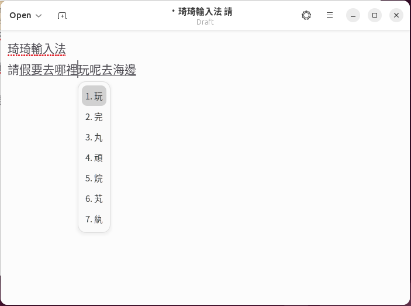

本機的「玩」為第 **1** 項，順位會隨詞庫、上下文與學習紀錄改變。

按候選編號或點選 **玩**，再按 **End** 回到組字末端。本例只保留「請假要去哪裡玩呢去海邊」，不追加文字。候選窗開著時 Enter 是選字；關閉後再按 Enter，才會確認整段。

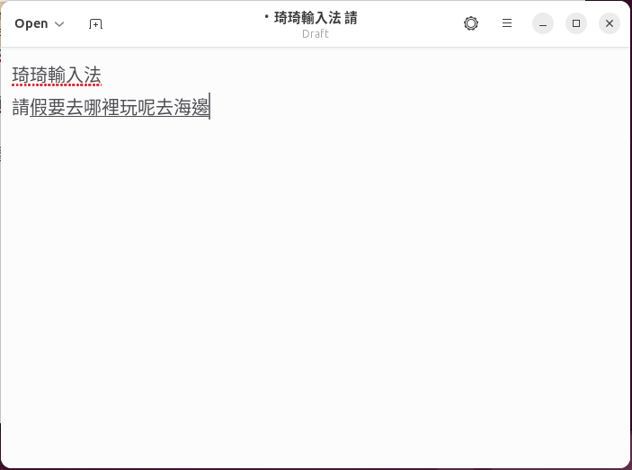

本機選字後游標停在「玩」後方；上圖已按 End 回句尾，尚未送出整段。

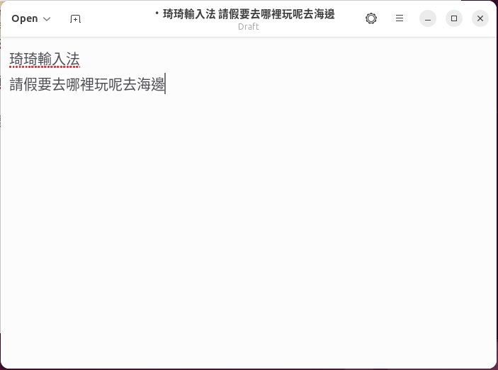

按 Enter 後，兩行文字保留，黑色組字底線消失；紅色虛線是文字編輯器的拼字檢查。

**Backspace／Delete** 可修正目前組字位置的讀音或文字；**Esc** 可先關閉候選或取消未完成讀音。

桌面好打注音保留最多十個已完成音節；第十一個音節完成時，最前方完整詞段會先固定，其餘仍可組字。已固定的前段要用文字 App 自己的編輯功能修改。

### 傳統注音

在 Fcitx 的 Bopomofo 設定頁把「注音模式」改成 **傳統注音**。傳統注音以逐字選字為主：輸入完整讀音和聲調後顯示候選；第一聲讀音可按 **Space** 開啟候選，再按候選編號或用滑鼠選字。選字後若出現關聯詞，可按 **Shift + 1–9** 選取對應詞，也可直接開始輸入下一個字。

### 倉頡打到「竹大」，就能提前選「喬」

從琦琦設定開啟 **倉頡設定…**，勾選 **即時候選**及 **未打完也能選字**，依視窗提示儲存。桌面版這兩項預設關閉，即時候選與錯碼清除互斥。

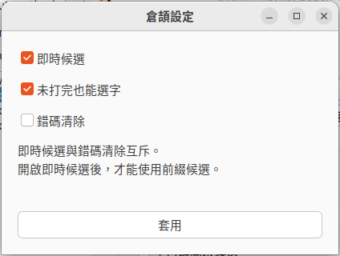

上圖保留正式 **1.3.7** 的獨立倉頡工具：兩項均已開啟，錯碼清除關閉，是本機原有設定。新版完整設定見下方[設定導覽](#倉頡與簡易進階設定)。

回文字編輯器，從 Fcitx 清單選 **Cangjie**，只輸入 H、K，也就是 **竹、大**，從候選找 **喬**。不必先輸入完整「竹大口月口」，按實際候選編號即可選字。

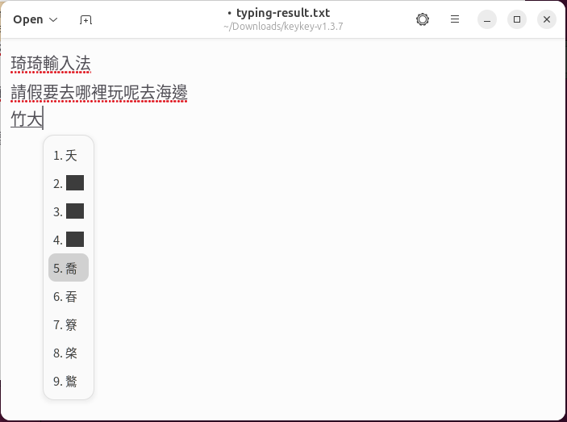

1.3.7 的實拍中，只打 H、K 時「喬」為第 **5** 項，選取後輸出「喬」。第 2～4 項罕字在當時的 VM 顯示為方框。

### 常用按鍵

| 按鍵 | 用法 |
| --- | --- |
| **Ctrl + Space** | 切換 Fcitx 的英文鍵盤與琦琦注音。 |
| `Ctrl + \` 或短按 **Shift** | 已選琦琦注音時，切換其中文／英文模式；`Ctrl + \` 可在設定中關閉。 |
| **Shift + Space** | 切換半形與全形。 |
| **↓** | 好打注音組字時，開啟目前選字目標的候選。 |
| **1–9**、滑鼠或方向鍵後按 **Enter** | 選取候選字；選字後可繼續組字。 |
| 候選窗中的 **Space／Page Down**、**Page Up** | 候選有多頁時翻頁。 |
| **Enter** | 候選窗開啟時選字；好打注音沒有候選窗時送出整段組字。 |
| **Ctrl + 0** | 開啟符號候選清單。 |

已選琦琦注音卻仍直接輸出英文字母時，按 `Ctrl + \` 或短按 **Shift** 切回中文；這和 **Ctrl + Space** 切換 Fcitx 輸入法是兩種不同操作。

好打注音會在目前 Linux 使用者的資料目錄保存自訂詞和選字學習紀錄。進階使用者可用 `keykey-smart-phrases list` 查看自訂詞，或執行 `man keykey-smart-phrases` 查看新增、移除與重設學習紀錄的指令。

## 日常設定與已知情況

「好打注音進階設定」可調整 **空白鍵開啟候選**、選字目標在游標前／後，以及 **Esc 清除整句**。1.5.2 新增 **省略聲調**，可連打讀音並自動分音節。這三個開關預設關閉；未啟用空白選字時仍可按 ↓ 開候選。啟用方式見下方[省略聲調說明](#省略聲調)。

在不同 App 或桌面 session 的鍵盤操作相同，但輸入橋接與候選窗位置可能不同。請先用上述文字編輯器主線試打，再比較其他 App。

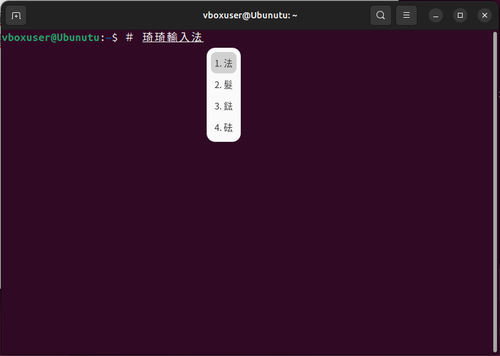

另一宿主為 **GNOME Terminal 3.52.0／GTK 3／Wayland**，使用登入環境的 `GTK_IM_MODULE=fcitx`。圖中「琦琦輸入法」仍在組字，「法」候選第 1 項反白；`#` 是終端機註解前綴。此畫面不代替其他 App 或 X11 的驗證。


- 在 Fcitx 5 Configuration 的 Bopomofo 設定頁可切換好打／傳統注音、五種鍵盤布局、直／橫式候選、繁轉簡與關聯詞庫。候選窗字體和外觀也受 Fcitx／GNOME 主題影響。
- GNOME 文字編輯器 46 的一般啟動方式，在某些 Wayland 輸入路徑可能無法啟用 Fcitx；可改用套件附的 **文字編輯器（琦琦注音）** 啟動器。其他 GTK App 遇到相同情況時，可用 `keykey-fcitx-app 程式名稱` 啟動。
- 切換輸入法或中英文模式時，好打注音會先完成可辨識的讀音並送出目前的組字文字。尚未完成的讀音會以原始按鍵保留。
- 實體雙螢幕、熱插拔、所有 GNOME 主題與所有 App 尚未逐一驗證；若遇到問題，請記下環境與重現步驟。

## 新版原始碼設定導覽（1.5.2）

以下為 **1.5.2** 的設定，共用 Guanyinma（Rust）核心。從 Fcitx 清單選琦琦輸入法並按設定齒輪，可在同一個長頁中調整各分組；改好後按 **OK／確定**或 **Apply／套用**儲存。若當下仍有組字，先完成或取消，再試新的設定。

### 一般設定

「一般」可設定啟動中／英文、中文模式的 Caps Lock 行為、數字鍵盤直接輸入、候選字窗方向、中英文切換快捷鍵、錯誤提示音與繁簡輸出。「中文模式忽略 Caps Lock」預設關閉，英文模式仍保留 Caps Lock 大小寫功能；候選窗字型與外觀由 Fcitx／桌面主題調整。

### 注音與好打組字

「注音」可切換好打／傳統模式、五種鍵盤配置、Big5 以外候選與傳統注音選字鍵。「好打注音進階設定」另有空白開候選、省略聲調、選字目標位置、**選字鍵**、**10～20 音節組字長度**、Esc 清句、選字後回句尾及 Shift 字母強制大寫，並分別控制上下文組句、記憶選字偏好與學習相鄰詞。

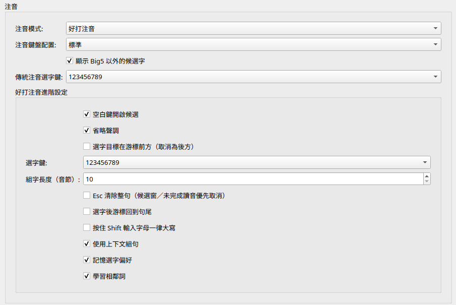

好打預設使用 `123456789` 九個選字鍵、十音節組字；也可改用八鍵或字母鍵。空白開候選、省略聲調、Esc 清整句、選字後回句尾與 Shift 強制大寫預設關閉，三個組句／學習選項預設開啟。上圖為省略聲調的示範設定。

#### 省略聲調

在「注音模式」選 **好打注音**，再於「好打注音進階設定」勾選 **省略聲調**。想用空白鍵選字時，一併勾選 **空白鍵開啟候選**，然後按 **OK／確定**或 **Apply／套用**儲存。

例如標準鍵盤可連打 `ㄋㄧㄏㄠ`（`sucl`）組出「你好」，按 **Enter** 確認整句；也可照常輸入聲調指定讀音，如 `ㄋㄧˇㄏㄠˇ`（`su3cl3`）。需要改字時按 **↓** 開候選，再用目前的選字鍵或滑鼠選擇。空白鍵依「空白鍵開啟候選」設定運作；仍有未完成讀音時，會先完成一聲音節。這個選項只影響好打注音，傳統注音仍照原本逐字輸入與選字。

### 倉頡與簡易進階設定

「倉頡」可調整滿碼查詢、動態詞頻、即時與前綴候選、錯碼清除、標點、選字鍵、最長字根數及空白鍵行為；通配字可設定為 `?`／`*`，留空停用。要打「竹大」提前選「喬」，仍須開啟 **即時候選**與 **未打完也能選字**。

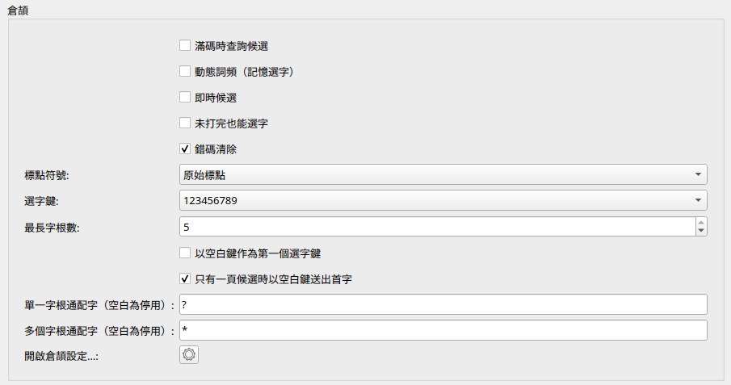

「簡易」也有獨立的選字鍵、動態詞頻、標點與空白鍵設定，最長字根數可設為一或二；不提供倉頡的前綴候選。兩種輸入法的預設不同，請分別確認。

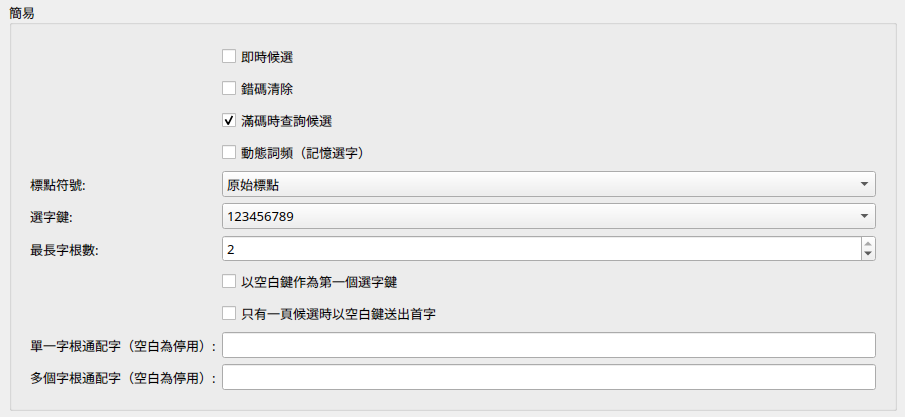

### 自訂詞與詞庫

「使用自訂詞庫」可控制自訂詞；按 **管理自訂詞與學習資料…**可新增、修改、刪除自訂詞，重設學習，或匯入／備份完整 Guanyinma JSON。「詞庫」分組可逐項開關 **小麥注音與 33 組分類**的關聯詞，包含常見名字、港澳用語、台灣用語及中國用語。

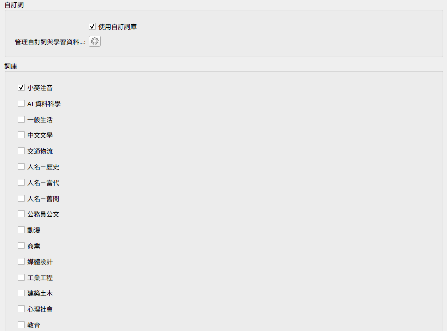

繼續向下捲動可看到詞庫尾端；這些開關控制關聯詞提示，與「使用自訂詞庫」及好打注音的學習開關分開設定。

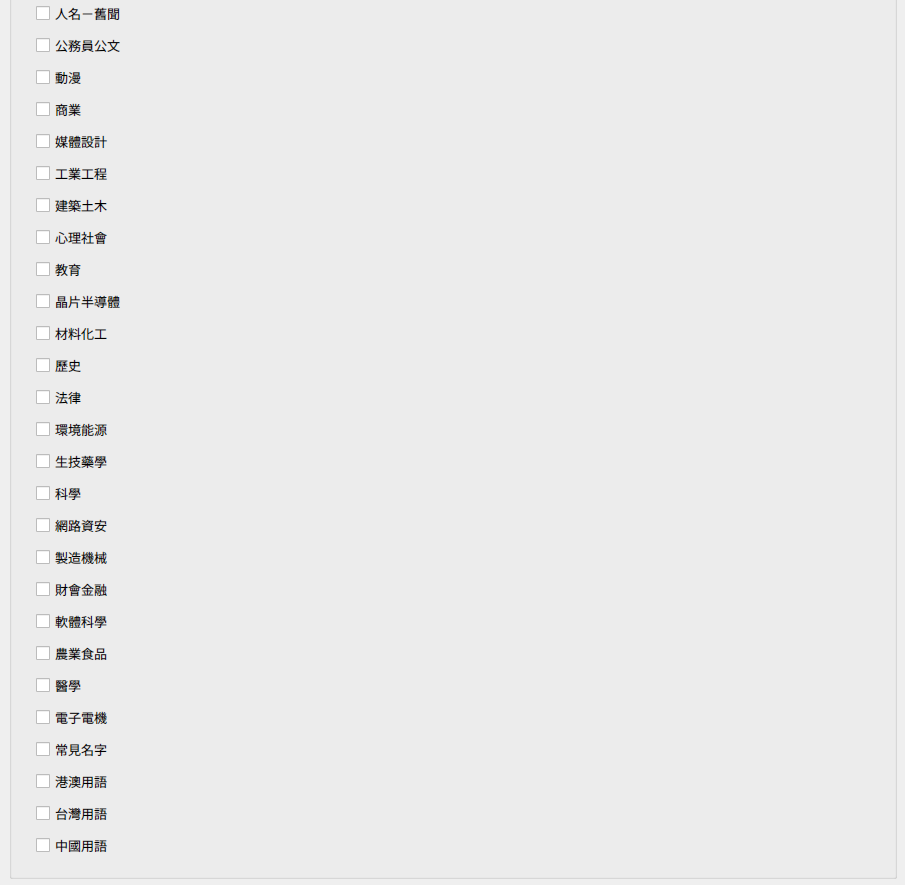

新版自訂詞與學習使用獨立的 `guanyinma-user.db`；舊 Linux 使用者資料不會自動匯入或刪除。完整設定及資料說明見 [Linux／FreeBSD Guanyinma 接合](docs/GUANYINMA_LINUX_ADAPTER.md)。

## 遇到問題時

| 情況 | 先檢查 |
| --- | --- |
| `sha256sum` 顯示 `FAILED` | 停止安裝，確認五個檔案都來自同一版正式發布頁，重新下載失敗的檔案。 |
| Fcitx 清單找不到琦琦注音 | 確認三個 `.deb` 已安裝、取消語言篩選，重新登入後再開設定工具。 |
| 找得到輸入法，但打字只有英文 | 確認選到 Bopomofo，按 `Ctrl + \` 切回中文；第一聲讀音後按 **Space** 完成音節。 |
| 只有「文字編輯器（琦琦注音）」可用，Firefox 或終端機只輸出英文 | 重新啟動 Ubuntu 後再開啟這些 App。執行 `printenv GTK_IM_MODULE QT_IM_MODULE XMODIFIERS`，三行應依序為 `fcitx`、`fcitx`、`@im=fcitx`；若仍是 `ibus`，重新執行 `im-config` 選 **fcitx5** 並重啟。 |
| 候選窗位置或滑鼠操作異常 | 執行 `keykey-gnome-panel status`，確認 `State: ACTIVE`；若曾自行安裝同名 GNOME 擴充，檢查是否存在重複版本。 |
| 只有 GNOME 文字編輯器無法輸入 | 用 **文字編輯器（琦琦注音）** 啟動器重試，並到其他文字欄位比較。 |

仍無法使用時，請記下 Ubuntu 版本、`dpkg --print-architecture` 的輸出、安裝檔名、`keykey-gnome-panel status` 的結果，以及無法輸入的 App 和文字欄位。

## 移除

先在 Fcitx 5 Configuration 的目前使用清單移除琦琦注音，再執行：

```sh
keykey-gnome-panel disable
sudo apt remove fcitx5-chichi77-keykey chichi77-keykey-data \
  gnome-shell-extension-keykey-kimpanel
```

登出並重新登入後，GNOME 會重新載入擴充狀態。這不會刪除其他 Fcitx 輸入法或 Fcitx 個人設定。

## 圖片與適用範圍

**1.5.2** 的六張設定圖於 **2026-11-18** 使用 master `586d5169` 的 Ubuntu 24.04 amd64 建置，在 Ubuntu 24.04.5／X11（Xvfb）隔離工作階段實拍；注音圖示範好打模式、空白開候選與省略聲調，未改動個人桌面設定。

**1.5.1** 的套件校驗、關於頁、Fcitx 目前清單與「請假」候選圖於 **2026-11-15** 使用 master `73b55054` 產出的 Ubuntu 24.04 amd64 套件實拍。圖形介面在 Ubuntu 24.04.5／X11（Xvfb）隔離工作階段從解包後的套件執行。

本文的 GNOME Wayland 桌面流程圖取自 **1.3.7**，於 **2026-10-24** 在 Ubuntu 24.04.5 LTS／GNOME Shell 46／amd64 實拍。當時從 1.3.3 升級，重新登入後確認候選面板為 `ACTIVE`，並在 GNOME Text Editor 和 GNOME Terminal 實際輸入。其他版本的圖片來源見 [跨平台截圖計畫](docs/CROSS_PLATFORM_SCREENSHOT_PLAN.md)。
