# macOS 安裝與使用指南

想在 Mac 上沿用熟悉的注音選字方式，可以試試琦琦輸入法。它提供**好打注音、傳統注音、倉頡與簡易**：好打注音適合連續輸入後再選字；習慣逐字選字的人，也能切換成傳統注音。

這份指南以 **1.3.7** 示範，從下載、加入輸入法到第一次選字依序說明。安裝完成後，請從畫面右上角的輸入法選單使用琦琦；它不會像一般 App 一樣開啟主視窗。

## 安裝前，確認你的 Mac

先按左上角 ** → 關於這台 Mac**，確認晶片是 **Apple M 系列**，且系統為 **macOS 15 或更新版本**。目前這份安裝包適用於 Apple Silicon，沒有提供 Intel Mac 版本。

首次安裝需要登出再登入，請先儲存手邊的文件。整個流程是：**下載 → 安裝 → 重新登入 → 加入輸入法 → 試打**。

## 1. 下載 macOS 安裝包

打開[最新正式版下載頁](https://github.com/polobread/KeyKey/releases/latest)，往下捲到 **Assets**，選 macOS Apple Silicon 的 **`.pkg.zip`** 安裝包。下圖及本文檔名以 **1.3.7** 示範，例如 `chichi77-KeyKey-1.3.7-macos-arm64.pkg.zip`；實際下載版本以頁面當次發布為準。

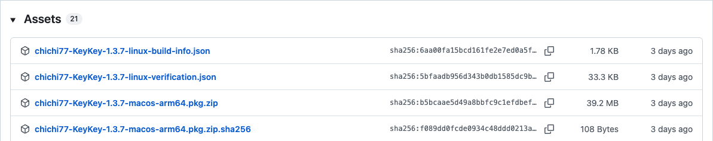

*選擇結尾為 `.pkg.zip` 的檔案；下一列多了 `.sha256` 的是校驗檔。*

### 也可使用台灣 AWS CDN 下載

同一個發布頁也有 **台灣 AWS 下載點**。在 **macOS Apple Silicon 安裝包**那一列按 **PKG ZIP**，取得的檔案與 GitHub Assets 相同，兩個來源選一個即可，都不需要登入 GitHub。

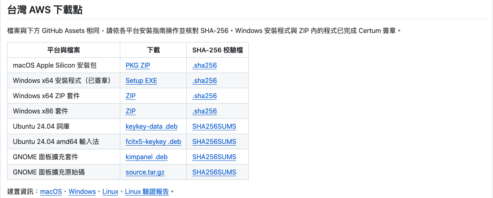

*macOS 使用第一列的 PKG ZIP；右側的 .sha256 用來核對下載內容。*

也可以直接點選 [1.3.7 macOS 安裝包（AWS CDN）](https://download.aws.polobread.com/keykey/releases/download/v1.3.7/chichi77-KeyKey-1.3.7-macos-arm64.pkg.zip)，以及[同名 SHA-256 校驗檔](https://download.aws.polobread.com/keykey/releases/download/v1.3.7/chichi77-KeyKey-1.3.7-macos-arm64.pkg.zip.sha256)。校驗時，請確認 ZIP 的 SHA-256 與校驗檔內的值一致。

## 2. 執行安裝程式

下載完成後，到 Finder 的「下載項目」連按兩下 ZIP，解壓縮後會得到 **`.pkg` 安裝檔**。

> **待補圖｜MAC-02a**
>
> Finder 解壓完成後的 .pkg 安裝檔，檔名可辨認。

再連按兩下 `.pkg`，開啟安裝程式。

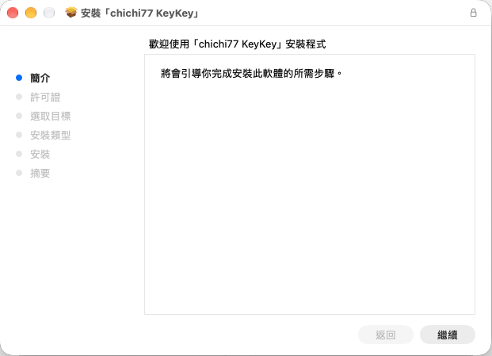

*安裝程式顯示的名稱是「chichi77 KeyKey」。看到歡迎畫面後，按右下角「繼續」，依序閱讀授權內容，再依提示進行安裝。*

如果 Mac 要求密碼或 Touch ID，使用平常登入這台 Mac 的帳號完成授權。等畫面顯示**安裝成功**，就可以關閉安裝程式。

> **待補圖｜MAC-02c**
>
> 安裝程式的安裝成功頁；既有歡迎頁保留，不能代替完成頁。


若安裝檔無法開啟，先核對下載來源與檔名，再記下 macOS 顯示的完整訊息，提供給協助排查的人。

## 3. 登出，再重新登入

首次安裝後，儲存文件，按左上角 ** → 登出〔你的使用者名稱〕**，再登入原本的帳號。重新登入後，macOS 才能找到新安裝的輸入法；只關閉安裝程式或系統設定不會完成這個步驟。

**已經裝過琦琦、這次只是升級？** 先切到 ABC，再切回琦琦並試打。如果琦琦仍在輸入法清單，就能直接使用，不必先移除再加入；版本可到偏好設定的「關於」確認。

## 4. 把琦琦輸入法加入 Mac

開啟 ** → 系統設定 → 鍵盤**，找到「文字輸入」，按輸入方式旁的 **編輯…**。

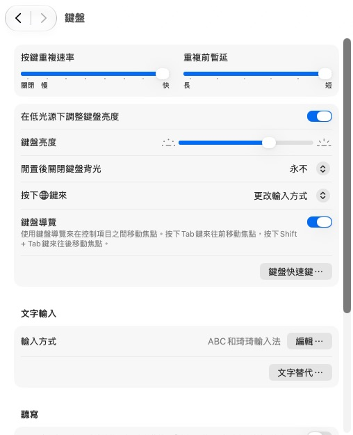

*「編輯…」會開啟這台 Mac 的輸入方式清單。*

接著按清單左下角的 **＋**。如果左側已經有「琦琦輸入法」，代表它已加入，可以直接前往下一節試打。

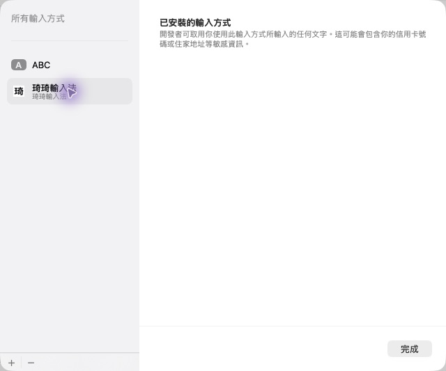

*左下角 ＋ 是新增入口；這張圖顯示的是已加入琦琦的狀態。*

在新增視窗左側選 **繁體中文**，右側選 **琦琦輸入法**，再按右下角 **加入**。回到清單後，確認左側已出現琦琦，再按「完成」。

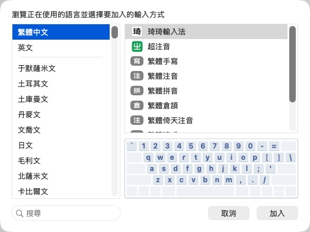

*選好「繁體中文 → 琦琦輸入法」，按「加入」即可完成設定。*

若右上角沒有輸入法選單，在同一個「文字輸入」設定中開啟 **在選單列中顯示輸入法選單**。

## 5. 切換輸入法並試打

打開 Mac 內建的**文字編輯**，新增空白文件並點一下文字區。接著從右上角的輸入法選單選 **琦琦輸入法**，再確認下方勾選的是 **好打注音**。

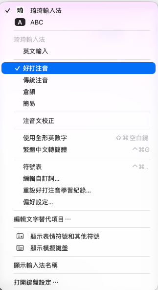

*上方勾選「琦琦輸入法」，下方勾選「好打注音」，就可以開始連續輸入注音。其他輸入方式和「偏好設定…」也在這個選單中。*

先輸入第一行 **「琦琦輸入法」**，按 **Return** 確定文字，再按一次 Return 換行。接著輸入 **「請假要去哪裡玩呢去海邊」**，第二行先不按 Return，讓文字保留組字狀態。

使用標準注音配置時，一聲讀音後按**空白鍵**完成音節；二、三、四、輕聲則用聲調鍵完成音節。輸入時看到的組字底線，表示這部分文字仍可修改。

### 在「玩」開啟候選，練習句中選字

用左右方向鍵把組字游標移到「玩」，按**方向下鍵**開啟候選清單；也可依設定使用空白鍵。這張圖中，「玩」是第 **3** 項，可以按 **3**，或用滑鼠點選。

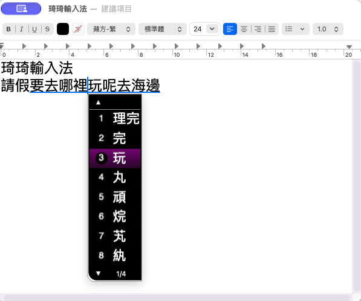

*第一行已確認，第二行仍在選字。紫色列是反白的候選；左側數字是選字鍵，底部 `1/4` 表示第 1 頁、共 4 頁。實際候選順位可能隨詞庫及學習結果改變。*

選字後可以接著輸入，完成時再按 Return 確定文字。**候選窗開著時，Return 是選取反白候選；候選窗關閉時，Return 才是確定組字。**

> **待補圖｜MAC-07b**
>
> 選玩後繼續輸入散步，文字接在句尾；與開候選圖分開。

連續輸入超過組字範圍時，前段會先自動固定。想回頭改字，請在文字仍有組字底線時操作。

## 日常使用

### 輕按 Shift 切換中英文，也能關閉這個快捷鍵

在琦琦中**輕按一下 Shift，就能在中文與英文間切換**；再按一下，會切回先前使用的中文輸入法。這項功能預設開啟，若不想使用，到 **偏好設定… → 一般**，取消勾選 **單按 Shift 切換中英文**即可。

也可以從琦琦選單直接選「英文輸入」，或切到 Mac 的 ABC 輸入法。需要逐字注音選字時，從相同選單改選「傳統注音」。

> **待補圖｜MAC-10b**
>
> 輕按 Shift 或選單切換後的英文模式可見狀態；搭配既有中文選單與一般設定圖。

### 倉頡：打到「竹大」，就能提前選「喬」

從琦琦選單開啟 **偏好設定… → 倉頡**，勾選 **即時候選**與 **未打完也能選字**。桌面版這兩項預設關閉，需要先開啟。

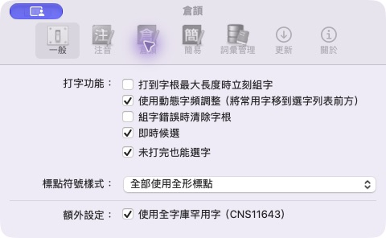

*同時開啟這兩項，候選清單就會隨輸入中的字根更新。圖中保留這台 Mac 已開啟的設定。*

回到文字編輯，從輸入法選單改選**倉頡**，輸入 **竹大**，也就是美式鍵盤的 **H、K**。這時就能查看以「竹大」開頭的候選，不必先打完「喬」的完整字根「竹大口月口」。

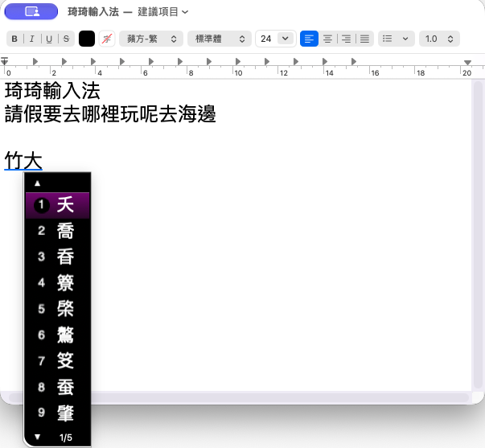

*這張圖的第 2 項是「喬」，按 2 或點選候選即可選字。上方兩行中文已確認，仍在組字的是「竹大」；候選編號以自己的畫面為準。*

### 調整候選窗大小與啟動模式

想讓候選字更容易看清楚，可以開啟 **偏好設定… → 一般**，調整**候選窗比例**，或選擇垂直、水平選字窗。若調整後尚未更新，切到 ABC 再切回琦琦即可重新載入。

同一頁也能設定「單按 Shift 切換中英文」，以及啟動時預設使用中文或英文。啟動模式預設為中文，新設定會在下次輸入法程序啟動時套用；平常手動切換不會改寫它。

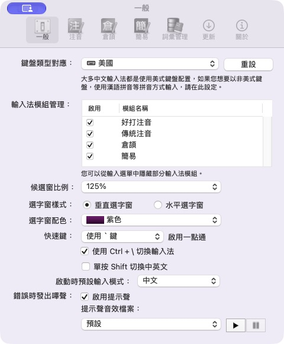

*這台 Mac 使用 125% 的垂直選字窗、已關閉 Shift 切換，啟動模式為中文。圖中是既有使用者設定，不代表全新安裝的預設值。*

注音鍵盤配置可在「注音」頁調整，關聯詞庫則在「詞彙管理」。Mac 系統的「鍵盤 → 文字輸入」負責加入輸入法；琦琦的偏好設定則用來調整打字習慣。

### 使用聯想詞、自訂詞與符號

選完字後如果出現「聯想詞」，那是接在後面的字詞建議。例如選了「台」，可能接著看到「灣」或「北」。依畫面提示按 **Shift + 數字鍵**選取，也可以直接開始輸入下一個注音。

常用的個人詞彙，可以從琦琦選單開啟 **編輯自訂詞…**，再新增詞彙。好打注音組字時，也能按住 Shift 搭配左右方向鍵，選取最多六個字後按 Return 加入自訂詞。匯入、匯出位於 **偏好設定… → 詞彙管理**。

若長期選字後的結果不符合習慣，可從琦琦選單執行 **重設好打注音學習紀錄…**。確認後會清除候選選擇與相鄰詞的學習資料，保留已新增的自訂詞。需要特殊符號時，則從同一個選單開啟 **符號表**。

需要 Emoji 時，從 **符號表**切到 **Emoji**分類，捲動找到想用的項目；點回文字欄位後再點符號，即可插入。

> **待補圖｜MAC-11a**
>
> 符號表的 Emoji 分類與可捲動列表。

> **待補圖｜MAC-11b**
>
> 點選 Emoji 後，文字編輯中的實際插入結果。

### 常用選字操作

| 操作 | 用途 |
| --- | --- |
| 候選旁的數字鍵或滑鼠點選 | 選取對應候選，以畫面上的編號為準。 |
| 候選窗中的空白鍵／Page Down、Page Up | 往後、往前翻頁。 |
| 方向鍵 | 移動反白候選；直式用上／下，橫式用左／右。 |
| Return | 候選窗開啟時選字，關閉時確定組字。 |
| Esc | 關閉目前的候選或聯想詞清單。 |

## 遇到問題時

可以先在「文字編輯」的空白文件試打，確認右上角已選琦琦，再依看到的情況檢查。

| 你看到的情況 | 可以怎麼做 |
| --- | --- |
| 在 ＋ 清單找不到琦琦 | 確認安裝成功，首次安裝後已登出再登入，並在「繁體中文」分類尋找。 |
| 已加入，右上角卻沒有輸入法選單 | 到「鍵盤 → 文字輸入 → 編輯…」，開啟「在選單列中顯示輸入法選單」。 |
| 選到琦琦，打字仍是英文 | 從琦琦選單選回「好打注音」，再輸入完整注音與聲調。 |
| 一聲讀音打完，沒有進入下一字 | 按空白鍵完成該音節；若叫出候選窗，先選字或按 Esc 關閉再繼續。 |
| 每個字都立刻開候選，無法連續組句 | 檢查是否選到「傳統注音」，改選「好打注音」。 |
| 選字後看到 Shift + 數字鍵 | 這是聯想詞建議，可以選用，也能直接繼續輸入。 |
| 數字鍵可選字，滑鼠卻沒反應 | 先用數字鍵操作，並記下 macOS 版本及點選時的權限提示。 |
| 權限頁圖示異常，或開關關閉 | 先確認實際打字是否正常；「隱私權與安全性 → 裝置控制和資料取用」不是加入輸入法的入口，單靠圖示無法判斷故障。 |

### 安裝或升級失敗時，解除安裝後重裝

先儲存文件並切到 **ABC**。到「系統設定 → 鍵盤 → 文字輸入 → 編輯…」移除琦琦，再於 Finder 選 **前往 → 前往資料夾…**，輸入 `/Library/Input Methods/`，將 **`chichi77 KeyKey.app`** 移到垃圾桶；若要求授權，依提示完成。

接著登出再登入，重新下載安裝包，依本指南安裝、加入琦琦並試打。

仍無法使用時，請提供**下載檔名、Mac 晶片、macOS 版本**，以及文字輸入清單、目前輸入法選單和試打畫面，方便協助排查。

### 進階檢查（提供給協助排查的人）

要確認版本，可從琦琦選單開啟 **偏好設定… → 關於**。這裡顯示的是已安裝版本。

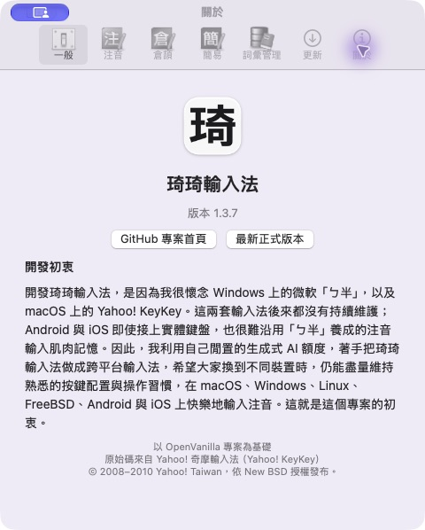

*本指南使用的 Mac 已安裝 1.3.7，可在「關於」頁核對。*

需要進一步核對安裝位置、版本與簽章時，可使用下列指令；一般安裝不需要執行：

```sh
/usr/libexec/PlistBuddy -c 'Print :CFBundleShortVersionString' '/Library/Input Methods/chichi77 KeyKey.app/Contents/Info.plist'
codesign -dv '/Library/Input Methods/chichi77 KeyKey.app' 2>&1 | grep -E 'Signature=|TeamIdentifier='
```

安裝包的建置與簽章流程見 [Installer 說明](Installer/README.md)。

## 畫面資訊與參考

本文的輸入與設定圖片取自 **macOS 27.0.1、Apple Silicon、已安裝的 1.3.7**，下載頁擷取於 2026-10-24。安裝歡迎頁、候選、輸入法選單與下載頁原圖由維護者提供；不同 macOS 版本的外觀可能略有差異。

Mac 系統操作可參考 [Apple：在 Mac 上登出帳號](https://support.apple.com/zh-tw/guide/mac-help/mchlcc122483/mac)與[Apple：設定中文輸入方式](https://support.apple.com/zh-hk/guide/chinese-input-method/cim6023ab944/mac)。
