# macOS 安裝與使用指南

想在 Mac 上沿用熟悉的注音選字方式，可以試試琦琦輸入法。它提供**好打注音、傳統注音、倉頡與簡易**：好打注音適合連續輸入後再選字；習慣逐字選字的人，也能切換成傳統注音。

本指南以琦琦輸入法 **1.5.1** 示範安裝、啟用、選字和偏好設定。安裝完成並重新登入後，從畫面右上角的輸入法選單選用琦琦。

## 新核心升級準備

1.5.0 改用 Guanyinma（觀音嬤）共用核心。升級前請先用原版本備份自訂詞及學習資料；新核心使用獨立詞庫，可明確匯入舊 MJSR，不會自動改寫舊檔。安裝完成後登出再登入，升級保留原有輸入來源。

## 安裝前，確認你的 Mac

先按左上角 ** → 關於這台 Mac**，確認晶片是 **Apple M 系列**，且系統為 **macOS 15 或更新版本**。目前這份安裝包適用於 Apple Silicon，沒有提供 Intel Mac 版本。

安裝或升級後都需要登出再登入，請先儲存手邊的文件。全新安裝：**下載 → 安裝 → 重新登入 → 首次加入輸入法 → 試打**；升級：**安裝 → 重新登入 → 選回原有琦琦 → 試打**，不必移除重加。

## 1. 下載 macOS 安裝包

打開[琦琦輸入法正式發布頁](https://github.com/polobread/KeyKey/releases)，選擇要安裝的版本。在 **Assets** 下載檔名包含 `macos-arm64`、結尾為 `.pkg.zip` 的安裝包，以及同名的 `.sha256` 校驗檔。請核對檔名中的版本和架構。

### 也可使用台灣 AWS CDN 下載

在該版本的發布說明找到 **台灣 AWS 下載點**，從 **macOS Apple Silicon 安裝包**那一列下載 **PKG ZIP** 及 **SHA-256**。GitHub 與 AWS 提供同一版本的安裝包，選其中一個來源即可。校驗時，請確認 ZIP 的 SHA-256 與校驗檔內的值一致。

## 2. 執行安裝程式

下載完成後，到 Finder 的「下載項目」連按兩下 ZIP，解壓縮後會得到 **`.pkg` 安裝檔**。

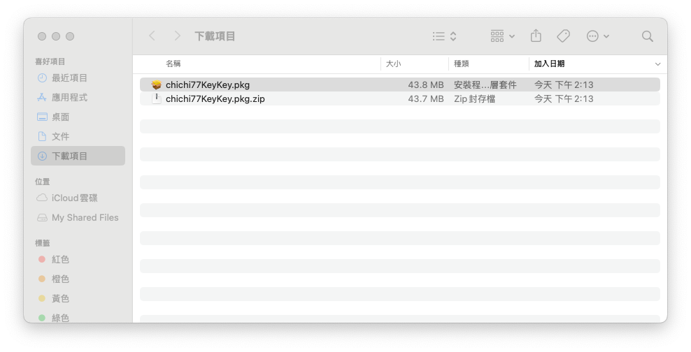

*上方的 `chichi77KeyKey.pkg` 是解壓後的安裝檔；下方 `.pkg.zip` 是下載的壓縮檔。*

再連按兩下 `.pkg`，開啟安裝程式。

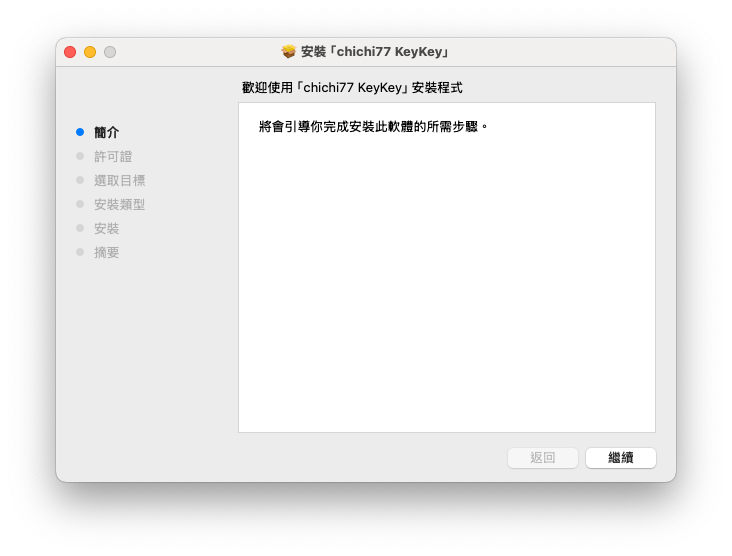

*安裝程式顯示的名稱是「chichi77 KeyKey」。看到歡迎畫面後，按右下角「繼續」，依序閱讀授權內容，再依提示進行安裝。*

如果 Mac 要求密碼或 Touch ID，依畫面提示完成管理員授權。看到「已成功完成安裝」後，請先儲存手邊的工作，再按右下角的 **登出**。

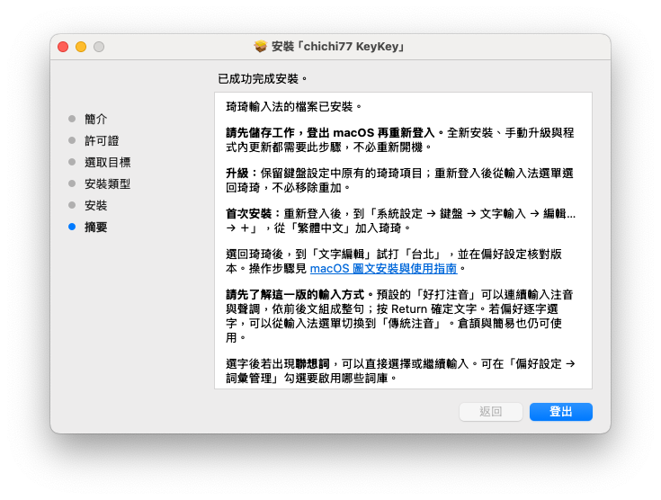

若安裝檔無法開啟，先核對下載來源與檔名，再記下 macOS 顯示的完整訊息，提供給協助排查的人。

## 3. 登出，再重新登入

安裝程式登出後，請登入原本的帳號，讓 macOS 重新載入輸入法，不必重新開機。若還在桌面，請先儲存文件，再從 ** → 登出〔你的使用者名稱〕** 登出。下方的加入步驟僅供首次安裝。

**已經裝過琦琦、這次只是升級？** 先切到 ABC，再切回琦琦並試打。如果琦琦仍在輸入法清單，就能直接使用，不必先移除再加入；版本可到偏好設定的「關於」確認。

## 4. 把琦琦輸入法加入 Mac

開啟 ** → 系統設定 → 鍵盤**，找到「文字輸入」，按輸入方式旁的 **編輯…**。

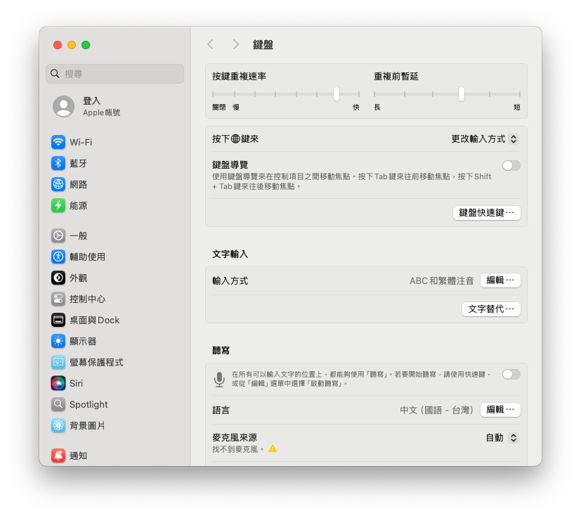

*「編輯…」會開啟這台 Mac 的輸入方式清單。*

接著按清單左下角的 **＋**。如果左側已經有「琦琦輸入法」，代表它已加入，可以直接前往下一節試打。

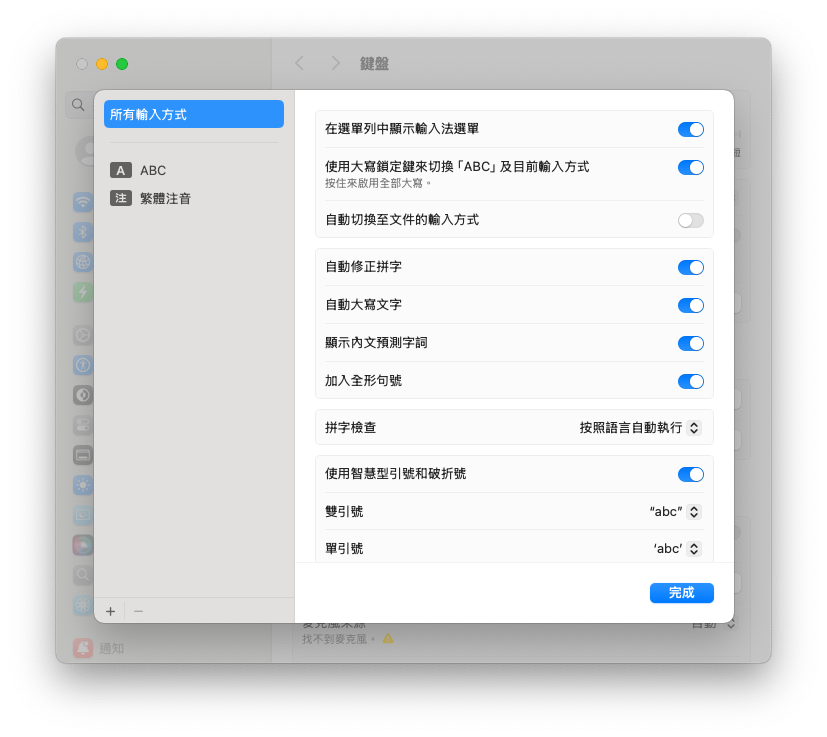

在新增視窗左側選 **繁體中文**，右側選 **琦琦輸入法**，再按右下角 **加入**。回到清單後，確認左側已出現琦琦，再按「完成」。

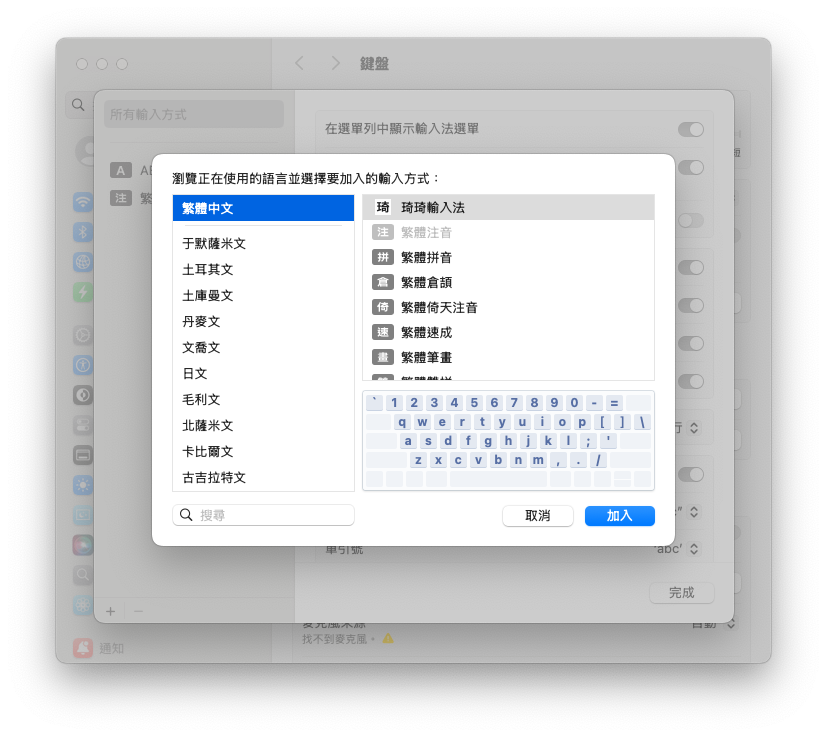

*選好「繁體中文 → 琦琦輸入法」，按「加入」即可完成設定。*

若右上角沒有輸入法選單，在同一個「文字輸入」設定中開啟 **在選單列中顯示輸入法選單**。

## 5. 切換輸入法並試打

打開 Mac 內建的**文字編輯**，新增空白文件並點一下文字區。接著從右上角的輸入法選單選 **琦琦輸入法**，再確認下方勾選的是 **好打注音**。

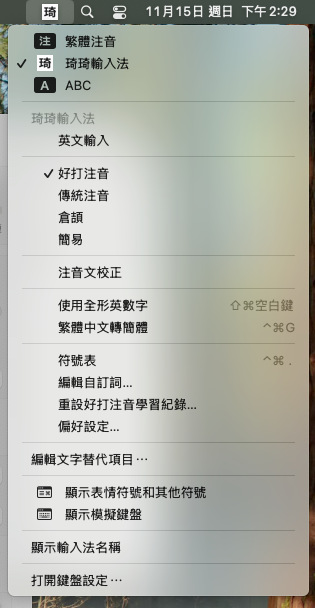

*上方勾選「琦琦輸入法」，下方勾選「好打注音」，就可以開始連續輸入注音。其他輸入方式和「偏好設定…」也在這個選單中。*

先試打 **「台北」**，按 **Return** 確定文字。接著試著輸入 **「請假要去哪裡玩呢去海邊」** 的讀音，先不按 Return，保留組字狀態以練習句中選字。

使用標準注音配置時，一聲讀音後按**空白鍵**完成音節；二、三、四、輕聲則用聲調鍵完成音節。輸入時看到的組字底線，表示這部分文字仍可修改。

### 在「玩」開啟候選，練習句中選字

用左右方向鍵把組字游標移到要改的音節。圖中「玩」的讀音目前組成了「完」；按 **方向下鍵**開啟候選清單，按 **3** 或用滑鼠點選「玩」。如果開啟了空白鍵選字，也可用空白鍵叫出候選。

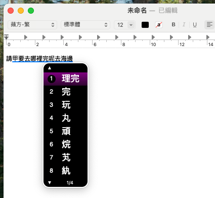

*紫色列是目前反白的候選；左側數字是選字鍵。底部 `1/4` 代表第 1 頁、共 4 頁。候選順位會隨詞庫與學習結果改變；修正需要的字後，按 Return 確定整句。*

連續輸入超過組字範圍時，前段會先自動固定。想回頭改字，請在文字仍有組字底線時操作。

## 6. 日常使用

### 輕按 Shift 切換中英文，也能關閉這個快捷鍵

在琦琦中**輕按一下 Shift，就能在中文與英文間切換**；再按一下，會切回先前使用的中文輸入法。這項功能預設開啟，若不想使用，到 **偏好設定… → 一般**，取消勾選 **單按 Shift 切換中英文**即可。

也可以從琦琦選單直接選「英文輸入」，或切到 Mac 的 ABC 輸入法。需要逐字注音選字時，從相同選單改選「傳統注音」。

切到英文模式時，畫面會短暫顯示「英文輸入」提示。

### 倉頡：打到「竹大」，就能提前選「喬」

從琦琦選單開啟 **偏好設定… → 倉頡**，勾選 **即時候選**與 **未打完也能選字**。桌面版這兩項預設關閉，需要先開啟。

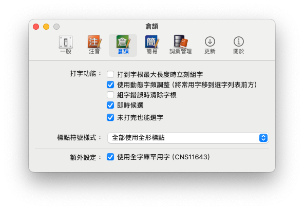

*同時開啟這兩項，候選清單就會隨輸入中的字根更新。圖中保留這台 Mac 已開啟的設定。*

回到文字編輯，從輸入法選單改選**倉頡**，輸入 **竹大**，也就是美式鍵盤的 **H、K**。這時就能查看以「竹大」開頭的候選，不必先打完「喬」的完整字根「竹大口月口」。

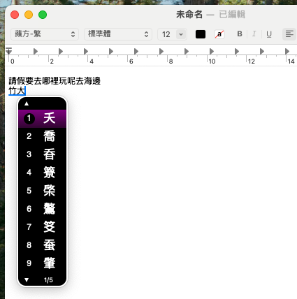

*這張圖的第 2 項是「喬」，按 2 或點選候選即可選字；候選編號以自己的畫面為準。*

### 調整候選窗大小與啟動模式

想讓候選字更容易看清楚，可以開啟 **偏好設定… → 一般**，調整**候選窗比例**，或選擇垂直、水平選字窗。比例預設為**跟隨顯示器**，也可選擇 70%、75%、80%、90%、100%、110%、120%、125%、130%、150%、175%、200%、225%、250% 或 300%。若調整後尚未更新，切到 ABC 再切回琦琦即可重新載入。

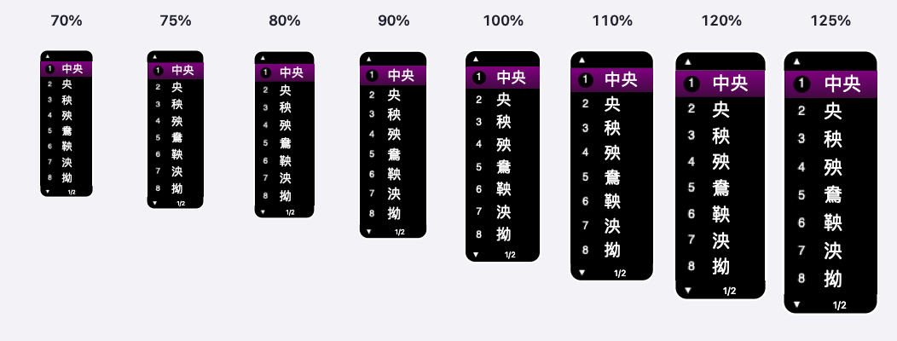

*從左到右比較八種比例。每一欄都顯示同一組候選，方便比較字級和視窗大小。*

同一頁也能設定「單按 Shift 切換中英文」，以及啟動時預設使用中文或英文。啟動模式預設為中文，新設定會在下次輸入法程序啟動時套用；平常手動切換不會改寫它。

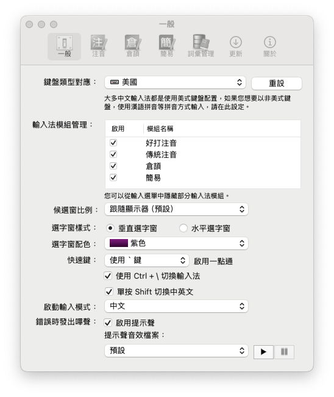

注音鍵盤配置可在「注音」頁調整，關聯詞庫則在「詞彙管理」。Mac 系統的「鍵盤 → 文字輸入」負責加入輸入法；琦琦的偏好設定則用來調整打字習慣。

### 使用聯想詞、自訂詞與符號

選完字後如果出現「聯想詞」，那是接在後面的字詞建議。例如選了「台」，可能接著看到「灣」或「北」。依畫面提示按 **Shift + 數字鍵**選取，也可以直接開始輸入下一個注音。

常用的個人詞彙，可以從琦琦選單開啟 **編輯自訂詞…**，再新增詞彙。好打注音組字時，也能按住 Shift 搭配左右方向鍵，選取最多六個字後按 Return 加入自訂詞。匯入、匯出位於 **偏好設定… → 詞彙管理**。

若長期選字後的結果不符合習慣，可從琦琦選單執行 **重設好打注音學習紀錄…**。確認後會清除候選選擇與相鄰詞的學習資料，保留已新增的自訂詞。需要特殊符號時，則從同一個選單開啟 **符號表**。

需要 Emoji 時，從 **符號表**切到 **Emoji**分類，捲動找到想用的項目；點回文字欄位後再點符號，即可插入。

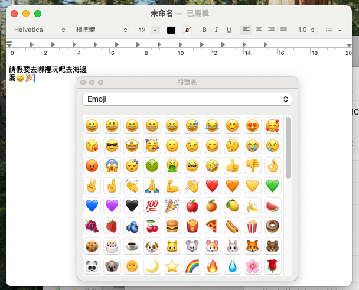

*點選後，Emoji 會出現在文字欄位；符號表仍保持開啟，可以繼續挑選。*

### 常用選字操作

| 操作 | 用途 |
| --- | --- |
| 候選旁的數字鍵或滑鼠點選 | 選取對應候選，以畫面上的編號為準。 |
| 候選窗中的空白鍵／Page Down、Page Up | 往後、往前翻頁。 |
| 方向鍵 | 移動反白候選；直式用上／下，橫式用左／右。 |
| Return | 候選窗開啟時選字，關閉時確定組字。 |
| Esc | 關閉目前的候選或聯想詞清單。 |

## 7. 檢查新版與更新

從右上角琦琦輸入法選單開啟 **偏好設定… → 更新**，按 **立刻檢查**，即可查看目前版本、上次檢查時間與更新資訊。同一頁的 **每週檢查新版並通知** 可控制自動通知；預設開啟，升級保留原本設定，關閉後仍能手動檢查。檢查不會預先下載安裝包；一般使用者可保持 beta 選項關閉。

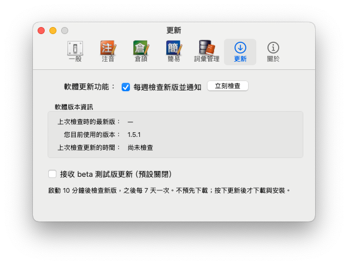

*「上次檢查時的最新版」顯示「－」，表示這個畫面還沒有新版查詢結果。*

### 收到新版通知後

檢查只會通知新版，不預先下載安裝包。只有你在更新視窗按下更新按鈕，才會下載、驗證並進入安裝流程；套件需要管理員同意時，依 macOS 提示授權。關閉或略過通知不會開始下載。

更新前先確認正在輸入的文字並儲存文件。安裝完成後一律登出 macOS 再登入，保留鍵盤設定中原有的琦琦項目，不必移除重加。重新登入後選回琦琦，在「文字編輯」試打，並到 **偏好設定… → 關於**核對版本。

**接收 beta 測試版更新（預設關閉）**位於更新頁，一般使用者保持關閉即可。切換頻道不會略過下載、驗證或安裝確認。沒有更新服務的舊版，須先從本指南的正式下載頁手動安裝支援更新的版本。

查詢失敗或逾時時，先確認網路，再按「立刻檢查」重試；也可從正式下載頁手動取得安裝包。macOS 沒有 Windows 的「重新安裝目前版本…」按鈕；需要重裝時，依本指南下載與安裝。更新流程詳見[桌面更新說明](update/README.md)。

## 遇到問題時

可以先在「文字編輯」的空白文件試打，確認右上角已選琦琦，再依看到的情況檢查。

| 你看到的情況 | 可以怎麼做 |
| --- | --- |
| 在 ＋ 清單找不到琦琦 | 確認安裝成功，首次安裝後已登出再登入，並在「繁體中文」分類尋找。 |
| 已加入，右上角卻沒有輸入法選單 | 到「鍵盤 → 文字輸入 → 編輯…」，開啟「在選單列中顯示輸入法選單」。 |
| 選到琦琦，打字仍是英文 | 從琦琦選單選回「好打注音」，再輸入完整注音與聲調。 |
| 部分常用中文字沒有候選，尤其剛裝好的 VM | 檢查 VM 內是否缺少 `STHeiti`，依下方[字型排查步驟](#vm-缺少中文字型導致部分字打不出來)補齊後重新登入。 |
| 一聲讀音打完，沒有進入下一字 | 按空白鍵完成該音節；若叫出候選窗，先選字或按 Esc 關閉再繼續。 |
| 每個字都立刻開候選，無法連續組句 | 檢查是否選到「傳統注音」，改選「好打注音」。 |
| 選字後看到 Shift + 數字鍵 | 這是聯想詞建議，可以選用，也能直接繼續輸入。 |
| 數字鍵可選字，滑鼠卻沒反應 | 先用數字鍵操作，並記下 macOS 版本及點選時的權限提示。 |
| 權限頁圖示異常，或開關關閉 | 先確認實際打字是否正常；「隱私權與安全性 → 裝置控制和資料取用」不是加入輸入法的入口，單靠圖示無法判斷故障。 |

### VM 缺少中文字型導致部分字打不出來

剛建立的 macOS VM 或尚未下載完整字型的 Mac，可能出現「台北」能輸入，卻找不到「你／囉」等常用字，或完整注音仍卡在組字區的情況。目前琦琦的字元支援判斷會使用 `STHeiti`；缺少這個字型時，可能把詞庫中原本存在的字詞排除。即使系統介面和其他 App 能顯示中文，也不能據此判斷 `STHeiti` 已安裝。

可以先依下列步驟處理；使用 VM 時，請在 **VM 內**安裝字型：

1. 開啟「字體簿」，尋找並下載 Apple 提供的 `STHeiti` 系統字型。若已有 Apple 提供的 `STHEITI.ttf`，也可在 VM 內連按兩下檔案，於「字體簿」按「安裝」。下載與安裝方式見 [Apple：在「字體簿」中安裝和驗證字體](https://support.apple.com/zh-tw/guide/font-book/fntbk1000/mac)。
2. 確認字型已啟用，且字型資訊中的 **PostScript 名稱為 `STHeiti`**。名稱相近的 `STHeitiTC-Light`、`STHeitiSC-Light` 或 Medium 字型不是這裡需要的字型，不能只憑檔名含有 Heiti 判斷已補齊。
3. 儲存文件、切到 **ABC**，再登出並重新登入，讓琦琦重新載入字型；不必先重新開機。選回琦琦，在「文字編輯」試打「你好」、「哈囉」與「請假要去哪裡玩呢去海邊」。

若仍有缺字，請提供 macOS 版本、字型的 PostScript 名稱，以及輸入的注音與候選畫面。缺少字型時，單純登出或重開機不會補上字型；可用的系統字型依版本而異，macOS 15 可參考 [Apple：macOS Sequoia 隨附的字體](https://support.apple.com/zh-tw/120414)。

### 安裝或升級失敗時，解除安裝後重裝

先儲存文件並切到 **ABC**。到「系統設定 → 鍵盤 → 文字輸入 → 編輯…」移除琦琦，再於 Finder 選 **前往 → 前往資料夾…**，輸入 `/Library/Input Methods/`，將 **`chichi77 KeyKey.app`** 移到垃圾桶；若要求授權，依提示完成。

接著登出再登入，重新下載安裝包，依本指南安裝、加入琦琦並試打。

仍無法使用時，請提供**下載檔名、Mac 晶片、macOS 版本**，以及文字輸入清單、目前輸入法選單和試打畫面，方便協助排查。

### 進階檢查（提供給協助排查的人）

要確認版本，可從琦琦選單開啟 **偏好設定… → 關於**。這裡顯示的是已安裝版本。

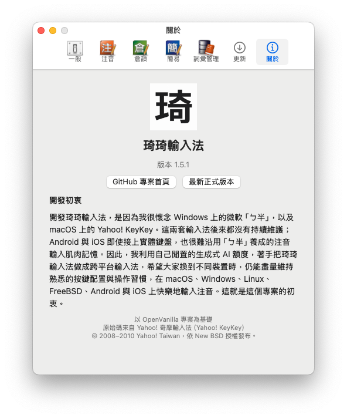

需要進一步核對安裝位置、版本與簽章時，可使用下列指令；一般安裝不需要執行：

```sh
/usr/libexec/PlistBuddy -c 'Print :CFBundleShortVersionString' '/Library/Input Methods/chichi77 KeyKey.app/Contents/Info.plist'
codesign -dv '/Library/Input Methods/chichi77 KeyKey.app' 2>&1 | grep -E 'Signature=|TeamIdentifier='
```

安裝包的建置與簽章流程見 [Installer 說明](Installer/README.md)。

## 畫面資訊與參考

安裝、輸入與設定畫面取自 **Apple Silicon 上的 macOS 15.6.1（Tart 虛擬機）**，使用琦琦輸入法 **1.5.1**。候選窗比例比較圖是獨立的尺寸示例。新版 macOS 的系統介面可能略有差異。

Mac 系統操作可參考 [Apple：在 Mac 上登出帳號](https://support.apple.com/zh-tw/guide/mac-help/mchlcc122483/mac)與[Apple：設定中文輸入方式](https://support.apple.com/zh-hk/guide/chinese-input-method/cim6023ab944/mac)。
