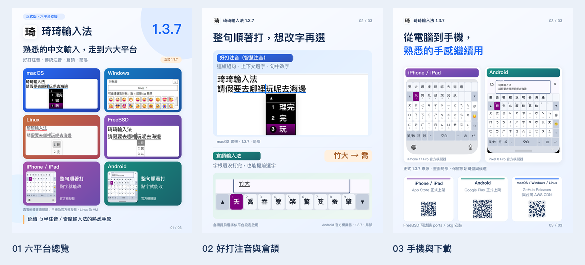
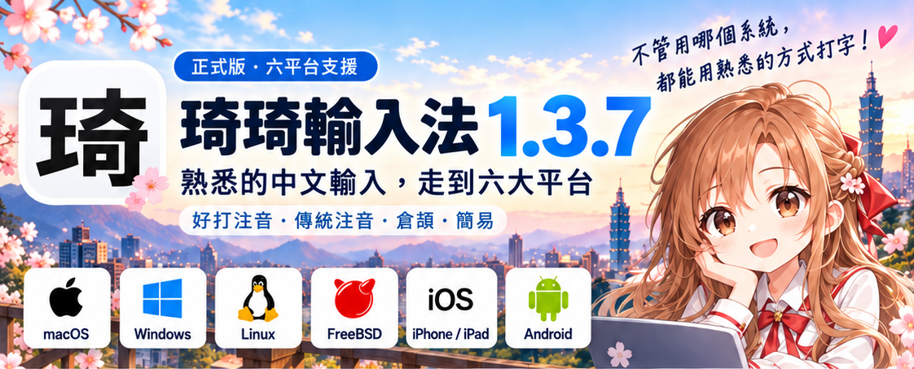

# 琦琦輸入法 1.3.7 · Threads 圖片

三張 1080 × 1350 px、4:5、RGB／sRGB PNG，可依 01 → 02 → 03 順序發布。`preview-all.png` 是 360 × 450 px 縮圖並排總覽，不是第四張輪播圖。

| 成品 | 內容 | 可編輯原始檔 |
|---|---|---|
| [01-six-platforms.png](01-six-platforms.png) | 六平台封面 | [SVG](01-six-platforms.svg) |
| [02-smart-phonetic-cangjie.png](02-smart-phonetic-cangjie.png) | 好打注音句中選字、倉頡竹大 → 喬 | [SVG](02-smart-phonetic-cangjie.svg) |
| [03-mobile-downloads.png](03-mobile-downloads.png) | 真實手機鍵盤與三個正式下載 QR Code | [SVG](03-mobile-downloads.svg) |



## 另附的宣傳設計素材

依維護者提供的兩張圖片加入：

| 檔案 | 採用方式 |
|---|---|
| [user-character-illustration.png](user-character-illustration.png) | 人物插畫原圖 1278 × 1230、RGBA；保留原始透明背景與內容。 |
| [user-title-six-platforms.png](user-title-six-platforms.png) | 從海報原圖 1122 × 1402 裁取 `(0, 0)–(1122, 454)`，輸出 1122 × 454 橫幅；只保留上方標題區、人物與六平台圖示。 |

這兩張是宣傳插畫與標題設計素材，與下方三張輪播的真實產品操作截圖分別登記。原三張輪播與其總覽維持原樣。



匯入來源、原始／成品 SHA-256 及裁切資料見 [user-art-manifest.json](user-art-manifest.json)。重新裁切需使用維護者提供的原始檔：

```sh
python3 StoreAssets/Threads-v1.3.7/prepare-user-art.py \
  --character "人物插畫原圖.png" --poster "完整海報原圖.png"
```

## 實際素材來源

原三張輪播的操作畫面只來自專案截圖，僅作連續區域裁切、等比例縮放、sRGB 色彩轉換與外框。未重畫候選、注音、鍵盤、輸入結果或作業系統視窗。官方模擬器是實際執行軟體的畫面；圖中保留來源標示，不是生成的介面示意。

| 成品 | 儲存庫原始檔 | 採用方式 |
|---|---|---|
| 01 平台識別 | [assets/platform_icons.png](assets/platform_icons.png) | 使用者提供的六平台圖示原圖，494 × 85。只裁取各平台 Logo 區域，不用作產品畫面；個別裁切座標見 design.json。 |
| 三張共用 | [StoreAssets/GooglePlay/app-icon-512.png](../GooglePlay/app-icon-512.png) | 原始白底黑字「琦」App Icon，未重新設計；藍色用於宣傳版面。 |
| 01／02 上半部 | [docs/images/keykey-macos-v137-mac07-middle-candidate-apple-silicon.png](../../docs/images/keykey-macos-v137-mac07-middle-candidate-apple-silicon.png) | macOS 1.3.7 實機；保留兩行文字與「玩」反白候選。原圖 597 × 499，裁切 (0, 96)–(450, 280)。 |
| 02 下半部 | [docs/images/keykey-android-v137-and08b-cangjie-candidates-pixel8pro-simulator-detail.png](../../docs/images/keykey-android-v137-and08b-cangjie-candidates-pixel8pro-simulator-detail.png) | Pixel 8 Pro 官方模擬器；保留竹大組字與完整候選列，喬為第 2 項、未確認。原圖 1344 × 1452，裁切 (0, 220)–(1344, 490)。 |
| 01／03 左側 | [docs/images/keykey-ios-v137-ios07a-middle-candidate-iphone17pro-simulator.png](../../docs/images/keykey-ios-v137-ios07a-middle-candidate-iphone17pro-simulator.png) | iPhone 17 Pro 官方模擬器；保留組字、玩候選、完整注音鍵盤與底部地球鍵。原圖 1206 × 2622，裁切 (0, 1350)–(1206, 2622)。 |
| 01／03 右側 | [docs/images/keykey-android-v137-and06a-middle-candidate-pixel8pro-simulator-detail.png](../../docs/images/keykey-android-v137-and06a-middle-candidate-pixel8pro-simulator-detail.png) | Pixel 8 Pro 官方模擬器；完整採用既有局部圖 1344 × 1392，保留測試文字、組字、玩候選與鍵盤。 |
| 01 Windows | [docs/images/keykey-windows-v137-win11b-emoji-inserted-win11.png](../../docs/images/keykey-windows-v137-win11b-emoji-inserted-win11.png) | Windows 11 實機的符號表；原圖 800 × 520，裁切 (118, 185)–(558, 373)，保留分類與前兩排 Emoji。 |
| 01 Linux | [docs/images/keykey-linux-v137-lnx07a-middle-candidate-ubuntu2404-wayland.png](../../docs/images/keykey-linux-v137-lnx07a-middle-candidate-ubuntu2404-wayland.png) | Ubuntu 24.04.5／GNOME 46／Wayland VM；原圖 703 × 523，裁切 (8, 72)–(360, 216)，玩候選為第 1 項。 |
| 01 FreeBSD | [docs/images/keykey-freebsd-v137-bsd07a-middle-candidate.png](../../docs/images/keykey-freebsd-v137-bsd07a-middle-candidate.png) | FreeBSD 15.1／Xfce／X11 的 Mousepad 與真實候選；原圖 740 × 340，裁切 (0, 53)–(355, 205)。 |

座標採原始像素 `(左, 上)–(右, 下)`，右與下為不含端點。所有截圖均採原比例；原圖中的候選順位及紫色選取狀態保持原樣。Mac 來源解析度較低，放大只使用一般重取樣，不以 AI 補畫文字。

手機模擬器素材來自正式 `v1.3.7` tag `a11f1eab`，使用既有 Debug 組態執行；來源、裝置與操作記錄見 [截圖登記](../../docs/CROSS_PLATFORM_SCREENSHOT_PLAN.md)。未將模擬器自建包說成 App Store／Google Play 下載包。

01 使用鮮明藍色主視覺、使用者提供的平台識別圖示、六平台真實軟體畫面拼貼與不同色彩分區。依維護者指定，Linux 與 FreeBSD 並排於第二列，各自使用自己的截圖；手機並排於第三列。不借用其他平台的畫面，不加入生成的桌布、裝置外殼或替代 Logo。

## 下載 QR Code

QR Code 由下列完整網址產生，使用 M 級容錯、四模組白邊及整數像素模組；未使用短網址。桌面 QR 連到最新版 Release，該頁提供台灣 AWS CDN；FreeBSD 另列 ports／pkg，不提供 CDN 安裝包。

- iPhone／iPad：<https://apps.apple.com/tw/app/id6807832939>
- Android：<https://play.google.com/store/apps/details?id=tw.chichi77.keykey.android>
- macOS／Windows／Linux：<https://github.com/polobread/KeyKey/releases/latest>

## 編輯與重新產生

- [design.json](design.json)：版號、文案、色票、平台名稱、來源圖、裁切座標及下載網址。
- [generate.py](generate.py)：全部版面座標、字級、外框、漸層與 QR Code 產生程式。
- 三份 SVG：可直接編輯文字、向量版面與截圖位置；PNG 來源以 data URI 嵌入，不依賴外部檔案路徑。
- `assets/`：未改寫的原始素材副本及 QR Code，供可攜編輯與重現；既有商店圖與 docs 來源不被覆蓋。
- [source-manifest.json](source-manifest.json)：來源路徑、SHA-256、尺寸、出處及裁切資料。
- [layout-report.json](layout-report.json)：成品文字邊界、圖像位置及 QR Code 資料。

需要 Python 3、Pillow、NumPy、ReportLab，以及繁體中文字型。macOS 自動尋找蘋方；也可用 `KEYKEY_FONT` 指定 Noto Sans CJK TC Regular TTC（索引 3）。SVG 使用 `PingFang TC`／`Noto Sans CJK TC` 等字型；編輯機需安裝對應字型。

從專案根目錄執行（使用已安裝上述套件的 Python）：

```sh
python3 StoreAssets/Threads-v1.3.7/generate.py
python3 StoreAssets/Threads-v1.3.7/verify.py
# macOS：直接從完成的 PNG 掃描驗證三個 QR Code
swift StoreAssets/Threads-v1.3.7/verify-qr.swift
```

修改版號時須先換用相應正式版素材，並重新核對平台指南與發布狀態，不能只改文字。重製依據為 [1.2.9～1.3.7 宣傳文案](../../docs/CROSS_PLATFORM_1_2_9_TO_1_3_7_PROMO.md)、[六平台截圖清單](../../docs/CROSS_PLATFORM_SCREENSHOT_PLAN.md)、各平台安裝指南與 [CHANGELOG 1.3.7](../../CHANGELOG.md#137)。不納入 Guanyinma 或 1.3.8 開發功能。

## 交付檢查

- 三張主圖均為 1080 × 1350、RGB，內嵌 sRGB 色彩描述；總覽亦內嵌 sRGB。
- 已逐張及以 360 px 寬縮圖檢查標題、文字邊界、截圖比例、版面一致性。
- 原始來源 SHA-256 與專案檔案相同；未改寫截圖內容。驗證程式亦比對成品截圖內部像素與原圖裁切縮放結果。
- 已由 macOS Vision 從最終第三張 PNG 解碼三個 QR Code，網址與設定完全相符。
- 倉頡依平台設定啟用；沒有宣稱候選順位相同、學習資料同步、iOS 系統外接鍵盤支援或 Android 雙排預設開啟。
