# Windows 安裝與使用指南

琦琦輸入法 **1.3.7** 已正式發布，提供好打注音、傳統注音、倉頡與簡易。安裝後，先在 Windows 加入琦琦鍵盤，再用 **Win + Space** 切換，就能在記事本或其他文字 App 開始打字。

第一次使用可照著 **下載 → 安裝 → 新增鍵盤 → 選用琦琦 → 試打選字**完成設定。一般使用者不需要安裝開發工具或 .NET；安裝程式登記輸入法後，仍須由你在 Windows 設定新增鍵盤。

## 1. 確認系統，下載安裝包

開啟 **開始 → 設定 → 系統 → 關於**，查看「系統類型」，再依下表選檔案。本版以 Windows 10 起為目標；目前已驗證 Windows 11 x64，Windows 10 x64／x86 的實機驗證範圍另列於頁末。

| 你的系統 | 選擇的安裝方式 |
| --- | --- |
| **x64 Windows** | 優先使用 x64 安裝精靈；也可用 x64 ZIP。套件同時支援 64 位元及 32 位元應用程式。 |
| **32 位元 x86 Windows** | 下載 x86 ZIP，完整解壓縮後執行 `Install.cmd`。 |
| **ARM64 Windows** | 目前沒有本指南涵蓋的安裝包。 |

打開 [最新正式版下載頁](https://github.com/polobread/KeyKey/releases/latest)，往下找到 **Assets**，選擇名稱包含自己架構的檔案。檔名多了 `.sha256` 的是校驗檔，請與安裝包一起下載。

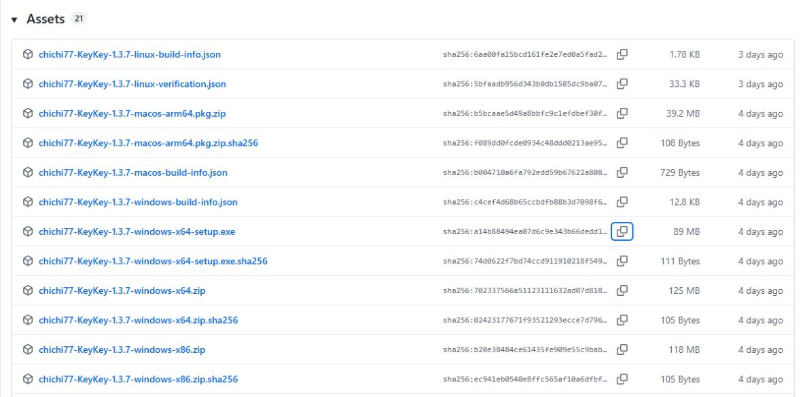

*選擇 x64 Setup EXE，或符合架構的 ZIP；同名 `.sha256` 是校驗檔。此圖為未登入 GitHub 的發布頁。*

下方檔名與 CDN 連結以 **1.3.7** 示範；要取得最新版，請依正式下載頁當次列出的安裝包及同版校驗檔下載。

### 也能使用台灣 AWS CDN

同一個發布頁的 **台灣 AWS 下載點**提供相同檔案，不需要登入 GitHub。也可從下表直接下載；兩個來源任選一個即可。

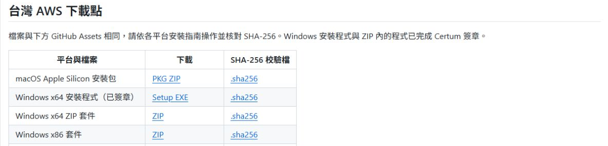

*Windows 三列分別提供 Setup EXE、x64 ZIP 與 x86 ZIP；右側 `.sha256` 用來核對下載內容。*

| 安裝方式 | AWS CDN 下載 | 校驗檔 |
| --- | --- | --- |
| x64 安裝精靈 | [chichi77-KeyKey-1.3.7-windows-x64-setup.exe](https://download.aws.polobread.com/keykey/releases/download/v1.3.7/chichi77-KeyKey-1.3.7-windows-x64-setup.exe) | [SHA-256](https://download.aws.polobread.com/keykey/releases/download/v1.3.7/chichi77-KeyKey-1.3.7-windows-x64-setup.exe.sha256) |
| x64 ZIP | [chichi77-KeyKey-1.3.7-windows-x64.zip](https://download.aws.polobread.com/keykey/releases/download/v1.3.7/chichi77-KeyKey-1.3.7-windows-x64.zip) | [SHA-256](https://download.aws.polobread.com/keykey/releases/download/v1.3.7/chichi77-KeyKey-1.3.7-windows-x64.zip.sha256) |
| x86 ZIP（32 位元 Windows） | [chichi77-KeyKey-1.3.7-windows-x86.zip](https://download.aws.polobread.com/keykey/releases/download/v1.3.7/chichi77-KeyKey-1.3.7-windows-x86.zip) | [SHA-256](https://download.aws.polobread.com/keykey/releases/download/v1.3.7/chichi77-KeyKey-1.3.7-windows-x86.zip.sha256) |

核對安裝包的 SHA-256 與同名 `.sha256` 內的值一致，再依前述方式確認發行者簽章及安裝。CDN 下載不改變簽章與安裝流程。

新版正式安裝檔及 ZIP 內的 EXE／DLL 均須有有效發行者簽章。下載完成後，連按安裝檔前先核對版本及來源。

## 2. 執行安裝精靈

連按兩下 x64 的 **setup.exe**。Windows 詢問是否允許變更裝置時，確認是剛下載的琦琦安裝檔，再依提示授權。歡迎頁按 **下一步**，閱讀授權內容後繼續。

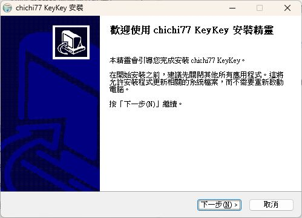

*此圖來自已核對 SHA-256 與有效發行者簽章的正式 1.3.7 安裝程式。按「下一步」繼續安裝。*

按 **安裝**，等進度完成後按 **下一步**，最後在完成頁按 **完成**。安裝位置由程式管理，無須選擇或手動搬動版本資料夾。

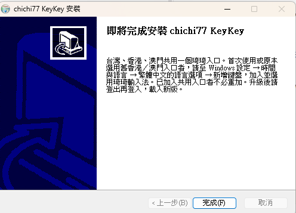

*按「完成」結束精靈。畫面提醒：首次使用須到 Windows 語言選項加入琦琦；升級後先登出再登入，載入新版。*

**首次安裝**接著到下一節新增鍵盤。**從舊版升級**則先儲存工作、登出 Windows 再登入，讓工作列與文字程式載入新版；原本已加入的共用入口會保留。

### 使用 x64／x86 ZIP 安裝

將符合架構的 ZIP 完整解壓縮，把整個資料夾放在本機磁碟，例如 `C:\KeyKeyInstaller`，再連按 `Install.cmd` 並依提示授權。不要從 ZIP 預覽、NAS 或共享路徑直接執行。讀完結果後關閉視窗；若有錯誤，記下錯誤碼。首次安裝仍須新增鍵盤，升級後仍須登出再登入。

兩種安裝方式都可直接升級已知舊 TSF 安裝；舊程式尚在使用的檔案會暫時保留。

## 3. 把琦琦加入 Windows 鍵盤清單

Windows 11 開啟 **開始 → 設定 → 時間與語言 → 語言與地區**。在你使用的繁體中文語言右側，點 **… → 語言選項**。

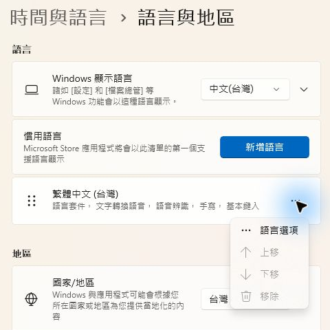

*在「繁體中文（台灣）」右側點 **…**，再選「語言選項」。*

找到「鍵盤」區塊，點 **新增鍵盤 → 琦琦輸入法**。返回後，確認「已安裝的鍵盤」中出現琦琦，才算完成加入。

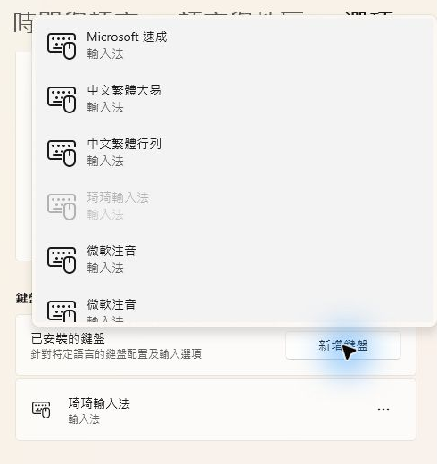

*初次加入時選「琦琦輸入法」。圖中這台電腦已加入，因此該項呈灰色；不必移除後重加。*

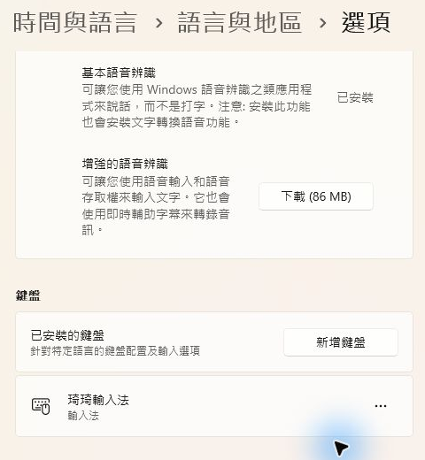

*「已安裝的鍵盤」中看得到琦琦，就能回到文字 App 選用。*

Windows 10 的入口是 **設定 → 時間與語言 → 語言 → 繁體中文 → 選項 → 新增鍵盤**。沒有繁體中文時，可先新增「中文（繁體，台灣）」；只為打中文時，無須改 Windows 顯示語言。

### 香港／澳門語言、舊區域入口與預設輸入法

台灣、香港、澳門共用一個「琦琦輸入法」入口。舊版曾分別登記三個區域，造成三個同名選項；升級成功後會移除舊香港、舊澳門註冊，只保留共用入口。原本選用舊區域入口者，請在 Windows 設定重新加入「琦琦輸入法」並選用；個人設定、自訂詞及學習資料保留。這些入口不是三份舊版本，不必手動刪除登錄或版本資料夾。

新版統一使用同一個共用入口（登記在台灣語言下）；香港、澳門語言使用者可在「新增鍵盤」清單的其他語言區域尋找「琦琦輸入法」。找不到時，可自行新增「中文（繁體，台灣）」再加入琦琦，不需要改 Windows 顯示語言。升級後不再提供「舊香港／舊澳門」入口；先前使用這兩個入口的帳號，需自行新增及選用共用入口；若原本設為預設，也請在進階鍵盤設定重新選擇。已加入共用入口者不必重加。若清單仍顯示舊項目，先關閉 Windows 設定再重開；仍未刷新時，儲存工作、登出再登入。請用包含此修正的新安裝檔直接升級，不必先解除安裝；若部署記錄顯示舊入口清理失敗，重跑同一安裝包可重試。

若希望預設使用琦琦，在 Windows 設定搜尋 **進階鍵盤設定**，於「覆寫預設輸入法」選已加入的琦琦；保持「使用語言清單（建議）」則由 Windows 決定。安裝程式不會替你改預設值。

## 4. 切到琦琦，在記事本試打

開啟 **記事本**並點一下空白文字區，按 **Win + Space**，選清單中的 **琦琦輸入法**。工作列顯示「ㄅ」時可輸入中文；若是「英」，按 **Ctrl + Space** 切回中文。

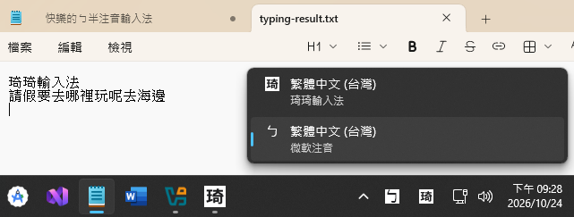

*選清單上列的「琦琦輸入法」。此圖下列反白的是微軟注音，仍須切到上列；不是已選中琦琦的狀態。*

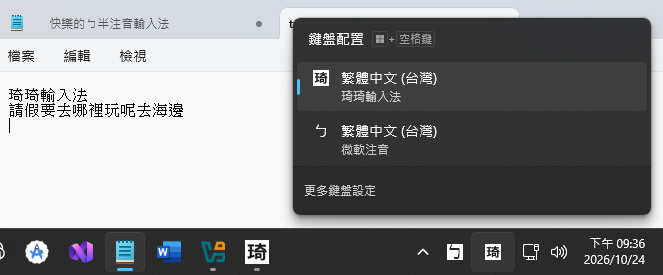

*切到上列後，「琦琦輸入法」整列反白，左側有藍色指示。放開切換按鍵，回記事本開始打字。*

新安裝預設為 **好打注音**。先輸入「**琦琦輸入法**」，按 Enter 確認，再按 Enter 換行；第二行輸入「**請假要去哪裡玩呢去海邊**」，先保留組字。標準注音的一聲字以空白結束音節，其他聲調用聲調鍵完成。

若出現同音錯字，請趁文字仍在組字時，依下一段的方法開候選改正，再確認。長句前方的完整詞段會先固定，固定後無法再從組字候選回改。

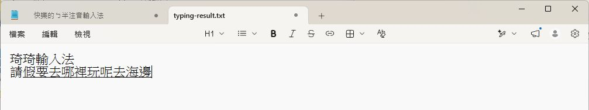

*第一行已確認；第二行尚未確認整句，仍有底線的範圍可回頭選字。*

### 在「玩」開候選，再接著打字

用左右方向鍵把組字游標移到「玩」附近，按 **↓** 開候選；選字目標依目前設定及畫面反白位置確認。按候選旁的數字，或用滑鼠點 **玩**。有候選窗時 Enter 是選字，候選關閉後 Enter 才確認整段。

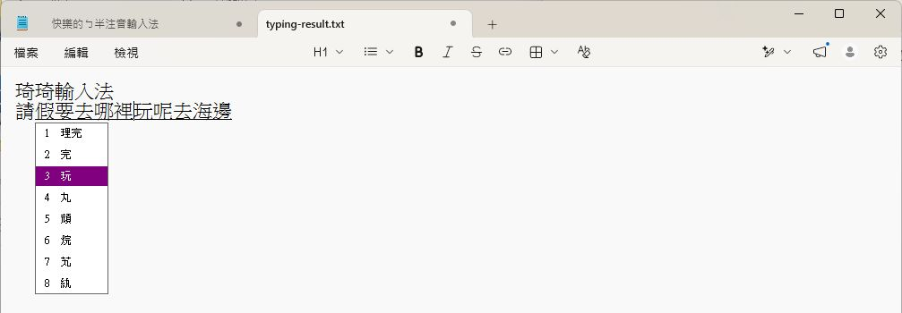

*本次「玩」在第 3 項，已反白但尚未選取；候選順位會受上下文及個人學習影響。*

選好「玩」後，組字游標會留在選字處。若要接著在句尾打字，先按 **End** 回到組字末端。本例保留原本兩行，不另加文字；完成時按 Enter 確認組字，文字就會留在記事本。組字底線的外觀可能隨 App 不同。

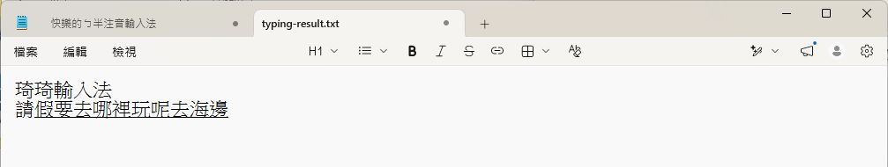

*候選已關閉，游標回到句尾；本例不追加其他詞語。*

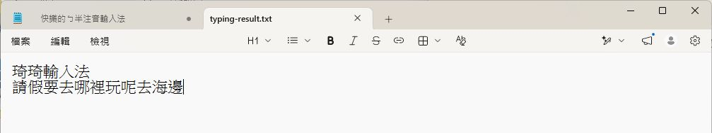

*確認後組字底線消失，兩行文字保留在記事本。*

## 5. 切換模式，使用倉頡提前選字

點工作列的琦琦圖示，可選 **好打注音、傳統注音、倉頡、簡易**，勾號表示目前模式。習慣逐字選字時改選傳統注音；同一個選單也提供中英文、全半形及 **輸入法設定…** 入口。

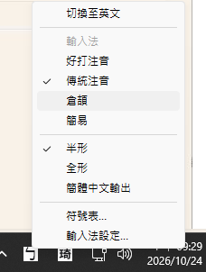

*勾號表示目前使用「傳統注音」；灰底的「倉頡」只是滑鼠停留位置，點選後才切換。選單下方也能開啟符號表與輸入法設定。*

想用倉頡提早選字，打開 **輸入法設定… → 倉頡／簡易**，在倉頡區塊開啟 **即時候選**與 **未打完也能選字**，按 **套用**。桌面版這兩項預設關閉。

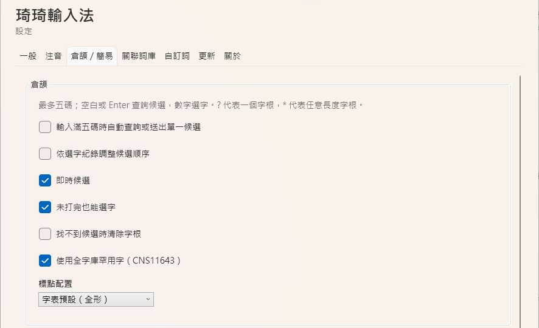

*這台電腦原本已開啟兩個選項；桌面新安裝預設仍為關閉。即時候選與錯碼清除不能同時開啟。*

回記事本，從工作列改選 **倉頡**，只輸入 **竹、大**，也就是 H、K，就能查看含 **喬**的候選。找到喬後點選或按候選編號即可，不必先打完「竹大口月口」。

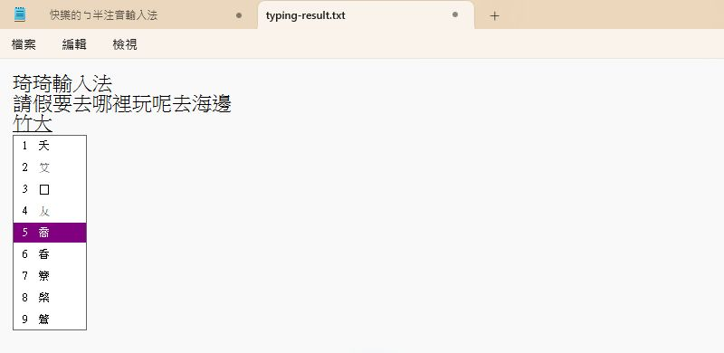

*只打 H、K，畫面仍是「竹大」字根，便能看到「喬」；本次在第 5 項，未打完整五碼。*

倉頡最多五碼，空白或 Enter 查詢；簡易滿兩碼自動查詢。用數字選字、Page Up／Page Down 翻頁、Backspace 刪字根、Esc 取消；倉頡也支援 `?`／`*` 萬用字元。

## 6. 調整設定、自訂詞與符號

從工作列選 **輸入法設定…**。先在「注音」選熟悉的鍵盤配置，再到「一般」調整候選窗方向及大小；改好按 **套用**，回記事本試打。

「一般 → 鍵盤與輸入法」的 **中文模式忽略 Caps Lock（微軟新舊注音）** 預設開啟，英文模式仍保留 Caps Lock 大小寫。啟動時使用中文或英文也可在一般設定選擇，下次輸入法服務啟用時生效。

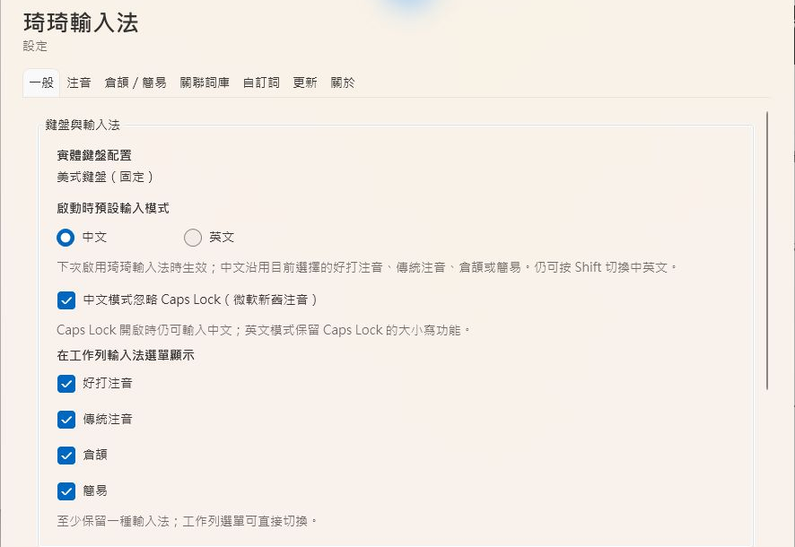

*本機使用啟動中文，已勾選中文模式忽略 Caps Lock，四種輸入法均顯示於工作列選單。*

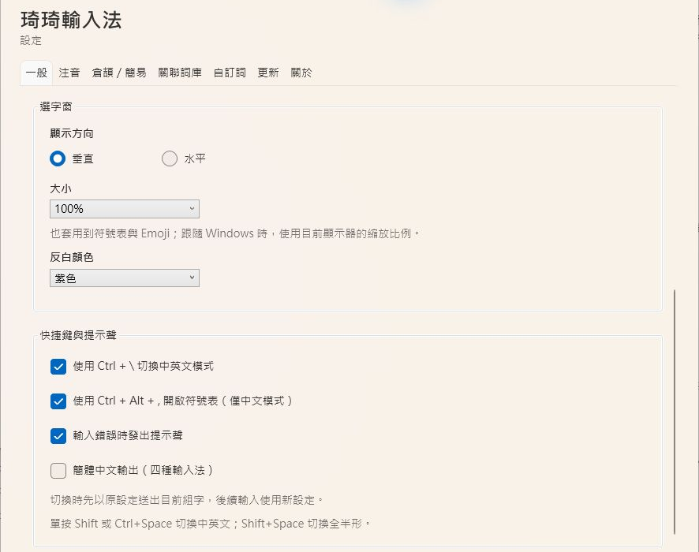

*本機使用 100% 垂直選字窗與紫色反白，並啟用 `Ctrl + Alt + ,` 開啟符號表。這些選項沿用本機既有設定。*

「注音」的好打注音進階設定可調整組字與選字習慣；關聯詞在「關聯詞庫」勾選。初次使用先保留預設，需要時再調整。

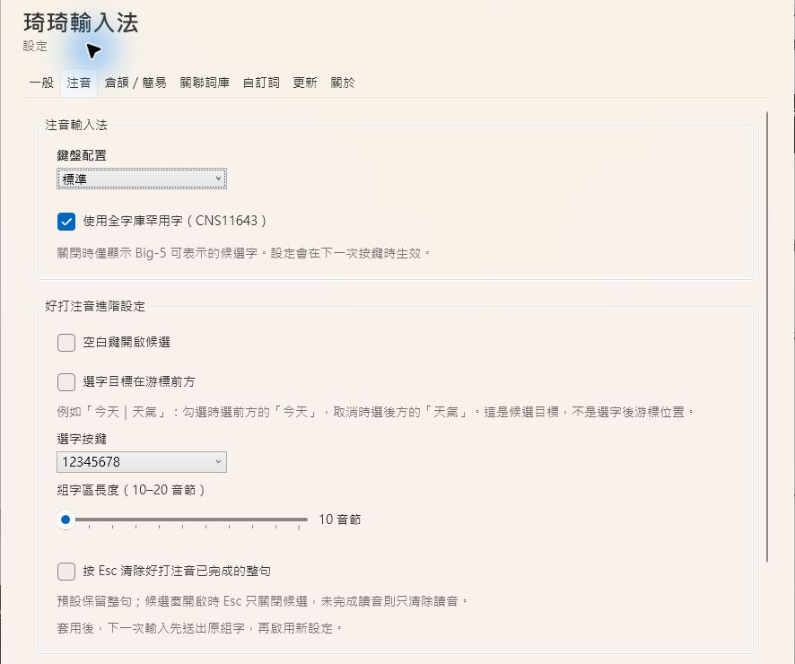

*本機使用標準注音、`12345678` 選字與 10 音節組字；空白鍵開候選、選字目標在游標前方及 Esc 清除整句均未勾選。*

在 **自訂詞**輸入常用詞，按 **取得讀音**後選擇符合詞義的讀音，再依畫面新增。也可匯入／匯出資料；重設好打注音學習紀錄會保留自訂詞。

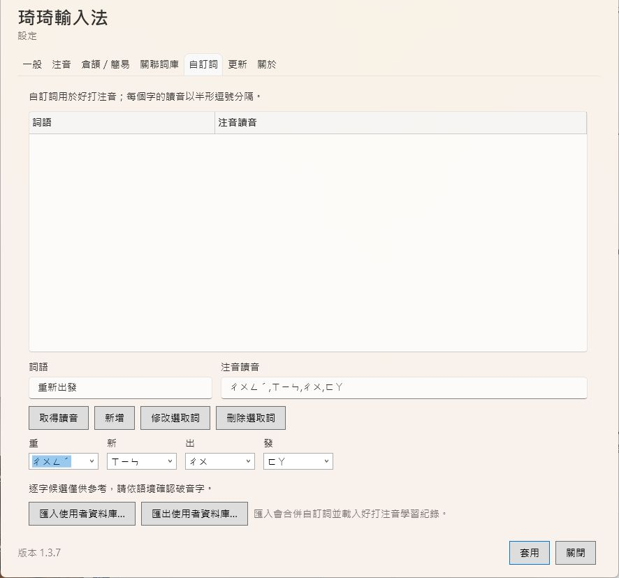

*輸入「重新出發」後按「取得讀音」，再依詞義把「重」選為 ㄔㄨㄥˊ。逐字候選僅供參考；圖中尚未按「新增」。*

需要標點或 Emoji，可從琦琦選單開啟 **符號表**，先點回文字欄位，再選想插入的符號。

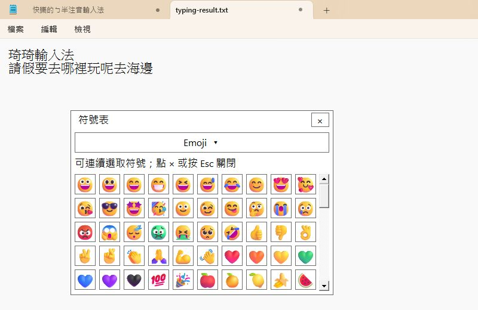

*從符號表上方的分類選單選 Emoji；先點回記事本要插入的位置，再點想用的符號。*

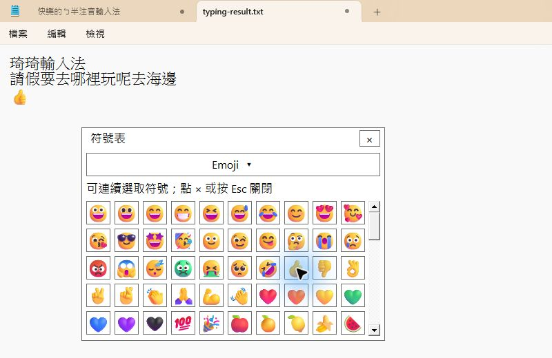

*點選後，👍 已出現在記事本第三行。符號表保持開啟，可繼續選取；按右上角 × 或 Esc 關閉。*

### 常用按鍵

| 按鍵 | 用途 |
| --- | --- |
| **Win + Space** | 切換 Windows 已加入的輸入法。 |
| **Ctrl + Space** | 在琦琦內切換中英文，保留並送出目前組字。 |
| **Shift + Space** | 切換半形／全形。 |
| **↓** | 好打注音組字時開候選。 |
| **1–9**、滑鼠或方向鍵後 Enter | 選取對應候選，以實際編號為準。 |
| 候選窗中的 **Space／Page Down**、**Page Up** | 候選翻頁。 |
| **Enter** | 候選窗開啟時選字，關閉時確認組字。 |
| **Esc** | 關閉候選窗或取消未完成輸入。 |

## 7. 檢查新版與更新

從工作列琦琦選單開啟 **輸入法設定… → 更新**。按 **立即檢查更新**，即可查看是否有新版；即使關閉自動檢查，仍可手動檢查。

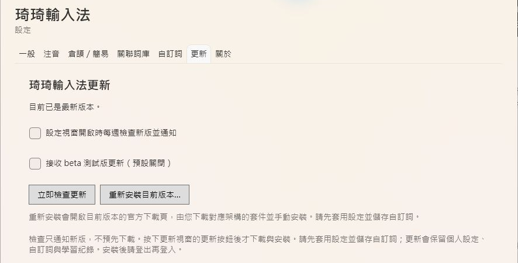

*這台電腦的 1.3.7 查詢結果為「目前已是最新版本」。圖中沿用原本關閉每週檢查的設定，未開啟 beta；不代表全新安裝的預設值。*

### 每週通知怎麼運作

**設定視窗開啟時每週檢查新版並通知**預設開啟，升級時保留既有選擇。Windows 只在這個設定程式執行期間檢查；關閉視窗後不會有常駐更新服務或登入排程。

距上次檢查嘗試滿 **7 天**，且設定程式啟動至少 **10 分鐘**，才會自動查詢。尚未滿 7 天時會等到期限；睡眠或關機期間不補跑。手動檢查也會記錄嘗試時間，讓下次自動檢查延至 7 天後。可隨時取消勾選停止自動檢查。

### 有新版時，先確認再下載

檢查只會通知新版。只有你在更新視窗按下更新按鈕，才開始下載，並在簽章驗證通過後啟動安裝程式；需要管理員授權時，依 Windows 提示確認。關閉或略過新版通知不會下載安裝包。

更新前先套用設定、儲存自訂詞與其他文件；更新會保留個人設定、自訂詞及學習紀錄。完成後儲存工作並登出、重新登入，再到記事本試打及核對版本。目前自動安裝更新適用 **x64 安裝程式**；32 位元 Windows 請從正式下載頁取得 **x86 ZIP**，依本指南手動安裝。

**接收 beta 測試版更新（預設關閉）**供願意測試新功能的人選用；一般使用者保持關閉即可。切換頻道前先套用設定並儲存自訂詞；開啟 beta 不會略過下載、簽章驗證或安裝確認。

### 重新安裝同一版本與檢查失敗

**重新安裝目前版本…**會查詢官方發布頁，確認有與目前版本及架構相符的套件後開啟該頁，由你下載並手動安裝。它不會自行下載或啟動安裝程式，也不會改選其他版號；使用前同樣先儲存設定與自訂詞。

查詢失敗或逾時時，先確認網路，再按「立即檢查更新」重試，或使用本指南第 1 節的正式下載頁。這次只實拍同版檢查結果，未執行新版下載或安裝；技術與驗收範圍見[桌面更新說明](update/README.md)。

## 遇到問題時

**若安裝或升級遇到問題，請先[解除安裝琦琦輸入法](#移除琦琦輸入法)，再重新安裝。** 使用 Windows 設定中的目前解除安裝入口；若提示需要重新開機，請先重新開機，再執行新版安裝包。重新安裝後，依第 3 節確認已加入並選用琦琦鍵盤。

| 情況 | 先檢查 |
| --- | --- |
| 安裝檔被 Windows 擋住 | 核對檔案來源、版號與安全提示；不要關閉 Defender 強行安裝。 |
| **Win + Space** 看不到琦琦輸入法 | 先依第 3 節到繁體中文的「語言選項 → 新增鍵盤」加入琦琦；仍未出現時登出再登入。 |
| 工作列仍開啟舊設定頁或顯示舊選單 | 升級後登出再登入，讓 Explorer 重新載入新版輸入法。 |
| 已選琦琦但打字仍是英文 | 確認工作列不是「英」，按 **Ctrl + Space** 切回「ㄅ」。 |
| 某個 App 沒有組字底線 | 先在記事本試打；不同 App 對 TSF 底線的顯示可能不同。 |
| 無法輸入中文字或候選 | 在記事本確認是「ㄅ」模式，輸入完整讀音；記下 Windows 版本、App 名稱與畫面後回報。 |
| 顯示請重新開機／代碼 3010 | 解除安裝已完成，使用中的產品檔案已排定於重開機時刪除。儲存工作後自行重新開機；不需要再次解除安裝。 |
| 舊測試包留下 `pending file cleanup`、清理時拒絕存取 `Uninstall.exe`，或重裝中止 | 保留 `Deployment.log`；使用包含一次移除與 TSF 驗證修正的新版安裝包直接安裝，不必反覆執行舊移除器，也不要手動刪登錄或 Program Files。 |
| 安裝／解除安裝顯示其他錯誤 | 記下錯誤碼並保留下載包；所有建置（含 GitHub Actions）預設關閉診斷，設定內開啟後的 3 天有效期限內才會寫 `C:\Program Files\chichi77 KeyKey\Deployment.log`。自訂路徑或登錄、檔案不一致的舊安裝可能需要個別處理。 |

## 移除琦琦輸入法

只想暫停使用，可到第 3 節的「語言選項」移除琦琦鍵盤，程式仍保留在電腦上，之後可再次新增。

要移除程式，先切換到其他輸入法並儲存工作。Windows 11 開啟 **設定 → 應用程式 → 已安裝的應用程式**，搜尋 **chichi77 KeyKey**，按 **… → 解除安裝**；Windows 10 則在 **應用程式與功能** 選取該項目並按 **解除安裝**。若顯示「請重新開機完成移除」，代表輸入法已解除註冊，Windows 已接受使用中產品檔案的刪除排程。**儲存工作後重新開機即可，不需要再次解除安裝。** 正常移除會同時移除「已安裝的應用程式」項目；若 Windows 設定尚未刷新，關閉再重開。只有實際操作失敗才保留「解除安裝未完成，請重試」入口並顯示錯誤。產品根目錄可能保留診斷記錄與移除狀態，額外放入或修改過的檔案也會保留，這不表示輸入法仍有註冊。

移除保留個人設定、自訂詞及學習資料，之後重新安裝可沿用。請使用 Windows 的**目前移除入口**；升級後不要執行以前另存的舊 ZIP／舊解除安裝 EXE。若舊 TSF 安裝的移除入口故障，可用新版 ZIP 的 `Uninstall.cmd` 載入安全維護工具後移除，再安裝新版。歷代實際發布包的升級、移除與重新安裝仍需逐一實機驗收；Yahoo 舊 IMM／MSI 產品需使用其自己的解除安裝入口。

Windows 切換鍵盤的系統操作可參考 [Microsoft 的語言與鍵盤設定說明](https://support.microsoft.com/en-us/windows/hardware/input-devices/manage-the-language-and-keyboard-input-layout-settings-in-windows)。建置與進階部署資訊見 [Windows TSF 技術文件](Source/Loaders/Windows-TSF/README.md)。

## 圖片與適用範圍

本頁的 Windows 操作圖拍攝於 2026-10-24，使用 Windows 11 26H2（26300.9711）x64 實機、已安裝 1.3.7 與記事本。下載頁為未登入 GitHub 的正式 1.3.7 頁面；歡迎頁使用已核對 SHA-256 與有效 Authenticode 簽章的安裝程式。安裝完成頁、Windows 切換清單與工作列四模式選單由維護者提供原圖；工具未執行安裝，完成頁不代表已完成登出、重新登入或安裝後版本核對。新增鍵盤清單呈現本機已加入的實際狀態，未移除後重加。

好打注音使用實際注音按鍵輸入，已確認指定兩行、「玩」候選與 Enter 確認結果；未貼上文字模擬組字。本輪 Windows 指南的補圖位置已補齊；Windows 10／x86、歷代發布包升級與移除須各自驗證，單張圖片不代表整個平台驗收完成。

自行建置與部署細節見 [BUILDING.md](BUILDING.md#windows-10-與-11)及 [Windows TSF 技術文件](Source/Loaders/Windows-TSF/README.md)。
