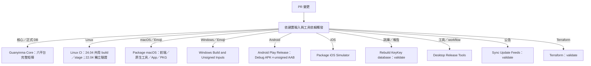
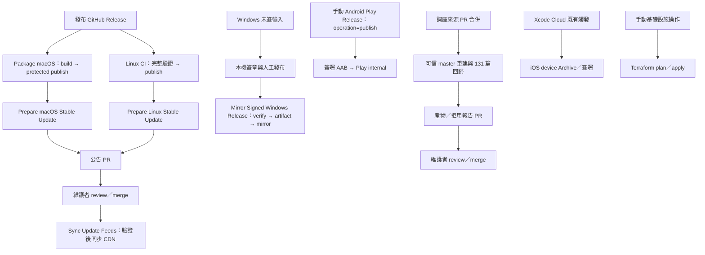

# PR 建置與發布驗證

PR 依實際建置輸入與工具依賴觸發，保留 Linux CI、Package macOS、Windows Build and Unsigned Inputs、Rebuild KeyKey database、Android Play Release 五個既有入口。共用核心、平台接合、正式包、發布後公告與 CDN 部署分開驗證。此文件描述接線，不能代替特定 commit 的 Actions 結果。

## 目前入口

儲存庫保留 13 份 workflow。macOS Symbols、Windows Shared Data、Windows Signing Tools 及 Package Android 的必要驗證已收進下列既有入口。

| Workflow | 驗證與共用方式 | 正式作業 |
| --- | --- | --- |
| Guanyinma Core | 六平台原生／無視窗 Rust 與 C ABI；macOS 原生 system SQLite 的 96% 涵蓋率門檻 | 不發布產品 |
| Linux CI | 24.04 staged smoke 共用 full job 的 build／stage；完整 24.04 與 22.04 各一個 runner | 原套件發布與鏡像入口 |
| Package macOS | 同 runner 執行符號、Shift／設定、Rust 接合、原生更新工具與 App／PKG 建置 | 原受保護的簽章、公證與發布 job |
| Windows Build and Unsigned Inputs | 共用 x64／x86 產物；保留嚴格短路徑、native／managed 配對、更新組態、PowerShell 5／7 與未簽封裝驗證 | 保留待本機簽章的來源與產物證明 |
| Android Play Release | PR／手動 verify：一次準備，同 job 產生 Debug APK 與 unsigned Release AAB；兩個 lint，選定 Debug JNI tests 一次，兩包分別驗 DB／授權／雜湊 | 預設手動 publish 保留 google-play-release environment、簽署及 Play internal 上傳 |
| Package iOS Simulator | Swift host 接合、Simulator App／extension 與封裝內容驗證 | 實機簽署與商店流程另由 Xcode Cloud 負責 |
| Desktop Release Tools | 一個 Ubuntu runner 執行 actionlint、Python 發布工具／metadata 測試及已提交 feed 檢查；原生組態由 Mac／Windows 入口驗證 | 不發布 |
| Prepare macOS Stable Update | 原生工具測試由 Mac 入口執行 | 正式發布成功後核對原包、簽候選、保留不可變副本並開公告 PR |
| Prepare Linux Stable Update | Python 工具測試由共用工具入口執行 | 核對原發布與套件，開 Linux／FreeBSD 公告 PR |
| Mirror Signed Windows Release | Python／PowerShell 工具測試集中於共用工具與 Windows 入口 | 原 Windows verify → 同 run artifact → 受保護的 CDN mirror |
| Sync Update Feeds to CDN | 保留 feed 資產檢查與按 beta metadata 變更啟動的 Windows 原生驗證 | reviewed master 的公告同步及明確手動 beta 資產保存 |
| Terraform Release Mirror | Terraform／自身 workflow 變更時 fmt、無 backend 的 init、validate | master 上手動 plan／apply |
| Rebuild KeyKey database | 來源工具、已提交模型、manifest 與共用 DB 接線驗證；使用鎖定 Guanyinma Rust typing-cost | 合併後可信來源重建、固定 131 篇／30 動作門檻，再開產物或拒用報告 PR |

Apple jobs 統一使用固定的 `macos-26` arm64 runner；iOS Simulator 封裝選用映像內的 Xcode 26.6。核心 iOS job 依可用的 iOS runtime 建立獨立模擬器，macOS 核心仍使用原生 system SQLite 並執行 96% 涵蓋率門檻。runner 映像版本不決定產品最低系統版本；更換映像後須以該次 CI 實際執行結果確認相容性。

## 觸發與驗證範圍

| 變更 | 必要流程 |
| --- | --- |
| 報告／manifest 更新，實際 KeyKey.db 沒變 | DB、manifest、來源與接線一致性驗證 |
| 正式 KeyKey.db bytes 或共用核心實碼 | 完整核心矩陣及受影響平台接合／封裝；DB 工具驗證 |
| 一般平台前端 | 該平台入口 |
| iOS ci_post_clone.sh（文件不單獨觸發） | iOS Simulator 建置；真正 Cloud hook 與 device Archive 另驗 |
| 共用 Emoji 來源 | 真正讀取該來源的平台：iOS KeyboardInput.swift 影響 iOS／macOS／Windows；SymbolEmojiSupplement.json 影響兩個桌面前端 |
| 發布、更新、簽章工具 | 共用 Python／語法檢查，以及相關原生平台的組態驗證 |
| Feed 內容 | feed／公開資產驗證；必要時 Windows 原生驗章 |
| Terraform | 基礎設施驗證 |

核心與平台入口排除無執行影響的 Markdown；DB 流程仍驗證作為建模／驗收輸入的文章，不能用全域 Markdown 排除規則略過它們。Git attributes 等全域建置輸入另依路徑規則處理。

Linux 的 staged smoke 在既有 24.04 full build／stage 完成後、任何 system install 前執行並獨立保存證據。source archive、system install、ASan／UBSan、套件升級／重裝、GTK3／GTK4／Qt6 與 22.04 最低 API 檢查均保留。合併 runner 不代表 staged 與 installed 測試可以互相代替。

合併的測試保留原參數與環境；一套失敗後其他獨立套件仍收集結果，失敗不轉成成功。Windows 強制 `KEYKEY_TEST_REQUIRE_SHORT_PATHS=1`，保留兩種 PowerShell 與 beta Settings 組態；原生／模擬器、ABI、SQLite provider 與封裝 variant 的產物不可混用。

此處的路徑篩選是各入口本身的事件規則，不另啟動總控 runner。以核心變更且影響全部平台估算，六個核心 jobs、兩個 Linux jobs、Mac／Windows／Android／iOS 各一個 job，以及 DB 一個 job，共 13 個需排 runner 的 jobs；實際以觸發檔案與執行結果為準，不把 skipped job 或 reusable 呼叫本身多算成 runner。

## 手動入口

原本的預設操作與 release_tag 使用方式保留。選定測試用途時可從既有入口執行：

- Package macOS：`checks=package` 為原預設建置／封裝；`checks=tests` 只執行合併進來的前端與原生工具驗證。
- Windows Build and Unsigned Inputs：`checks=package` 為原預設完整驗證與未簽封裝；`shared-data`、`signing`、`updater` 保留原獨立驗證用途。
- Android Play Release：手動預設 `operation=publish` 仍使用發布金鑰與 Play internal；`operation=verify` 只產生 APK／unsigned AAB，與 PR 驗證相同。
- Linux CI、資料庫重建及其餘正式發布／補救入口沿既有流程。

## 發布與信任邊界

PR 維持唯讀，不使用發布環境或其 secrets。workflow 檔名、發布工作名稱、同 run artifact handoff、來源 commit、簽章與防過期部署檢查均是發布契約，不能僅為減少檔案數目任意搬移。正式簽章、商店上傳、Terraform 操作、公告 PR 與 CDN 部署仍各自依既有事件、分支及 environment 條件執行。

平台編譯、核心 runtime、Simulator／實機 UI 與安裝驗收是不同證據層級。合併工作不改變各平台原本的驗收要求。
