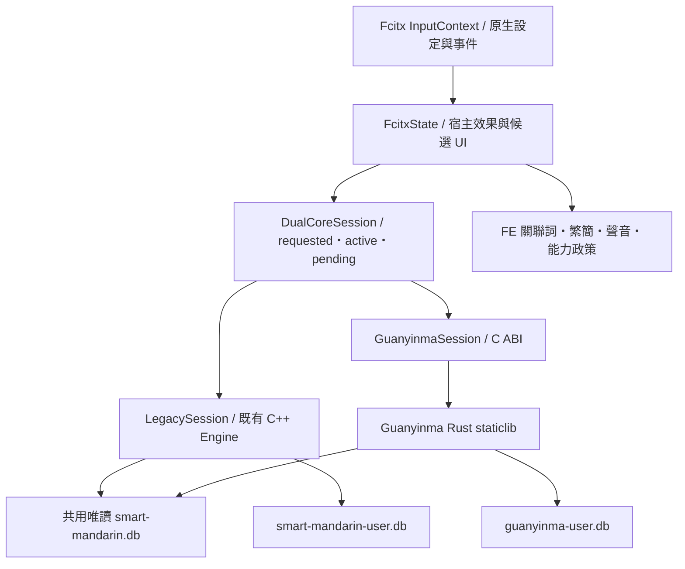

# Guanyinma Linux Fcitx 5 雙核心接合評估與開發計畫

評估日期：2026-10-26。程式基準：`Guanyinma` 分支、`6d335f7`。本文是讀碼後的實作提案；本次沒有修改引擎、執行建置、安裝套件或操作桌面輸入法。文中的新檔案、設定鍵及測試名稱均為規劃，尚未實作。

實作進度：本計畫的 Linux 程式接合、資料工具與建置／封裝入口已實作。依使用者最新指定，含 Rust 的雙核心建置預設改為 Guanyinma（Rust），不含 Rust 的建置仍預設 C++；保留已明確保存的核心偏好。操作與目前驗證界線見 [Linux adapter 說明](GUANYINMA_LINUX_ADAPTER.md)。以下保留原評估基準與分階段工作範圍，其中保留 C++ 預設的原規劃已由上述決定取代；不能將未執行的桌面／FreeBSD 驗收推定通過。

## 結論與交付範圍

Linux 可以沿用其他平台的方式，在同一個 Fcitx 5 addon 中加入 Guanyinma backend，保留現有 C++ 核心與預設。工作集中於接合與平台生命週期，無須重寫 Rust 注音解析、walker、排序或學習，也無須建立第二套 Fcitx frontend。

首輪目標為 Ubuntu 24.04 x86_64：同一套好打注音、傳統注音、倉頡及簡易可選兩個核心，沿用原生設定、候選窗、關聯詞與輸出功能。保留 Ubuntu 22.04 建置相容性；FreeBSD 共用程式碼與系統 SQLite 策略，但 Rust 雙核心的 ports 封裝及原生宿主驗證另列交付，不由 Linux 結果推定完成。

建議分六個階段完成。第一個可交付切片是「可選建置 Rust、獨立 session、四法基本輸入與一次送字」；正式顯示雙核心可用之前，還須完成安全切換、字型過濾、資料管理、封裝及少量宿主冒煙。

## 其他平台的實際接合方式

以下已對照文件與實作；接合程式存在、測試入口存在、原生測試通過、安裝及真實宿主驗收是不同證據。

| 平台 | 雙核心入口與預設 | 值得沿用的設計 | Linux 不宜直接照搬之處 |
|---|---|---|---|
| macOS | `GuanyinmaMacAdapter` decorator 與 `GuanyinmaMacCoreSelection` proxy；預設 Manjusri | 穩定 context proxy；檢查原生 buffer、候選與 pending commit；新事件前才換 delegate；失敗保留舊 session | PV sandwich、IMK／TIS、UTF-16 buffer、MJSR 容器及 Apple SQLite codec |
| Windows | `KeyKeyEngineSession::Create` 與 `GuanyinmaWindowsAdapter`；預設 Manjusri | requested／active core 分開；TSF retained effects 完成後才接受下一事件；詞庫 handle 固定 backend | TSF 多階段文字交易、WinRT JSON、DirectWrite、bundled SQLite／靜態 CRT |
| iOS | `InputEngine`／`DualCoreInputEngine`；預設 Swift | 共用 FE contract；設定與模式同步；組字、候選及 host effects 完成後才切換 | App Group 詞庫發布及各入口私有學習、UIKit document proxy |
| Android | `InputEngine`／`DualCoreInputEngine`、JNI；預設 Java | host effects 綁原 `InputConnection`；成功後 acknowledge，新宿主明確 abandon；不重播；App／IME 共用該核心資料 | Java／JNI、Android bundled SQLite、觸控及實體雙排行為 |

主要程式依據：

- [macOS proxy](../Source/Loaders/OSX-IMK/GuanyinmaMacCoreSelection.mm)：`BufferQuiet`、`NativeBoundaryQuiet`、`prepare`；[macOS adapter](../Source/Loaders/OSX-IMK/GuanyinmaMacAdapter.mm)：`createContext`、`createDelegate`、`render`。
- [Windows session](../Source/Loaders/Windows-TSF/KeyKeyEngine.cpp)：`KeyKeyEngineSession::Create`；[TSF host](../Source/Loaders/Windows-TSF/TextService.cpp)：`retainedInputResult_`、`retryInputResult`；[Windows adapter](../Source/Loaders/Windows-TSF/GuanyinmaWindowsAdapter.cpp)：`Configuration`、`syncCandidatePosition`、`render`。
- [iOS proxy](../Source/Loaders/iOS-Keyboard/KeyKeyEngine/Sources/KeyKeyEngine/DualCoreInputEngine.swift) 與 [iOS adapter](../Source/Loaders/iOS-Keyboard/KeyKeyEngine/Sources/KeyKeyEngine/GuanyinmaInputEngine.swift)。
- [Android proxy](../Source/Loaders/Android-IME/app/src/main/java/tw/chichi77/keykey/android/DualCoreInputEngine.java)、[IME service](../Source/Loaders/Android-IME/app/src/main/java/tw/chichi77/keykey/android/BopomofoImeService.java)：`apply`、`applyHostEffects`、`onStartInput`、`onFinishInput`；[JNI ownership](../Source/Loaders/Android-IME/app/src/main/cpp/guanyinma_jni.cpp)。

四平台共同點是：核心只處理共用輸入語意，FE 負責原生事件、座標、字型、視窗與宿主操作。各自的 acknowledge／abandon 是 FE 自訂的交易管理，**C ABI 沒有通用的宿主 ack 函式**。`apply` 回傳當次 effects，`snapshot` 不產生新 effects，見 [C ABI 契約](../Source/Guanyinma/include/guanyinma.h)。

## Linux 現況與修改位置

目前 Linux 沒有 Guanyinma build/link、核心選擇或 Rust session。原核心是 Linux 自有 C++ 引擎，不是 Manjusri；設定及介面應稱「C++ 原核心」，不能直接沿用 Windows 的 `Manjusri` 識別值。

| 區域 | 現有實作 | 必要修改 |
|---|---|---|
| 引擎契約 | `engine/include/keykey/linux_ime/engine.h` 的 `Engine`、`InputContextState`、`EngineResult` | 增加 backend 中立的 session／snapshot／effects 契約；以 wrapper 包住原 `Engine`，避免讓 Rust 偽裝成可複製的 `Engine` |
| 每個輸入 context | `adapters/fcitx5/fcitx5_engine.cpp` 的 `FcitxState` 持有 `context_`、`sourceEngine_`、`activeEngine_` | 改由每個 `InputContext` 持有雙核心 proxy、有效設定快照、模式、候選視圖 token 與當次效果狀態 |
| 設定 | 同檔 `KeyKeyConfig`、`applyConfig`、`engineFor`、`reloadConfig` | 新增輸入核心選項與可用性／錯誤狀態；保留既有設定鍵及 defaults；核心偏好變更不強迫送出舊組字 |
| 事件 | 同檔 `translate`、`processModeKey`、`process` | Rust 路徑使用實際 Unicode 字元、raw modifiers 與 keypad 來源；快捷鍵辨識後轉語意操作 |
| 送字與焦點 | 同檔 `apply`、`commitAndReset`、`reset`、`deactivate`、switch watcher | 定義一次性效果消耗、`ClientUnfocusCommit`、reset／destroy 與新 context 邊界，防止漏字及重送 |
| 候選與組字 | 同檔 `CandidateWord`、`select`、`selectSmartCharacter`、`updateUi` | 明確映射當頁索引、scalar／reading／UTF-8 byte 座標；過期候選 callback 拒絕 |
| FE 附加功能 | `engine/src/engine.cpp` 的 `outputText`、`punctuationQueryKey`、`selectAbsoluteCandidate`；`associated_phrase_dictionary.*` | Rust 路徑重用關聯詞資料與繁簡轉換；釐清符號表由誰持有；避免送字、寬度及繁簡轉換做兩次 |
| 候選能力 | `engine/src/candidate_encoding.cpp` 僅有 iconv Big5-HKSCS 過濾 | 新增原生字型能力服務，經 C ABI callback 在核心排序／分頁／graph 前過濾 |
| 使用者資料 | `smart_mandarin_user_data.*`、`tools/smart-mandarin-phrases.cpp` | 獨立 Rust DB；詞庫命令按核心分派，Rust CRUD／reset／備份經 C ABI |
| 建置與發行 | CMake、`configure`、CI、source archive、Debian staging | 加鎖定工具鏈、Rust PIC staticlib、系統 SQLite、JSON／字型依賴、離線來源及 notices |

現行 `FcitxState::process` 在輸入法、注音模式或部分設定改變時會 `commitAndReset`，不能直接把核心選擇塞進這個判斷，否則一按切換就可能送出未完成組字。`applyConfig` 也會遍歷 context 結束倉頡組字；核心偏好的保存必須與這些既有設定行為分開。

目前原引擎內含關聯詞及繁簡／全形處理，不能僅替換 `processKey` 就宣稱 FE 功能完整。採小幅增量：先包裝 legacy 路徑，保留原行為；Guanyinma 路徑重用既有資料／轉換服務，只有確有共用價值時才抽出 helper，不大幅重寫原引擎。

## 建議架構與固定契約

建議新檔案置於 Linux-IME 內的 `engine/include/keykey/linux_ime/`、`engine/src/` 或 `adapters/fcitx5/`，按責任拆成 `input_session.*`、`legacy_session.*`、`guanyinma_session.*`、`dual_core_session.*`、`candidate_font_support.*`、`guanyinma_user_data.*`；不複製 Windows 的 PV／WinRT 相依。

### 核心切換與失敗

- 儲存值提議為 `InputCore=Legacy/Guanyinma`；缺值、未知值與不含 Rust 的 build 使用 Legacy。build 是否含 Rust，與執行時選哪一個核心分開。
- 每個 context 分開保存 requested／active／pending／lastError。只有舊 session 沒有 reading／組字／核心候選／FE 關聯詞或符號候選，且沒有未消耗 effects 時，才由下一個新輸入事件切換。
- 候選點擊交回產生該視圖的 backend；附 backend generation、view generation 及候選文字／跨度身分。失效視圖消耗或拒絕，不將相同 index 用於新 session。
- 先成功建立 replacement，再釋放舊 session。同步設定、中英及全半形模式；不搬移學習、不重放按鍵。首次建立失敗可留原核心，顯示失敗原因；以偏好／設定 revision 或明確重試為界，不逐鍵反覆開啟。
- 已運作的 Rust session 發生操作或寫入錯誤時保留最後可見狀態並回報；不將同一事件交給另一核心。只有明確生命週期邊界才 reset／abandon。

### Fcitx 效果、焦點與座標

`InputContext::commitString`、`deleteSurroundingText`、`forwardKey` 都沒有宿主接受結果；因此本計畫的「效果完成」只能表示已按順序交給原本的 Fcitx context，不能表示文字已被應用接受。[Fcitx 5.0.14 官方 InputContext 介面](https://github.com/fcitx/fcitx5/blob/5.0.14/src/lib/fcitx/inputcontext.h)可核對這個邊界。

1. 每個 operation 產生一個 owned `EffectBatch`，綁定原 context／generation；按需要消耗 discard、delete、commit、return，再更新原生 preedit／panel。順序依實際可產生的效果組合做接合測試。
2. `snapshot` 僅重建畫面，不重新提交 effects；UI 更新失敗也不重送 `apply`。相同 batch 不因下一鍵、設定 reload 或 repeated deactivate 再次送出。
3. 原 `ClientUnfocusCommit` 分支必須保留：客戶端已在 focus-out 提交可見 preedit 時，FE 只清理舊 session，不再送一次 `finish` commit。若 Rust reset 失敗，retire／close 舊 session，在新邊界重建，不能將舊組字留給新宿主。reset、輸入法切換、focus-out 及 destroy 各自明定保留／丟棄規則，不向新 context 補送舊 effects。
4. Rust `delete_backward`／`send_return` 不能當作空效果忽略。先確認 Linux desktop 路徑哪些情況可能產生；能讓原按鍵自然通過時不另送同一鍵，需合成時以 Fcitx 原生 API 派送並避免雙送。若使用 surrounding-text 刪除，須檢查 capability、有效座標與字元單位，不能任意假設 byte。
5. Rust `cursor` 是可見文字的 Unicode scalar；Fcitx `Text::setCursor` 是 UTF-8 byte，必須轉換。preedit click 的文字位置再按 `segments`／讀音跨度轉成 `open_candidates.index`；未完成注音、補充平面字及多字詞不能直接用同一整數。[Fcitx Text 官方介面](https://github.com/fcitx/fcitx5/blob/5.0.14/src/lib/fcitx/text.h)明定 byte cursor。

### 設定與既有行為對照

所有設定先複製成有效的 owned snapshot；部分 Rust setter 是整組替換，不能只送變動欄位而意外回到核心預設。下表是首輪建議值；未列為既有 Linux 功能的選項不趁此增加 UI。

| Linux 設定／行為 | Rust／FE 對應 |
|---|---|
| 三個既有 Fcitx method IDs；注音另選 Smart／Traditional | `method=smart/traditional/cangjie/simplex`，不新增重複輸入法 |
| 五種注音布局 | `layout=standard/eten/eten26/hsu/hanyu_pinyin` |
| 桌面十／十一整詞擠字 | `profile=desktop`、`max_completed_syllables=10`、`shift_at_limit=false` |
| Linux 固定 1–9、每頁九字 | 明確指定 `smart.candidate_selection_keys`、`traditional_selection_keys`、`table_selection_keys` 為 `123456789`；不能套 Rust 好打預設八鍵 |
| 三個 Smart preferences | `space_opens_candidates=false`、`candidate_cursor_at_end=false`、`clear_composing_with_escape=false`，依保存值覆寫 |
| Bigram 與現有好打學習 | `smart.use_bigrams=true`；Smart `learning.user_phrases/candidate_overrides/bigrams=true`；原 Linux 字表未實作持久學習，首輪 `table_learning=false` |
| 倉頡即時／前綴／錯碼清除 | `cangjie.realtime/prefix/clear_on_error`；保留互斥設定、五碼等待確認及 wildcard；簡易沿用二碼查詢／連續輸入，逐項映射 |
| 單按 Shift、Ctrl+反斜線 | 沿用 300ms FE recognizer，先依下述 handoff 政策保留／清理，再送 `set_english`／`toggle_english`；保留 Shift release 的 filter 與 accept 差別，避免宿主認為 Shift 一直按住 |
| 英文半形輸入 | 保留原生 pass-through；不要把每個普通英文字元交給 Rust English session 再改成 `commitString`。全形與明確語意操作另走接合送字 |
| Shift+Space | FE 辨識後送 `toggle_full_width`；Rust 不內建此快捷鍵，repeat 不能反覆切換 |
| Caps Lock／Shift／數字鍵盤 | `ignore_caps_lock_in_chinese=false`；從 raw event 保留真實字元／Shift、CapsLock、NumLock 與 keypad 身分。`literal_keypad` 首輪明確採核心預設 true，列出相較舊 Linux 的差異並驗證，不偷偷改 legacy 行為 |
| 候選直／橫及角括號翻頁 | FE 綁定映射為核心 page／move_highlight；同一頁模型只由一方管理，不讓 CommonCandidateList 再分一次頁 |
| 顯示 Big5 以外候選 | 原設定只限制注音；Rust callback 依 method 合併相同 Big5-HKSCS 規則與原生字型能力，不擴大成倉頡／簡易新字集限制 |
| 繁簡輸出／全半形 | Rust 管其寬度狀態，核心 commit 已轉寬度，不再轉一次；FE raw 關聯詞／符號依同步寬度自行轉一次。兩種來源最後各做繁簡轉換一次，關聯詞查詢／學習保留繁體原文 |
| 關聯詞與符號 | FE 管 overlay、Shift+1–9、資料集選擇及敏感欄位政策；延續原本非 Smart 關聯詞觸發條件，不把已送 commit 再當 `direct_text` 重送 |
| Password／Sensitive、應用快捷鍵 | 沿用 Fcitx 原生 capability 與 pass-through；關聯詞不外洩，輸入 context 的模式／資料不串到另一欄位 |

`EngineResult` 目前只有 commit／beep／UI 等欄位，無法完整承載 Rust 的 delete、return、discard、marked phrase 與候選跨度。新契約應明確表示這些資訊；原引擎 wrapper 可提供空值，不能靠丟棄欄位取得編譯成功。

### 已確認的 handoff 語意差異

讀碼發現不能把 Linux 的 `finishComposition` 直接一對一換成 Rust `finish`；`set_english` 也會呼叫核心 finish，因此中英切換同樣受影響。

| 狀態 | Linux 原 `finishComposition` | Rust 現有 `finish` | 本計畫建議 |
|---|---|---|---|
| 倉頡／簡易尚未確認的字碼 | 清除，不送字根文字 | 送出目前 display | 保留 Linux 宿主邊界政策；模式／方法切換前先走無送字清理，不直接以 setter 隱含 finish |
| 傳統注音已有候選 | 提交目前反白候選 | 提交 display；不能假設就是反白候選 | 以真正 session fixture 對照，定義一次保留反白文字且不額外產生學習／關聯詞的 handoff |
| Smart 尚有未完成讀音 | 先嘗試完成讀音，再提交組句；無匹配時留下可見 literal | `SmartState::finish` 提交當前 visible text | 明列差異，先驗證既有語意操作是否可正確表達；不能在 FE 自行重做讀音解析／選字 |

上述以 `engine/src/engine.cpp` 的 `finishComposition`／`finishSmartComposition`、Rust `src/engine.rs::finish` 及 `src/smart.rs::finish` 為依據。階段 1 必須固定中英切換、方法切換、一般 deactivate、ClientUnfocusCommit 及 reset 各自的政策；階段 2 用少量實例確認操作組合。不足時只新增最小、按行為分類的共用 handoff 設定或語意操作並補核心契約測試，不新增 Linux 名稱的核心演算法分支，也不把有副作用的選字學習當作結束組字捷徑。這是進入階段 3 前須解決的接口缺口，不能留到桌面驗收才處理。

### 候選字型能力

Linux 目前只有 Big5-HKSCS 編碼過濾，沒有可直接沿用的原生 glyph service。建議新增不需要顯示伺服器的 PangoFT2／Fontconfig 字型 provider，以 Pango layout 的 unknown-glyph 檢查作為接受文字的依據；先以最小原型驗證補充平面字、組合字及 fallback，再定案套件依賴。Pango 官方說明指出 [unknown glyph count](https://docs.gtk.org/Pango/method.Layout.get_unknown_glyphs_count.html) 可判斷字串是否有可用字型。

- 經 `guanyinma_session_open_with_candidate_filter` 在完整碼／wildcard／前綴 36 字上限／分頁／Smart graph 前過濾；UI 不再刪除核心候選。
- provider、callback context 與有限記憶體快取活到 session close；callback 不拋例外、不重入 session、不保存借用的 UTF-8 指標。
- 字型／字集政策在 session 內固定。字型集合更新於安全邊界換 provider/session，不在候選中途改索引；若服務初始化失敗，回報不可用，不能悄悄改成接受全部。
- 系統字型可用性不保證 GNOME panel、Qt、GTK 或應用選用相同字型；真正候選及宿主顯示仍以對應桌面冒煙驗證。這項服務不藉由字元範圍黑名單模擬。

### 使用者資料與管理工具

- Legacy 保留 `$XDG_DATA_HOME/chichi77-keykey/smart-mandarin-user.db` 及現有 `CHICHI77_KEYKEY_USER_DB`。Rust 提議另用 `guanyinma-user.db` 與獨立 `CHICHI77_KEYKEY_GUANYINMA_USER_DB` override；沿用私有目錄／檔案權限要求，不能把舊 override 直接當 Rust 目的檔。
- `keykey-smart-phrases` 增加明確的 `--core legacy|guanyinma`；原命令省略時仍操作 Legacy，避免舊腳本因桌面偏好改變而寫錯 DB。Rust 命令透過 admin session 的 C ABI 操作，不直接寫 Rust schema。
- CRUD／reset 以 query＋text 的穩定身分處理；未來若新增詞庫 GUI，開啟時固定 backend token。好打 reset 使用 `reset_method_learning(method=smart)`，保留自訂詞與其他方法的學習領域。
- 提供 Guanyinma 完整 JSON 備份／匯入：`guanyinma_session_user_data`、`guanyinma_user_archive_validate`／`import_user_data`；備份不包含本機 generation／revision。原子寫檔，保護 model、兩核心 DB、sidecar 與別名，不覆蓋唯一原資料。
- 舊 Linux 的三張表欄位、注音 base79 qstring 編碼及 Bigram 的 `previousQuery + " " + currentQuery` 都與 Rust `read_legacy` 相符，可直接接既有 `import_legacy_user_data`，無須另寫 SQLite importer。接合時仍以真正 Linux writer 產生的 fixture，驗證匯入後候選／Bigram 實際生效，不能僅用成功狀態判定；不自動匯入或原地升級。
- 明確匯入會合併自訂詞並保留目的地既有詞值；來源帶 Smart cache 表時替換目的地的 Smart 學習、保留其他方法。重複 query 以來源較後 rowid 為準，override／Bigram 各只保留最近 200 筆，與舊 Linux 不限筆數不同；不宣稱所有舊學習可無損搬移，原來源保留。
- Rust session／詞庫 admin session 共用這一個 Rust store；核心已有多 writer／generation 機制。FE 仍要測外部詞庫變動後的過期候選、重設及寫入失敗，不複製 iOS 特有的 publication DB 架構。

## 建置、來源封裝與 CI

1. CMake 新增 `KEYKEY_ENABLE_GUANYINMA`。初次導入建議預設 OFF，提供明確雙核心 preset；等相應平台驗證完成後再獨立決定正式包的預設。`engine-only`／既有原核心檢查明確 OFF，不讓純 C++ 使用者被迫安裝 Rust。
2. Unix build helper 使用 crate 的 `rust-toolchain.toml`（目前鎖定 1.99.1）及 `Cargo.lock`，`cargo build --locked --lib`、獨立 target-dir、可選 offline、完整增量依賴。跟蹤 `.rs`、header、manifest、lock、toolchain、`build.rs` 和 `Source/Shared`，不 cooker。toolchain 不能以 `Cargo.toml` 的最低 `rust-version` 代替。
3. imported `libguanyinma.a` 連入現有 Fcitx `.so`；驗證 PIC、native link libraries、factory export、`--as-needed` 與不洩漏 Rust／SQLite 符號。兩核心共用 CMake 選定的系統 SQLite，Linux／FreeBSD 不啟用 `bundled-sqlite`，不照搬 Windows provider／CRT。
4. 新 adapter 需要正式 JSON parser；建議以系統 `json-c` 提供 UTF-8 JSON encode/decode，驗證 schema/kind、型別、索引範圍及完整結果後才發布 UI/effects；不手寫字串搜尋。配合字型原型確認 `json-c`、`pangoft2` 的 CMake／Debian／FreeBSD 依賴與 licenses；legacy-only build 不要求它們。
5. `configure` 暴露 enable／disable、CARGO 與 offline 設定，保留 prefix、DESTDIR、out-of-source 及含空白路徑。Unix 建置與 notices 工具不直接沿用目前 Windows helper／notices script 對 Python `tomllib` 的依賴；保留既有 Ubuntu 22.04 Python 相容範圍，或明確加入解析依賴。
6. 同時修兩個獨立來源入口：`ci/create-source-archive.sh` 的白名單及 `ci/build-debian-packages.sh` 的手動 staging，都須帶完整必要 `Source/Guanyinma`、`Source/Shared`、toolchain、Cargo.lock、header、helper 和授權。乾淨解壓後不依賴原 repo、`.git`、target 或 Cargo cache 才能重建。
7. 雙核心離線封裝需要可追溯的 Cargo sources／vendoring 策略與 checksum；單有 Cargo.lock 不保證離線可建。容器與 runner 預備鎖定工具鏈及依賴，任意 uid 的 build user 都可讀寫正確 cache，不把 root 私有 cargo 路徑當成公開工具。
8. 擴充 notices collector 的 Unix／system-SQLite 模式，涵蓋實際 Rust std、鎖定 crates、來源衍生聲明及資料授權。現有 `package-runtime-notices.py` 僅支援 Android／Windows 並強制 bundled provider，不能直接呼叫。一般 install 與 Debian licenses 關閉 standalone copies 的路徑都要真正裝入 notices；同步 `.install` 與 `copyright`。
9. 增量修改 `.github/workflows/linux-ci.yml` 的 paths、工具鏈準備與少量 FE smoke；補 `Source/Guanyinma/**`、`Source/Shared/**` 影響路徑。完整 Rust／C consumer／跨平台核心矩陣仍只由 `guanyinma-core.yml` 負責，不由 Linux workflow 再跑一次。
10. 版本沿用 Linux CMake 的 `PROJECT_VERSION`，本次不升版。現行 Linux release workflow 還有解析 README 版號的舊路徑，與 AGENTS 規則衝突；封裝階段應改讀既有 CMake 來源，列為相鄰修正，不增加專門測版號字串的案例，也不重構更新／發布服務。

FreeBSD 必須尊重 `/usr/local` 的 SQLite、pkg-config 與安裝 prefix；非 Linux 的 Fcitx 預設仍是 OFF，ports 使用時明確啟用。ports 配方不在本 repo，後續另更新 Cargo sources、Rust／JSON／字型依賴、distinfo、plist／notices，並在原生 FreeBSD 執行雙核心 FE smoke；在此之前保留其 legacy build。

## 六階段開發順序與完成條件

| 階段 | 工作與主要檔案 | 完成條件／依賴 |
|---|---|---|
| 1. 契約與 legacy wrapper | 新 `input_session.*`／`legacy_session.*`；小幅接到 `FcitxState`；記錄設定／效果／候選 ownership 與各種 handoff 政策 | 原有 C++ 路徑與 mode-key 檢查通過；requested／active／pending 語意及 API 明確；不改產品預設 |
| 2. Rust 建置與基本 adapter | CMake、Unix helper、新 `guanyinma_session.*`、正式 JSON parser；四法 session／render／一次 commit；釐清上表 handoff 接口缺口 | 真實 C ABI 無 UI 接合冒煙；ON／OFF 均可 build；RAII 正確釋放、無重複 effects、model 唯讀；handoff 可表達；依賴階段 1 |
| 3. 雙核心與 Fcitx 生命週期 | `dual_core_session.*`、核心設定、事件／keypad、候選／座標、焦點與 effects bridge | 未完成讀音、候選、FE overlay、pending effects 延後切換；新 context 不重播；初始化／寫入失敗、過期點擊與 repeated reset 可控；依賴 2 |
| 4. 完整 FE 與資料 | 字型 provider、Big5、關聯詞／符號、繁簡、獨立 user store、CLI CRUD／reset／JSON／明確舊 DB 匯入 | 新核心四法保留相關設定及 FE 功能；跨程序詞庫變動安全；兩資料檔互不污染；依賴 2，可與階段 3 的部分工作並行 |
| 5. 可重建封裝與 CI | source archive、Debian staging/control/rules/install/copyright、containers、configure、notices、workflow | extracted tree 雙核心重建、staged install、套件升級／移除、實際 `.so`／模型／notices 通過；保留舊 user DB；依賴 3、4 |
| 6. 隔離宿主與平台驗收 | 既有 X11 hosts／GNOME VM runner 增加核心選擇及少量案例；FreeBSD 另行原生驗證 | 新 build 的兩核心各自具有 Fcitx→宿主證據；X11、Wayland、XWayland、安裝各自記錄；依賴 5；發布與預設變更另行審查 |

階段 2 可先做基本字型 provider 原型，及早確定階段 4／5 的依賴；正式啟用 Guanyinma 時不能省略候選 callback。若讀碼發現共用 C ABI 缺少必要語意，先以最小通用操作補核心並走其自身驗證，不建立 Linux 專用演算法分支。

## 驗證計畫與證據界線

日常開發以改到的 target 和測試為範圍。以下是計畫中的新測試分類，尚非現成命令或通過紀錄。

| 層級 | 範圍與少量必要案例 | 不能替代的證據 |
|---|---|---|
| 接合無 UI | 真正 C ABI＋Linux adapter／proxy：約 20–30 個代表案例，涵蓋四法載入、設定 defaults、九候選、分頁／點擊、scalar→byte、一次 commit、pending 換核、模式保存、關閉／失敗及資料隔離；舊 `fcitx5_mode_key_tests.cpp` 延伸測真正 `FcitxState` | 不重跑 walker／排序／所有布局的完整 Rust 演算法矩陣；不以 mock commit 證明應用接受 |
| staged install | `.so` 可載入、factory export、系統庫依賴、model hash、工具與 notices；ON／OFF 各自建立 | 不代表套件升級與桌面登入成功 |
| X11 FE smoke | 隔離 D-Bus／Xvfb，GTK3 兩核心各一次實際輸入；另選 GTK4／Qt6 的焦點、候選點擊及核心切換代表案例 | 不代表 GNOME Wayland、XWayland 或真實 App 相容 |
| 封裝改動 | `test-source-archive.sh`、configure/Make、Debian lifecycle；舊 DB 內容不變、Rust DB 保留、remove/purge 不誤刪使用者資料 | 不代表 FreeBSD ports 或正式發布 |
| 桌面驗收 | 專用 VM 的 GNOME native Wayland／XWayland；preedit 點擊、Shift release、跨 App／欄位、候選位置及送字；FreeBSD 原生 Xfce/X11 另列 | 不拿舊 1.3.7 或 legacy 核心的歷史數字當新雙核心證據 |

接合代表案例必須包含：

- Smart 第 10／11／19 音節與「請假要去哪裡玩呢去海邊因為那裡有比基尼」的 FE 送字不漏／不重複；只驗接合消耗 effects，完整邊界演算法仍由核心測試負責。
- 主鍵盤數字與真正 keypad、CapsLock＋Shift、NumLock 關閉的導航、Shift+Space repeat，以及 Shift press／release 的 pass-through。
- `ClientUnfocusCommit` 有／無能力、focus-out 後 repeated reset/deactivate、作用中候選時關閉 client、核心偏好於舊候選仍可見時變更。
- 倉頡／簡易未確認字碼、傳統注音已移動反白、Smart 未完成讀音在各種 handoff 邊界的保留／丟棄，以及 reset 失敗後 session 被確實退役；英文半形保持 pass-through，FE raw overlay 在全形模式只轉換一次。
- 多 context 各自保存中英／全半形與 pending core；舊候選 callback、外部詞庫更新、DB lock／寫入失敗及初始化失敗皆不重播輸入。
- 固定字型 fixture／可注入能力 provider 的 callback 接合，再以真實 provider 做少量無 UI smoke；不把 runner 恰巧裝了哪些字型當成固定排序斷言。
- Legacy／Rust 各自 CLI CRUD、Smart reset、JSON 往返、舊 Linux DB 明確唯讀匯入；匯入失敗原子回復，模型及舊資料雜湊不變。

`tests/fixtures/core-functional/` 與 `run_core_functional.py` 只在遷移差異有疑義時手動參考，不加入預設 CTest、日常 CI 或發布 gate。原生 adapter 與核心新增測試也不能讀取這批資料作日常斷言。

## 風險優先順序與本次檢查限制

| 優先 | 具體風險 | 開發時的處理點 |
|---|---|---|
| P0 | 原組字／ClientUnfocusCommit 或 pending effects 因切核心而漏送／重送 | 階段 1 先定契約，階段 3 真正 FcitxState 隔離檢查；effects 綁 context 並一次消耗 |
| P0 | 候選 page-local／完整 index 或 scalar／byte 混用，點到錯字 | owned snapshot、view generation、候選跨度及明確座標轉換 |
| P0 | 原 user DB 被 Rust 誤開、詞庫操作隨偏好寫錯核心 | 不同路徑／override、固定管理 backend、公開 C ABI、明確唯讀匯入 |
| P1 | 舊 FE 關聯詞／符號／繁簡在 Rust 路徑遺漏或做兩次 | 每種文字及候選的 owner 明確；按路徑只轉換／提交一次 |
| P1 | 字型能力在 UI 才過濾，或政策中途改變 | session callback、固定 provider；初始化失敗可見，安全邊界重建 |
| P1 | repo build 成功，但 tarball／Debian source 缺 crate、lock 或 offline deps | 兩套 staging 同改，乾淨 extracted tree 重建及 notices 驗包 |
| P1 | shared FreeBSD 路徑或 Ubuntu 22.04 Python 被新工具破壞 | prefix／provider 由 CMake 決定；保留 legacy-only，Unix helper 不偷加 Python 3.11 門檻 |

本機唯讀盤點可找到 Fcitx5Core 5.1.7、PangoFT2 1.52.1 headers／pkg-config；PATH 未找到 Cargo／rustup，SQLite 只有 runtime library，`sqlite3.pc` 不存在。因此尚未具備可證明本機雙核心 build 的完整依賴；本次沒有安裝工具鏈或依賴。此狀態只記錄準備工作，不當作產品阻礙或測試失敗。

本文為文件變更，只需檢查 diff、相對連結及 `git diff --check`。開始實作後，依上述階段補上實際 build／test 結果，勿將計畫內測試名稱、舊桌面測試或純交叉編譯改寫為已通過。

相關入口：[核心總計畫](GUANYINMA_IMPLEMENTATION_PLAN.md)、[核心 README](../Source/Guanyinma/README.md)、[Linux frontend README](../Source/Loaders/Linux-IME/README.md)、[既有 Linux 測試計畫](LINUX_TEST_PLAN.md)、[Linux 建置與驗證](../BUILDING.md)、[FreeBSD 安裝範圍](../FREEBSD_INSTALL.md)。舊平台開發／測試計畫的廣泛後續目標不自動成為本次接合的新增 gate；以目前程式、支援矩陣與本計畫為準。
