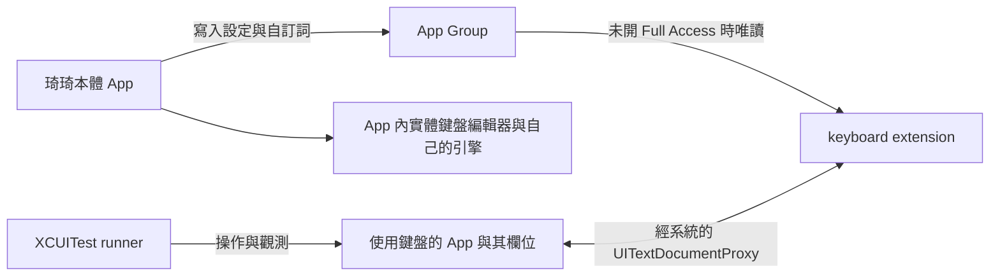

# iOS 本體 App 與鍵盤 Extension 及輸入測試頁面架構審查

審查日期：2026-10-23。程式基準：`codex/ios-iphone-duo-adaptation`，commit `c5e04e5c3b2586e9fdf099b9e2bd7c20b43b17f8`。本輪只進行官方文件閱讀、原始碼與既有紀錄對照，沒有修改程式、建置或新增執行測試。

目前應先釐清文字交接與測試證據的定義，再決定後續開發。既有實作已有正確的程序分離、文字代理、各自安全區與手動外觀保存；不能將整個架構判為錯誤。但有一條確定與所選權限不一致的 App Group 寫入路徑，以及數個沒有 Apple 時序保證的組字交接假設。地球鍵 SIGABRT 的根因仍未確定。

另有重要的環境限制：Xcode 27.1 官方 release notes 將 Duo Simulator 的「多數 App extension 無法執行與除錯」列為已知問題，編號 `187708767`。這不等於 Apple 已確認本案的鍵盤當機，也沒有逐項指明 custom keyboard 是否包含其中；但足以要求我們將模擬器限制與產品問題分開判讀。[Apple Xcode 27.1 release notes](https://developer.apple.com/documentation/xcode-release-notes/xcode-27_1-release-notes)

閱讀順序：本文件說明責任與疑點；[狀態與驗證矩陣](IOS_APP_EXTENSION_HOST_STATE_MATRIX.md)列出螢幕、模式和切換處理；[Apple 來源與版本清單](IOS_APP_EXTENSION_HOST_APPLE_SOURCES.md)記錄官方依據、SDK 比對與資料缺口。

## 審查範圍與判定方式

範圍涵蓋 iOS 17 起與本專案相關的 UIKit、keyboard extension、文字輸入、Scene、版面與工具行為，至 iOS 27.1，以及本機 Xcode 27.2 beta 3 所附 SDK。作業系統實際版本、SDK、編譯器與測試工具分別記錄。App 內的演算法、詞頻與共用詞庫模型不在本輪調整範圍。

結論使用以下分類，避免把讀碼推論寫成實測：

| 分類 | 意義 |
|---|---|
| 官方規定 | Apple 現行文件或公開 SDK 的明確宣告與條件 |
| 設計建議 | HIG、官方教材或範例提供的建議，不自動等同強制 API 規則 |
| 實作確認 | 可從本次固定 commit 直接確認的程式行為 |
| 既有實測 | 先前保存的報告與畫面，本輪沒有重跑 |
| 待驗證推論 | 由上述證據提出的風險或可能解釋，尚未重現或排除 |

文件中的待審處理原則不是已採用的修補。沒有在 release notes 找到某個問題，不表示系統沒有該問題；API 能編譯，也不表示 Simulator 已完整支援。

## 三種角色與資料所有權

「使用鍵盤的 App」（Apple 原文 host app）指提供文字輸入欄位的 App，例如備忘錄或 Safari；「輸入測試頁面」指目前放在琦琦本體內的 Debug 測試功能。

| 角色 | 現況入口 | 擁有什麼 | 不應推定擁有什麼 |
|---|---|---|---|
| 琦琦本體 App | `AppDelegate`、`SceneDelegate`、`SetupViewController` | 自己的 Scene、Window、設定、購買流程與 App 內編輯器 | 其他使用鍵盤的 App 的欄位、extension 視窗或 extension 的生命週期 |
| 琦琦 keyboard extension | `KeyboardViewController: UIInputViewController` | 鍵盤介面、引擎暫態、私有設定與學習資料；經 proxy 操作目前文件 | 使用鍵盤的 App 內的 `UITextField`／`UITextView`、first responder 與其他介面 |
| 輸入測試頁面 | 容器 App 的 Debug `InputFieldTestViewController` | 實際輸入欄位、焦點、選取、Return 行為及輸入測試頁面的版面 | 直接把 extension 的內部引擎狀態當作輸入測試頁面的狀態 |

目前沒有第三個獨立的輸入測試 App target。輸入測試頁面位於琦琦本體內；`KeyKeyUITests-Runner` 是操作與觀測者，並不是持有測試文字的 App。Apple 明確允許由本體 App（containing app）提供輸入欄位，測試自己的鍵盤，因此現有安排本身不是 API 誤用；不足之處是對照環境尚不獨立。[Creating a custom keyboard](https://developer.apple.com/documentation/uikit/creating-a-custom-keyboard)

這是角色關係圖，不是固定程序數量圖。當琦琦本體自己提供輸入欄位、使用自己的鍵盤時，A 與 H 是同一個 App；extension 仍在獨立程序。系統鍵盤服務的內部程序安排由 OS 決定。[Keyboard text interactions](https://developer.apple.com/documentation/uikit/handling-text-interactions-in-custom-keyboards)

### 本體內實體鍵盤編輯器的界線

`HardwareKeyboardCaptureView` 是可成為 first responder 的普通 `UIView`，透過 `pressesBegan` 接收按鍵；輸出 `UITextView` 被設為不可編輯、不可選取。它使用自己的引擎與文字狀態，沒有把 extension 掛進 App，也不是全系統實體鍵盤 IME。[實作](../Source/Loaders/iOS-Keyboard/ContainerApp/HardwareKeyboardEditorViewController.swift#L11)

Apple 的實體鍵盤事件文件描述的是 active app 的 responder chain。它不能作為「其他 App 前景時，琦琦 extension 也能取得一般 USB／藍牙按鍵」的依據。這兩條輸入路徑要各自驗證。[Handling key presses made on a physical keyboard](https://developer.apple.com/documentation/uikit/handling-key-presses-made-on-a-physical-keyboard)

## 必須分開的基本定義

| 概念 | 本案的正確判讀 |
|---|---|
| 裝置與介面 idiom | Duo 內螢幕可以是 `.phone` 且 regular／regular；不能用 `.pad` 代表所有寬視窗 |
| 螢幕、Scene、Window、View | 四者的 bounds 和座標空間不等同；App 與 extension 也不能共用一份幾何假設 |
| safe area | 是各 View 自己的可用邊界；對邊可能不對稱，也不代表已處理所有中間折線或鍵盤遮擋 |
| size class 與實際尺寸 | size class 表達粗略的介面空間；同一 class 內仍會持續改變寬高 |
| hinge 與 reserved regions | hinge 描述狀態與角度；配置避讓使用本地有效區域。無資料不等於全開 |
| 系統鍵盤切換 | 地球鍵切換使用者啟用的輸入法，與琦琦內部的「英／數」不同 |
| 琦琦分離外觀 | 是 extension 自己排列按鍵；不是 iPadOS 浮動、未固定或系統分離鍵盤的控制 API |
| 文字保留 | 已在使用鍵盤的 App 內的文件中看到文字，不表示引擎還保留可回頭選字的組字 |
| 文件身分 | `documentIdentifier` 區分文件，不是游標位置、選取範圍或一次文字操作的交易編號 |
| 顯示、焦點、程序 | view 消失、first responder 改變、Scene 失去活動、extension 程序結束是不同事件 |

以上分別以 [UIWindowScene](https://developer.apple.com/documentation/uikit/uiwindowscene)、[safeAreaInsets](https://developer.apple.com/documentation/uikit/uiview/safeareainsets)、[HIG Layout](https://developer.apple.com/design/human-interface-guidelines/layout)、[UIHingeInteraction](https://developer.apple.com/documentation/uikit/uihingeinteraction)、[documentIdentifier](https://developer.apple.com/documentation/uikit/uitextdocumentproxy/documentidentifier)為依據；「琦琦內部模式」與「文字保留」的細分則來自本專案的實作與產品行為。

## 官方定義與現況對照

| 主題 | 官方依據 | 目前實作與判定 |
|---|---|---|
| App Scene | 靜態 scene manifest 或動態 configuration 可以提供 Scene；支援多 Scene 是另一個選項 | 本體有 manifest、`SceneDelegate`、`UIWindow(windowScene:)`；`UIApplicationSupportsMultipleScenes=false` 不是缺少 Scene lifecycle。[程式](../Source/Loaders/iOS-Keyboard/ContainerApp/AppDelegate.swift#L19)、[Apple](https://developer.apple.com/documentation/uikit/transitioning-to-the-uikit-scene-based-life-cycle) |
| extension 入口 | custom keyboard 使用 `UIInputViewController` 與其主要 view | 現有 class、`com.apple.keyboard-service`、principal class 符合；沒有在 extension 建立 App 的 root window。[程式](../Source/Loaders/iOS-Keyboard/Keyboard/Info.plist)、[Apple](https://developer.apple.com/documentation/uikit/uiinputviewcontroller) |
| 寬度與高度 | 寬度由系統提供；高度可用 primary view 的 Auto Layout constraint 調整 | 自訂高度 constraint 不是誤用。330／155／360 pt 與 820 pt 內容上限是產品選擇，不是 Apple 的尺寸規定。[程式](../Source/Loaders/iOS-Keyboard/Keyboard/KeyboardViewController.swift#L77)、[Apple](https://developer.apple.com/documentation/uikit/configuring-a-custom-keyboard-interface) |
| 幾何更新 | 初次 appearance 與後續 layout、traits 變化是不同更新時機 | 已有 size-class registration 與每次 layout 更新；初始 `viewDidLoad` 的幾何只能作起始值。需檢視 `viewIsAppearing` 所保證的更新時點。[程式](../Source/Loaders/iOS-Keyboard/Keyboard/KeyboardViewController.swift#L90)、[Apple](https://developer.apple.com/documentation/uikit/uiviewcontroller/viewisappearing(_:)) |
| 安全區 | insets 屬於本地 view，可能為零或不對稱 | 鍵盤、設定面板分別採自己的 guide，這部分方向正確；沒有把使用鍵盤的 App 的右側 84 pt 直接塞給鍵盤。[程式](../Source/Loaders/iOS-Keyboard/Keyboard/KeyboardView.swift#L140)、[Apple](https://developer.apple.com/documentation/uikit/uiview/safeareainsets) |
| 地球鍵 API | `handleInputModeList` 接收全部 touch events，處理短按與清單 | `.allTouchEvents` 接線符合官方模式；額外 `.touchDown` 提交是琦琦政策，不是系統要求。[程式](../Source/Loaders/iOS-Keyboard/Keyboard/KeyboardViewController.swift#L64)、[Apple](https://developer.apple.com/documentation/uikit/uiinputviewcontroller/handleinputmodelist(from:with:)) |
| 地球鍵顯示 | 以 `needsInputModeSwitchKey` 決定；Duo false 回報另有 DTS 確認 | 27.1 寬版 phone 的 fallback 是有限 workaround，沒有文件證明涵蓋所有 Duo 視窗／姿態。[程式](../Source/Loaders/iOS-Keyboard/Keyboard/KeyboardViewController.swift#L123)、[DTS](https://developer.apple.com/forums/thread/849736) |
| 收鍵盤 | extension 使用 `dismissKeyboard()`，無權直接 resign 使用鍵盤的 App 的欄位 | 現有 API 選擇正確；延後一個 main-loop turn 並不是跨程序文字操作完成的確認。[程式](../Source/Loaders/iOS-Keyboard/Keyboard/KeyboardViewController.swift#L551)、[Apple](https://developer.apple.com/documentation/uikit/uiinputviewcontroller/dismisskeyboard()) |
| 文字與選取通知 | proxy 提供目前文字上下文；delegate 的 `textInput` 參數在 extension 為 nil | 現況沒有將 nil 參數視為錯誤，這部分正確。通知的來源分類仍有時序假設。[程式](../Source/Loaders/iOS-Keyboard/Keyboard/KeyboardViewController.swift#L188)、[Apple](https://developer.apple.com/documentation/uikit/handling-text-interactions-in-custom-keyboards) |
| 組字語意 | `setMarkedText` 取代目前 marked text，沒有 marked text 時使用目前選取；`unmarkText` 保留文字 | 傳統路徑採 marked text；好打觸控另用 App 輸入框中的普通文字作可修改尾段。後者是自訂編輯模型，須自行確保尾段仍位於目前游標前。[程式](../Source/Loaders/iOS-Keyboard/Keyboard/KeyboardViewController.swift#L450)、[Apple](https://developer.apple.com/documentation/uikit/uitextdocumentproxy/setmarkedtext(_:selectedrange:)) |
| Full Access | 未開時可讀 App Group，不能寫入；可寫自己的 sandbox | `KeyboardPreferenceStore` 的一般設定及私有學習符合方向；`SupporterState` 有例外寫入路徑，見 R03。[程式](../Source/Loaders/iOS-Keyboard/KeyKeyEngine/Sources/KeyKeyEngine/BopomofoCompositionMode.swift#L7)、[Apple](https://developer.apple.com/documentation/uikit/configuring-open-access-for-a-custom-keyboard) |
| 使用鍵盤的 App 的欄位類型 | secure、phonePad、namePhonePad 由系統鍵盤處理；其他類型按支援能力回應 | 不應要求這三種欄位仍出現 extension。`keyboardType` 是介面提示，不等於使用鍵盤的 App 的資料驗證。[程式](../Source/Loaders/iOS-Keyboard/KeyKeyEngine/Sources/KeyKeyEngine/InputFieldPolicy.swift)、[Apple](https://developer.apple.com/documentation/uikit/configuring-a-custom-keyboard-interface) |
| Return | 鍵盤提供文字輸入；使用鍵盤的 App 決定是否搜尋、傳送或移動焦點 | 現況送 `\n` 並改鍵帽；輸入測試頁面的 `textFieldShouldReturn` 一律 endEditing，不能據此宣稱各種動作已驗證。[程式](../Source/Loaders/iOS-Keyboard/ContainerApp/SetupViewController.swift#L1030)、[Apple](https://developer.apple.com/documentation/uikit/uiinputviewcontroller) |
| 系統按鍵音 | 可見、啟用的 input view 透過 `UIInputViewAudioFeedback` 播放系統 click | 現況有 protocol 與 `playInputClick`。不能因未開 Full Access 的 speaker 限制，就推定標準按鍵音也不允許。[程式](../Source/Loaders/iOS-Keyboard/Keyboard/KeyboardView.swift#L881)、[Apple](https://developer.apple.com/documentation/uikit/uidevice/playinputclick()) |

## 優先疑點

### R01 固定 250 毫秒不能識別回呼的來源

**優先度高；實作確認與待驗證推論。** `mutateDocument` 在每次 proxy 操作後保留 250 毫秒 guard。期間同一文件的 text／selection 回呼會被當作自己的操作忽略。`documentIdentifier` 能抓到部分換文件情況，卻不能區分同一欄位中的使用者移動游標、選取或使用鍵盤的 App 本身所做的修改。[呼叫處](../Source/Loaders/iOS-Keyboard/Keyboard/KeyboardViewController.swift#L533)、[忽略條件](../Source/Loaders/iOS-Keyboard/Keyboard/KeyboardViewController.swift#L220)

Apple 自 iOS 17 的鍵盤架構說明即提醒：文字與選取操作包含非同步時序；公開 proxy 沒有提供「250 毫秒內的通知必定屬於自己的變更」這項保證。[Keep up with the keyboard，1:29 起](https://developer.apple.com/videos/play/wwdc2023/10281/)

好打觸控會依本地尾段長度連續 `deleteBackward` 再插入新尾段；若同欄位游標變更被忽略，下一次改字可能作用於新的位置。這是由程式路徑導出的資料一致性風險，本輪沒有重現誤刪，也沒有證據將它連到地球鍵 SIGABRT。

待審原則：將文件身分、編輯範圍是否仍有效、自己的待完成操作分開表達；文字安全條件失效時停止沿用舊尾段。驗證重點是同文件內的快速游標／選取修改，而不只是換欄位。

### R02 觸下地球鍵即結束組字

**優先度高；實作確認與產品行為待決。** 地球鍵的 `.touchDown` 無條件呼叫 `finishCompositionForInputHandoff`。引擎會清除 composition，因此後續即使只打開清單再取消，原先可修改的組字也已結束。[接線](../Source/Loaders/iOS-Keyboard/Keyboard/KeyboardViewController.swift#L64)、[引擎](../Source/Loaders/iOS-Keyboard/KeyKeyEngine/Sources/KeyKeyEngine/BopomofoEngine.swift#L835)

Apple 的清單 API 區分短按切換與長按清單，沒有要求在 touch-down 就先確認文字。目前測試主要核對使用鍵盤的 App 還有「你好」，不足以證明取消清單後還能繼續修改原組字。[系統行為](https://developer.apple.com/documentation/uikit/uiinputviewcontroller/handleinputmodelist(from:with:))

待審決策：取消清單是否應保留完整組字、候選目標及未完成讀音。若採此語意，文字交接的時點就須與「使用者開始碰地球鍵」分開；本輪不選定替代實作。

### R03 首次使用時間繞過 App Group 唯讀設計

**優先度中；確定存在不符合所選權限的寫入路徑。** extension 的 `supporterState` 使用預設 `SupporterState()`，其 defaults 指向 App Group；`viewDidLoad`、`viewWillAppear` 及顯示提示判定都可能呼叫 `recordFirstUse`，在 key 不存在時執行 `defaults.set`。[extension 呼叫](../Source/Loaders/iOS-Keyboard/Keyboard/KeyboardViewController.swift#L53)、[資料實作](../Source/Loaders/iOS-Keyboard/KeyKeyEngine/Sources/KeyKeyEngine/SupporterState.swift#L21)

`RequestsOpenAccess=false` 與這條 shared-container 寫入路徑不一致。若 App 已先寫入時間，該次呼叫只讀；所以不能推論每次打字都寫入或整個支持功能必然失效。尚待驗證首次只使用鍵盤、程序重建與磁碟持久化的結果。[權限規定](https://developer.apple.com/documentation/uikit/configuring-open-access-for-a-custom-keyboard)

待審原則：保留離線、不要求 Full Access 的產品方向，明訂首次使用時間由 App 或 extension 私有資料誰負責，以及兩者日期如何協調；不以擴大權限作為預設解法。

### R04 顯示生命週期不等同文件交接

**優先度高；使用假設待驗證。** `viewWillDisappear` 會完成交接並重設引擎；`viewWillAppear` 會查文件身分並套用設定。Apple 允許在 `viewWillDisappear` 提交編輯變更，因此使用這個 callback 本身不是誤用；但 SDK 的 disappearance 定義也涵蓋遮蓋與隱藏，它不是「文件已確定切換」的專用通知。鍵盤隱藏也不保證程序終止。[實作](../Source/Loaders/iOS-Keyboard/Keyboard/KeyboardViewController.swift#L180)、[viewWillDisappear](https://developer.apple.com/documentation/uikit/uiviewcontroller/viewwilldisappear(_:))、[extension 程序](https://developer.apple.com/documentation/uikit/creating-a-custom-keyboard)

需要逐情境決定：同文件版面改變、暫時隱藏、換文件與程序重建，各自保留什麼。`DispatchQueue.main.async` 只排程本程序工作，不能作為 remote text proxy 已完成提交的 acknowledgment。本輪不認定所有 disappearance 都不該提交，也不將版面回呼當作重啟引擎的理由。

目前以 KVC 取值容許 `documentIdentifier` 為 nil，是既有的容錯策略；官方仍宣告為非 optional UUID。nil 到 UUID 不重設的做法需要配合「目前尾段是否仍可安全修改」判定，不能只憑 UUID 規避所有早期連線問題。[實作](../Source/Loaders/iOS-Keyboard/Keyboard/KeyboardViewController.swift#L230)、[官方語意](https://developer.apple.com/documentation/uikit/uitextdocumentproxy/documentidentifier)

### R05 輸入測試頁面尚不足以代表一般文字 App

**優先度高；測試設計缺口。** 輸入測試頁面以 sheet 呈現 14 種欄位；一般欄位標成「一般文字／換行」，實際是單行 `UITextField`。所有文字欄位的 Return delegate 都結束編輯。這可以測鍵盤外觀和部分輸入流程，但不能涵蓋備忘錄這類文件 App 的完整行為。[呈現](../Source/Loaders/iOS-Keyboard/ContainerApp/SetupViewController.swift#L329)、[欄位](../Source/Loaders/iOS-Keyboard/ContainerApp/SetupViewController.swift#L905)

scroll view 目前貼住 safe area，沒有明確的 keyboard layout guide 或鍵盤交集計算。這不直接證明 UIKit 的自動捲動一定失效；它表示浮動鍵盤、小視窗和下方欄位的可見性仍需要專門證據。Apple 建議以 keyboard layout guide 處理使用鍵盤的 App 與鍵盤的相對區域，而不是把螢幕鍵盤高度直接當成要避開的距離。[官方範例](https://developer.apple.com/documentation/uikit/adjusting-your-layout-with-keyboard-layout-guide)

`becomeFirstResponder` 是請求，也不保證軟體鍵盤立即出現；有效 key window、目前 responder 與硬體鍵盤狀態要分別確認。現有手動聚焦參數忽略其回傳值，因此「有執行該行」不能當作聚焦及顯示驗收。[Apple](https://developer.apple.com/documentation/uikit/uiresponder/becomefirstresponder())

待審方案：保留原 Debug 頁作整合測試，再建立只有基本原生輸入框的測試 App 及 WebKit 對照；是否增加獨立 App target 要等確認。單純把容器頁改成全螢幕或多行，先前都沒有消除當機。

### R06 高度與裝置分類仍有產品假設

**優先度中；產品規格與證據待補。** `KeyboardMetrics.forCompactHeight` 先判 `isPad`，因此 iPad 一律取 330 pt 的 pad metrics；接著才處理 compact height。設定面板可要求至少 360 pt。這些是可用 Auto Layout 表達的偏好，但尚不能涵蓋 iPad 矮視窗、浮動寬度和系統限制後的所有可用高度。[metrics](../Source/Loaders/iOS-Keyboard/KeyKeyEngine/Sources/KeyKeyEngine/KeyboardMetrics.swift)、[面板高度](../Source/Loaders/iOS-Keyboard/Keyboard/KeyboardViewController.swift#L162)

App 內實體編輯器部分配置還用螢幕 points／native pixels 判斷小手機；即使取自目前 window scene，螢幕大小也不等於分配給 App 的大小。其版面快取只比較橫直式配置與 compact 分類，需檢視同分類內改高、改 safe area 時的常數是否仍正確。[實作](../Source/Loaders/iOS-Keyboard/ContainerApp/HardwareKeyboardEditorViewController.swift#L480)

待審原則：以本地可用範圍配置，size class 選擇樣式，明定高度不足時的最小可操作配置。600 pt、820 pt、十二欄都保留為產品參數，不宣稱是 Apple 的摺疊機判定規則。[官方版面建議](https://developer.apple.com/design/human-interface-guidelines/layout)

### R07 手動左右分離不保證避開實際折線

**優先度中；已知能力邊界。** 目前分離的間距來自本地可用寬度，沒有 production reserved-region 輸入。這適合作為使用者手動外觀選擇，卻不能代表已完成每種姿態的實際折線避讓。[實作](../Source/Loaders/iOS-Keyboard/Keyboard/KeyboardView.swift#L438)

`reservedRegions` 回傳與該 view 重疊的區域，frame 屬於該 view 座標；預設只回傳 active 區域，且 frame 已包含 interactive margins。不能直接搬用 App 的折線 frame，也不能對 frame 再重複加一次 margins。沒有回呼或空陣列，只能表示當前未取得相關資料，不能反推 fullyOpen。[Apple API](https://developer.apple.com/documentation/uikit/uiview/reservedregions(kind:options:))、[UIHingeInteraction](https://developer.apple.com/documentation/uikit/uihingeinteraction)

目前公開宣告沒有把 UIHingeInteraction 標成 extension-unavailable，但也未找到保證 keyboard extension 與使用鍵盤的 App 得到相同區域／回呼的說明。現有「App 有、extension 無」是特定 runtime 的實測，不是永久平台禁令。27.1 新增的 `UIArrangementViewController` 是配置容器，不是鍵盤自動分離開關；是否適用須另審。[容器 API](https://developer.apple.com/documentation/uikit/uiarrangementviewcontroller)

### R08 地球鍵根因與模擬器限制尚未分離

**優先度高；根因未定。** DTS 確認的是 `needsInputModeSwitchKey` 在 Duo 回傳 false 的錯誤；沒有確認本案 `activationIndicatorView` 的 SIGABRT，也沒有發布針對本案的修正版本。[DTS](https://developer.apple.com/forums/thread/849736)

既有紀錄顯示：同一完整鍵盤在 Safari 六輪切出／切回通過，原輸入測試頁面則可在帶組字時當機；原輸入測試頁面關閉 probe、改多行仍可當機；最小 extension、不同 SDK 與取消 touch-down commit 也曾失敗。這排除了一些單一解釋，但尚不足以判定只有自製輸入測試頁面有問題，或所有第三方鍵盤都有錯。[既有證據](IOS_IPHONE_DUO_ADAPTATION.md#%E4%B8%8D%E5%90%8C%E5%AE%BF%E4%B8%BB%E7%9A%84%E5%9C%B0%E7%90%83%E9%8D%B5%E5%B0%8D%E7%85%A7)

Xcode 27.1 的 extension 已知限制需要加入上述證據的環境註記。27.2 官方同網址目前回傳 RC 說明，不能把其中修復項目倒推成 Beta 3 已修復；本輪沒有找到可完整凍結 Beta 3 已知問題的官方當版說明。下一階段需以真機與清楚標記的工具／runtime 組合補足，不能靠修改更多延遲或移除切換入口宣告修復。[27.1 notes](https://developer.apple.com/documentation/xcode-release-notes/xcode-27_1-release-notes)、[版本資料缺口](IOS_APP_EXTENSION_HOST_APPLE_SOURCES.md#版本資料缺口)

### R09 測試斷言與跨螢幕觀測仍有缺口

**優先度中；實作確認。** 正常地球鍵測試先斷言 `SETTINGS` 不存在，再看 App 前景與文字；這不足以單獨確認目標系統鍵盤真的可輸入。Safari 的一次性對照額外核對原生「ㄅ」，但尚未成為一般回歸來源。[正常測試](../Source/Loaders/iOS-Keyboard/KeyKeyUITests/KeyKeyUITests.swift#L1682)

部分舊測試只取 `XCUIScreen.main`；新對照已取 `XCUIScreen.screens`。main screen 不等於目前輸入所在的顯示器。旋轉命令是否成功，也應看實際 Scene geometry，而不是只看命令或按鍵仍存在。[Apple XCUIScreen](https://developer.apple.com/documentation/xcuiautomation/xcuiscreen)、[既有嚴格旋轉結果](IOS_IPHONE_DUO_ADAPTATION.md#驗證範圍)

十四種欄位可到達，不等於十四種 extension 輸入全部通過。secure／phonePad／namePhonePad 的系統接管須作正確預期；預期 extension 的案例若啟用失敗仍應 fail，不以 skip／pass 取代。另須記錄失敗發生在啟用前、按鍵前或實際切換後。

### R10 SDK 與編譯器條件須有明確下限

**優先度中；定義缺口與靜態推論。** probe 目前以 `compiler(>=6.4)` 加 runtime `#available(iOS 27.1, *)` 圍住新 API。但 Xcode 27.0 也包含 Swift 6.4，compiler 條件不等於「SDK 已有 UIHingeInteraction 宣告」。runtime availability 也不能補出舊 SDK 不存在的 symbol。[probe](../Source/Loaders/iOS-Keyboard/SimulatorGeometryProbe.swift#L1)、[Xcode 27 notes](https://developer.apple.com/documentation/xcode-release-notes/xcode-27-release-notes)

應先決定 Duo 開發工具最低是否為 Xcode 27.1。最低執行 iOS 17、用 Xcode 27.1 建置、在 27.1 Duo 上測試，三者完全可以同時成立。本輪沒有以未安裝的 Xcode 27.0 編譯，因此不宣稱已重現編譯失敗。

## 可保留的既有設計

- App 與 extension 採各自的 UI 入口、文字狀態與私有學習資料；本體只透過 App Group 提供可讀設定與自訂詞。
- 大部分設定由 `KeyboardPreferenceStore` 區分 App 寫入與 extension 本地寫入，並以 revision 避免無關設定互相覆蓋。
- keyboard width 服從系統，內容可設上限；逐邊使用自己的 safe area。
- full／split 切換重排既有按鈕，不重建引擎。十二欄視覺位置沒有提高候選頁數或音節上限。
- 地球鍵採公開系統 handler；收鍵盤使用 extension 自己的公開 API。
- 系統按鍵音與標準 UIKit accessibility 語意已部分具備；VoiceOver、Dynamic Type 和窄版可操作性仍需對應環境的實際驗證，不能僅因使用 UIButton 就宣告完成。[HIG accessibility](https://developer.apple.com/design/human-interface-guidelines/accessibility)

這些是讀碼確認的設計方向，不替代產物、安裝或實機結果。

## 待確認的設計決策

| 決策 | 研究後建議的方向 | 確認前保留的問題 |
|---|---|---|
| 文字交接 | 定義文件、選取與可修改尾段的有效條件；取消選單與真正切換分開 | 未完成讀音、選字中與被動隱藏分別何時提交 |
| 模式與版面 | 幾何改變只調整呈現；引擎語意變更另有交接政策 | 是否維持現有所有模式切換的提交行為 |
| 權限 | 保留 `RequestsOpenAccess=false`；修正 first-use 資料責任 | 日期由 App 計算、私有 extension 計算或如何整合 |
| 輸入測試頁面 | 只有基本原生輸入框的測試 App、WebKit 對照與現有容器整合頁各有用途 | 是否另建獨立測試 App；需要哪些欄位 traits 對照 |
| Duo 避讓 | 以本地有效區域處理；資料未知時保留明確的手動選擇 | keyboard extension 的區域供應是否有官方保證或真機證據 |
| 工具與驗收 | 明定 SDK 下限；分離 Simulator 診斷與真機驗收 | Beta 3 當版 release notes、Duo 真機可取得性及實測組合 |

確認上述責任與[驗證矩陣](IOS_APP_EXTENSION_HOST_STATE_MATRIX.md)後，才決定開發範圍。這份研究沒有採用新的地球鍵 workaround，也沒有把既有模擬器成功列為發布驗收。
