# 琦琦輸入法功能圖解

以 **Windows 最新版**為主要示範，macOS 差異放在頁末。首次安裝請看 [Windows 安裝指南](../WINDOWS_INSTALL.md)；其他平台請查[跨平台支援表](CROSS_PLATFORM_SETTINGS_ROADMAP.md)。正式下載版本以 [Release](https://github.com/polobread/KeyKey/releases/latest) 實際提供內容為準。

## 功能索引

| 想做什麼 | 看這裡 | Windows 設定入口 |
|---|---|---|
| 選好打注音、傳統注音、倉頡或簡易 | [四種輸入法](#四種輸入法) | 工作列琦琦圖示 → 右鍵選單 |
| 不打聲調、換注音鍵位、調整組字習慣 | [省略聲調與注音](#省略聲調與注音) | 注音 |
| Shift 切中英、Caps Lock、全半形 | [中英文與常用按鍵](#中英文與常用按鍵) | 一般 → 鍵盤與輸入法／快捷鍵與提示聲 |
| 倉頡未打完先選字、簡易選字 | [倉頡與簡易](#倉頡與簡易) | 倉頡／簡易 |
| 放大候選、橫排或直排、改反白色 | [候選窗大小](#候選窗大小) | 一般 → 選字窗 |
| 輸入標點、顏文字與 Emoji | [符號表](#符號表) | 工作列選單 → 符號表… |
| 常用詞、讀音、接字建議與備份 | [自訂詞與關聯詞](#自訂詞與關聯詞) | 自訂詞／關聯詞庫 |
| 繁轉簡、提示聲、診斷與更新 | [其他設定](#其他設定) | 一般／更新／關於 |
| 查 Mac 的設定位置與差異 | [macOS 對照](#macos-對照) | 琦琦選單 → 偏好設定… |

## 四種輸入法

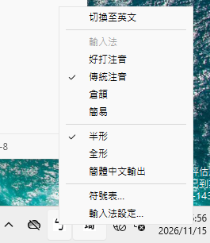

| 輸入法 | 怎麼用 |
|---|---|
| **好打注音** | 連續打讀音，由上下文組句；左右移動游標後按 ↓ 換字，Enter 送出。會學習選字習慣。 |
| **傳統注音** | 打完一個讀音與聲調後選字，適合逐字確認。 |
| **倉頡** | 最多五碼；空白或 Enter 查詢，依候選編號選字。可開啟提前選字。 |
| **簡易** | 最多兩碼；滿兩碼自動查詢或送出單一候選，依候選編號選字。 |

## 省略聲調與注音

**設定 → 注音 → 省略聲調 → 套用**。預設關閉，僅用於好打注音；開啟後仍可混用聲調。

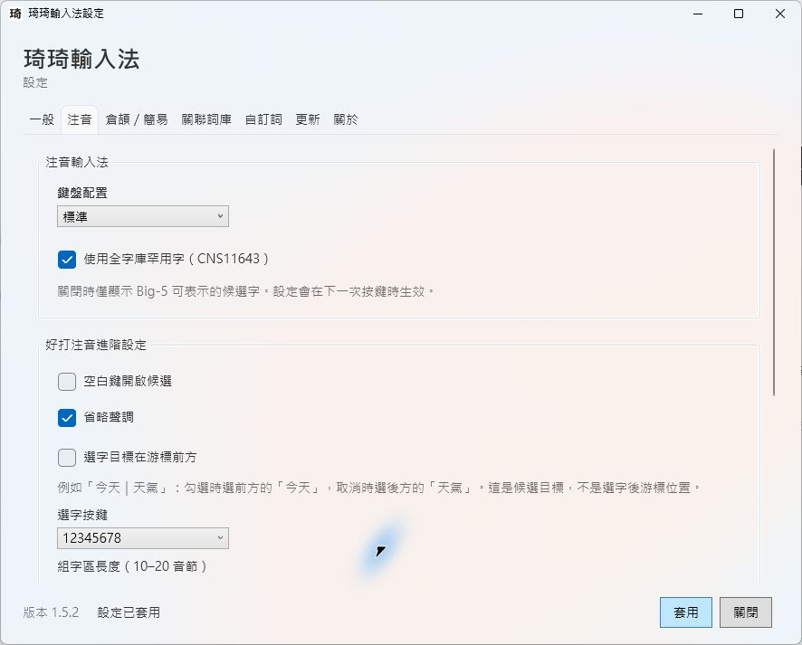

標準注音連打 **S、U、C、L**（ㄋㄧㄏㄠ）即可組成「你好」；**Enter** 送出，**↓** 開候選。不必為了省略聲調開啟「空白鍵開啟候選」。

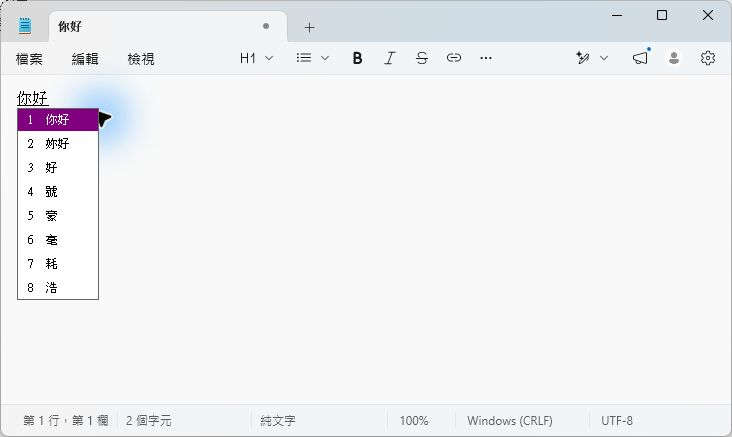

| 同頁可調整 | 選擇 |
|---|---|
| 注音鍵位 | 標準、許氏、倚天、倚天 26 鍵、漢語拼音；好打與傳統注音共用。 |
| 選字習慣 | 空白開候選、游標前／後方的選字目標、三組選字按鍵。 |
| 組字與取消 | 10–20 音節組字區、Esc 是否清除已完成的整句。 |
| 字集 | 全字庫罕用字，或限制為 Big-5 可表示的候選。 |

## 中英文與常用按鍵

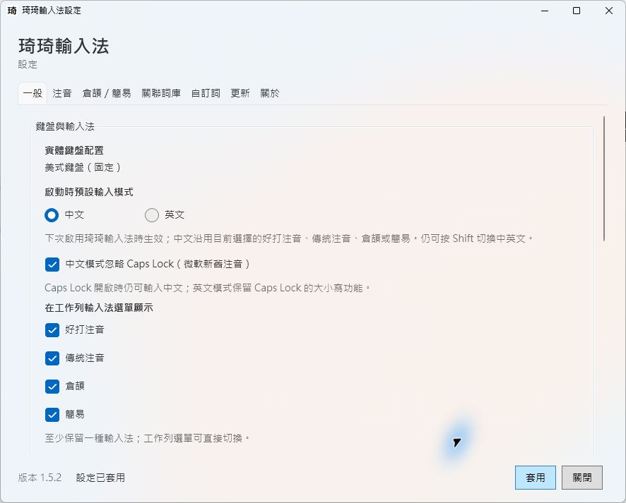

**中文模式忽略 Caps Lock** 預設開啟，四種中文輸入法都適用；英文模式仍照常使用 Caps Lock 切換大小寫。啟動時預設中文／英文也在這裡設定。

| 按鍵 | 功能 |
|---|---|
| **單按 Shift**／**Ctrl + Space** | 切換中英文；長按 Shift 或搭配其他鍵仍保留原有鍵盤操作。 |
| `Ctrl + \` | 另一組中英切換鍵，可在設定關閉。 |
| **Shift + Space** | 切換全形／半形。 |
| **↓**／**Enter** | 好打注音開候選／確認組字；候選開啟時 Enter 選字。 |
| **Page Up／Page Down** | 候選翻頁；依畫面提示的編號選字。 |
| **Backspace／Esc** | 刪除字根或讀音／關閉候選或取消輸入，依目前狀態處理。 |
| **Win + Space** | 切換 Windows 已加入的不同輸入法。 |

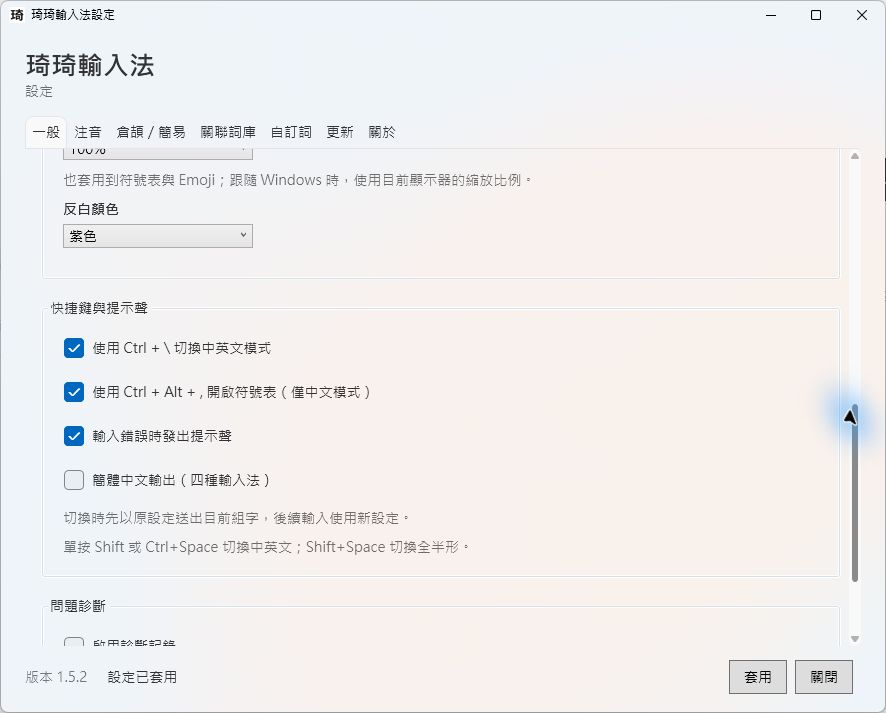

## 倉頡與簡易

在倉頡區塊開啟 **即時候選＋未打完也能選字**，按套用。兩項在桌面版預設關閉；即時候選與錯碼清除擇一使用。

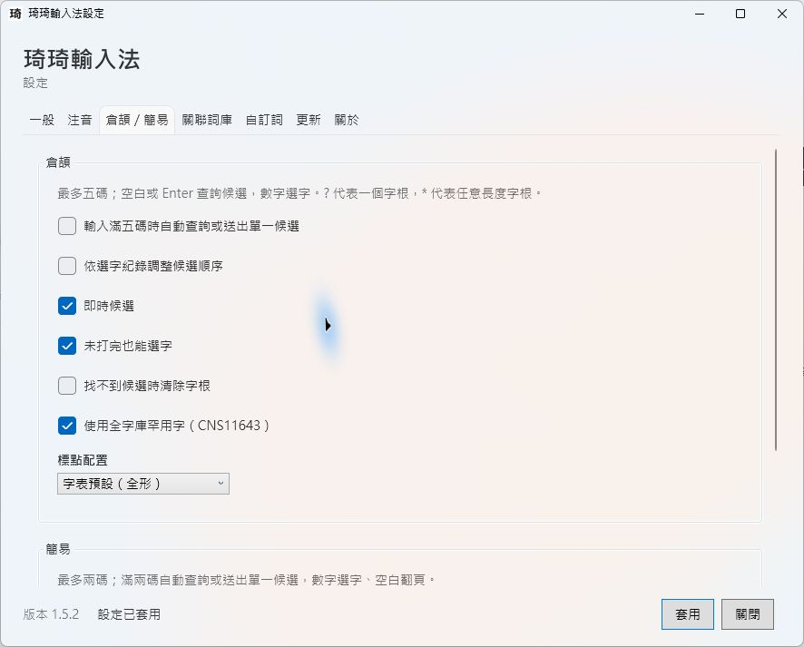

只打 **H、K（竹大）**，就能找「喬」，不必先打完「竹大口月口」。依自己的候選編號選取；字型與設定會影響順位。

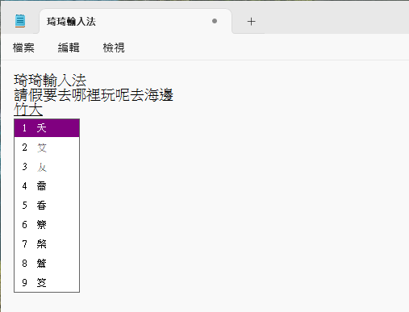

| 進一步調整 | 入口與用途 |
|---|---|
| 倉頡滿五碼、選字排序、標點 | 同頁倉頡區塊，可選滿碼查詢、依選字紀錄排序及標點配置。 |
| 倉頡萬用字元 | `?` 代表一個字根，`*` 代表任意長度字根。 |
| 簡易即時候選、錯碼清除、字集 | 同頁向下捲到簡易區塊；即時候選與錯碼清除同樣擇一。 |

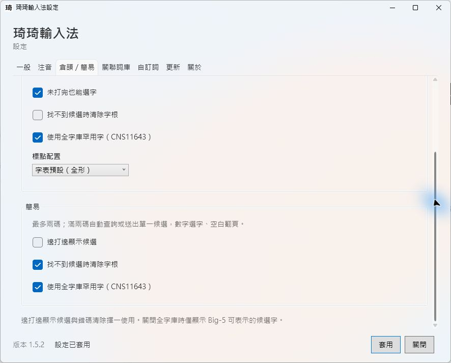

## 候選窗大小

**一般 → 選字窗**：預設跟隨 Windows 縮放，也可固定 **70%–300%**；可選垂直／水平及四種反白色。大小同時套用到符號表與 Emoji。

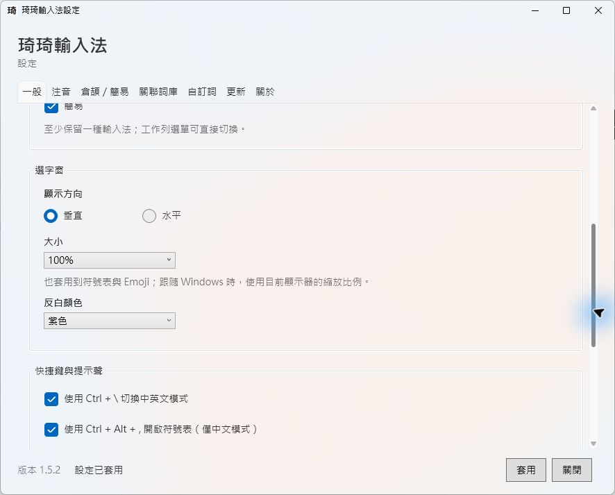

| 100% | 200% |
|---|---|
| 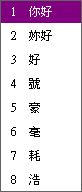 | 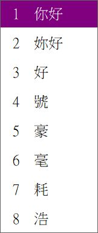 |

*同一組候選的實際大小比較；點圖可查看原圖。*

## 符號表

Windows 從工作列選 **符號表…**，或在中文模式按 **左 Ctrl + 左 Alt + ,**。先點回要輸入的位置，再點標點、顏文字或 Emoji；選完仍可繼續挑選，Esc 或 × 關閉。

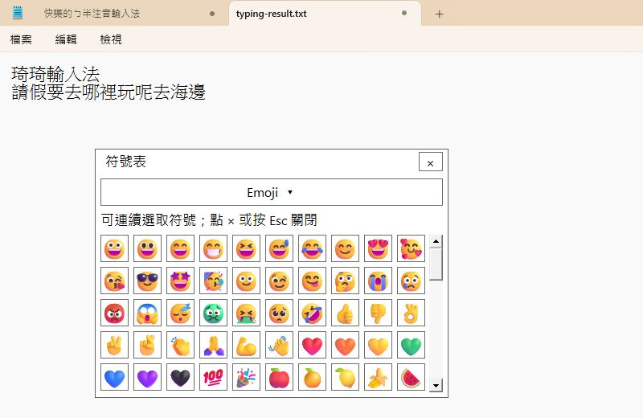

macOS 同樣從琦琦選單開啟符號表；不套用上述 Windows 專用快捷鍵。

## 自訂詞與關聯詞

**自訂詞 → 輸入詞語 → 取得讀音 → 確認讀音 → 新增**。多音字依詞義選讀音；也可修改或刪除選取詞。

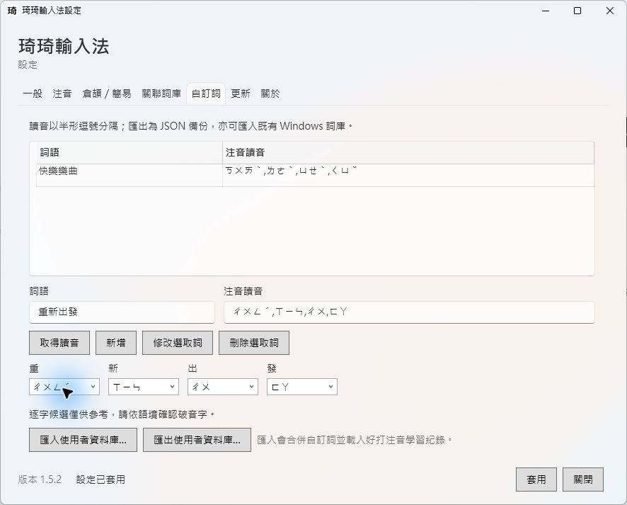

*圖中只查詢讀音，尚未按「新增」。匯入／匯出使用者資料庫可備份自訂詞及好打注音學習；重設學習位於「注音」頁下方，保留自訂詞。*

**關聯詞庫**用來選擇輸入後接續建議的來源，不是切換好打注音模型。依畫面提示選接字建議，也可直接繼續打下一字。

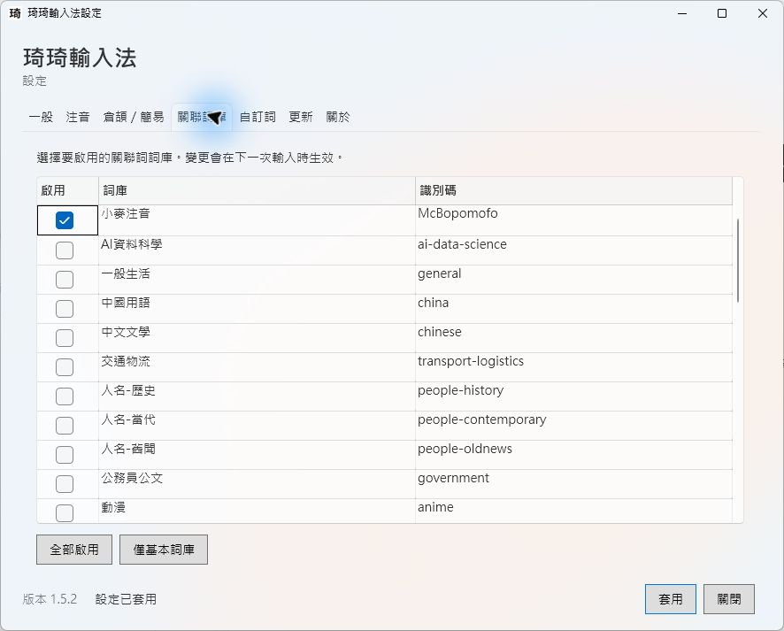

## 其他設定

| 功能 | 在哪裡／怎麼用 |
|---|---|
| 簡體中文輸出、錯誤提示聲 | 一般 → 快捷鍵與提示聲；繁轉簡適用四種輸入法。 |
| 問題診斷 | 一般 → 問題診斷；需要排查時才開啟，記錄包含按鍵與視窗狀態，三天到期。 |
| 更新通知 | 更新 → 每週通知／立即檢查；先通知，按下更新才下載與安裝。 |
| 同版本重裝、版本與授權 | 更新 → 重新安裝目前版本…；關於 → 版本與專案入口。 |

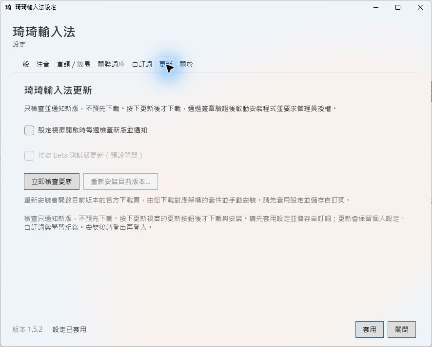

*圖中沿用每週通知關閉的既有設定；可用按鈕依安裝版本與更新設定而異。*

## macOS 對照

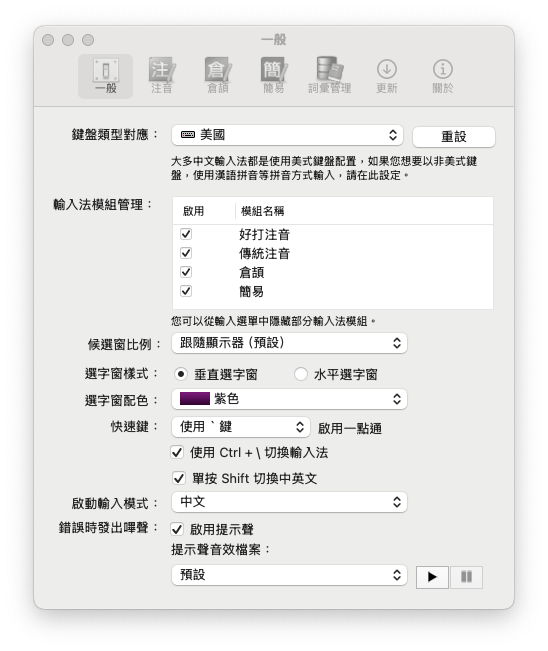

| Windows 主要操作 | macOS 對應 |
|---|---|
| 輸入法設定… | 琦琦選單 → 偏好設定…；自訂詞另有「編輯自訂詞…」，來源與備份在「詞彙管理」。 |
| 四種輸入法、省略聲調、倉頡提前選字 | 都有；省略聲調與提前選字分別在注音、倉頡頁調整。 |
| 單按 Shift 固定可切換中英 | 一般頁可開關「單按 Shift 切換中英文」。 |
| 中文忽略 Caps Lock | 沒有 Windows 的同名開關，不照抄這項設定。 |
| 候選窗跟隨 Windows／70%–300% | 一般 → 跟隨顯示器／相同固定比例範圍。 |
| Ctrl + Alt + ,、同版本重裝按鈕 | 沒有相同入口；用符號表選單、正式下載頁。 |
| 簡體中文輸出、問題診斷 | 沒有 Windows 的同名開關。 |

完整 Mac 操作見 [macOS 安裝與使用指南](../MACOS_INSTALL.md)。Linux／FreeBSD、Android、iOS 的設定與鍵盤限制見[跨平台支援表](CROSS_PLATFORM_SETTINGS_ROADMAP.md)。

圖片：Windows 設定、無聲調輸入與比例比較於 2026-11-19 實拍；輸入法選單、倉頡候選、符號表及 macOS 圖沿用較早版本。勾選狀態是示範或既有設定，不代表全部預設值。
